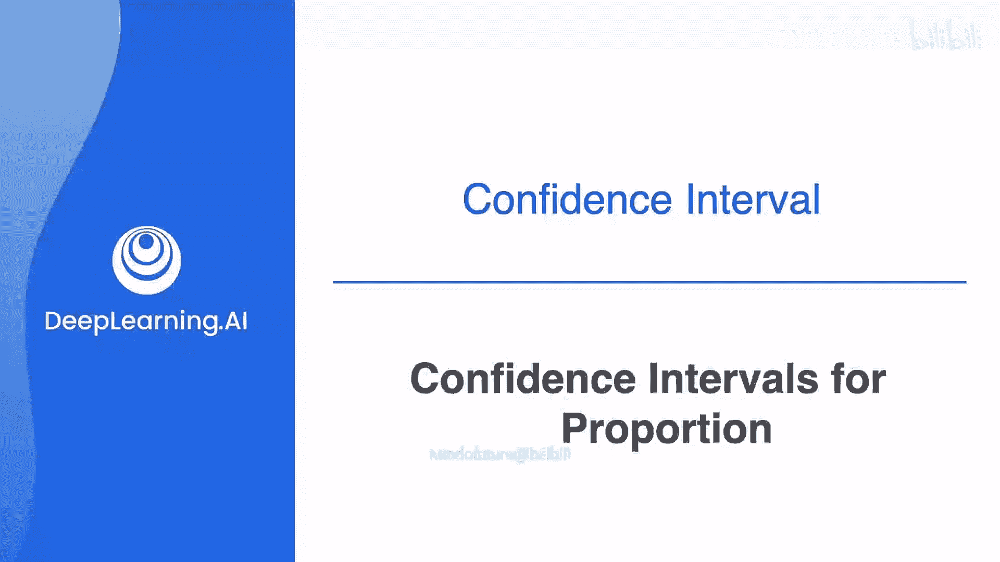
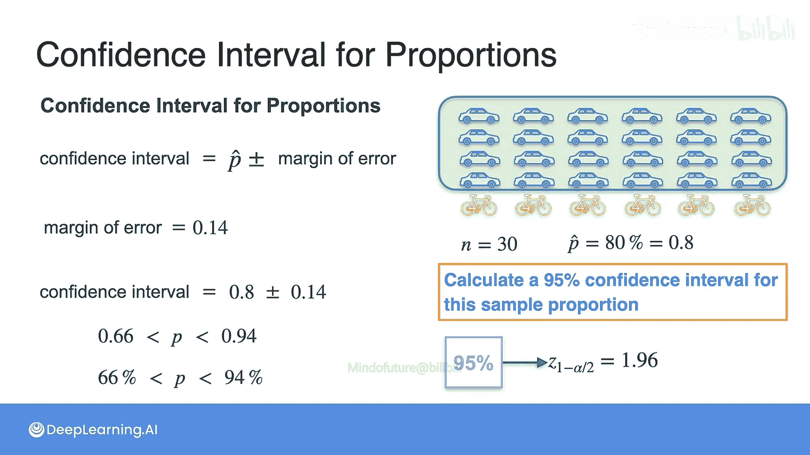

# 【Deeplearning】机器学习和数据科学概率与统计3 ｜ Machine Learning Probability And Statistics 吴恩达 p86 P86_比例的置信区间_04_01_10 -BV1c86VBrE93_p86-

So in the last lesson we looked at how to compute confidence intervals given a sample mean。

 we knew we were working with sample means because we were calculating the confidence interval for the average height of the population。

And recall that when calculating the conference interval for sample means。

 then this is equal to the sample mean plus or minus the margin of error where the margin of error is given by this formula over here。

 the z value times the standard deviation divided by the square root of the sample size but now how do we work with confidence intervals for proportions so for example consider this problem you want to find out the proportion of adults who would own a car in Statopia。

You sample， let's say 30 people， so n is equal to 30 and out of the 30 people you find that 24 of them own a car。

 therefore x is equal to 24 you calculate the proportion of the people who own a car and that's given by P hat and that's 24 divided by 30 which is 80%。

This is the sample proportion now of course that may not be the population proportion but is likely to be close to it and the question is how do we calculate a 95% confidence interval for the sample proportion well similar to the confidence interval for the mean the confidence interval for the proportions is given by the formula B hat which is your sample proportion plus or minus some margin of error now the question is how to calculate this margin of error。

This is where the difference lies。 The margin of error with calculating the confidence interval for proportions is given by the formula margin of error equals the critical value times the square root of P hat times 1 minus P hat divided by n。

 Obviously the critical value will depend on the confidence interval you use。

So the major difference is in the standard error and how it's calculated so just as a sample distribution of means the standard deviation is given by sigma divided by square root n。

 the standard deviation of a sample distribution of proportions is given by P hat times 1 minus P hat divided by the sample size n so quick recap the confidence interval for proportions is given by P hat plus or minus the margin of error where the margin of error is given by the critical value times the square root of P hat times1 minus P hat divided by n so we had an example we wanted to calculate the proportion of adults that own a current Statopia from the sample size of 30 we found P hat the sample proportion to be 80% Now I want to calculate a 95% confidence interval for the sampler proportion for a 95% confidence level the critical value is 1。

96。the margin of error is 1。96 times the square root of 0。8 times 1 minus 0。8 which is 0。

2 divided by the sample size 30， and that gives us a margin of error of 0。

14 and therefore the 95% confidence interval is be hat which is 0。

8 plus or minus the margin of error which is 0。14， that means that the confidence interval is between 0。

66 and 0。94。Thus we're 95% confident that the population proportion of how many people own a car in Statopia is within 66% and 94%。

