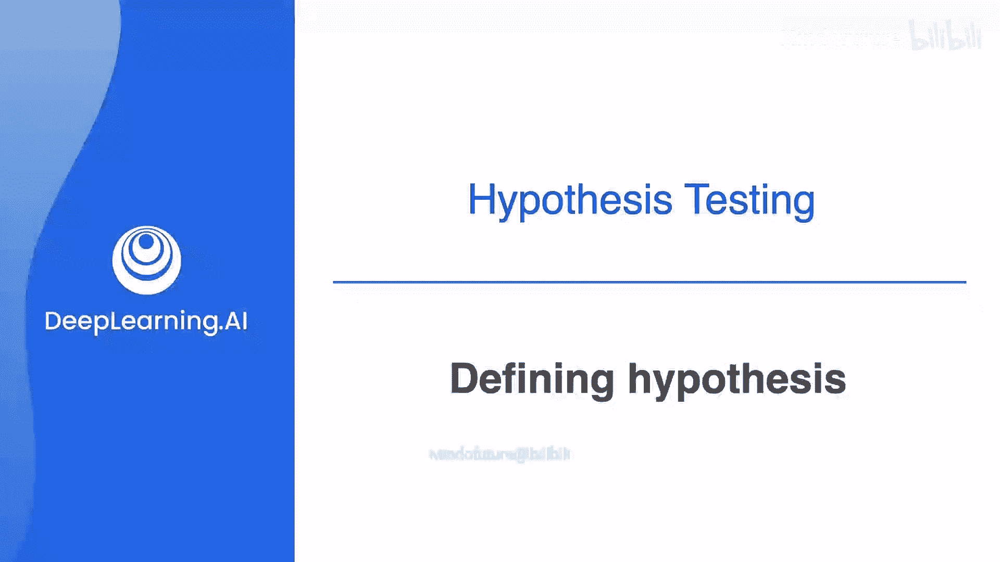
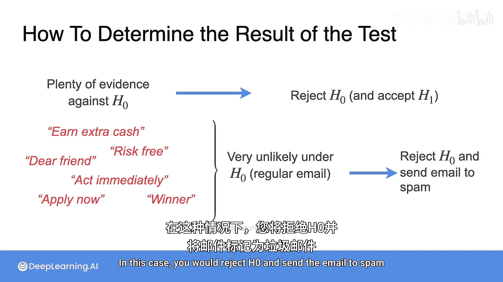

# 【Deeplearning】机器学习和数据科学概率与统计3 ｜ Machine Learning Probability And Statistics 吴恩达 p87 P87_定义假设_04_02_01 -BV1c86VBrE93_p87-

Alright， welcome to lesson2 in this lesson you're going to learn about hypothesisthesis testing。

 Hypothesis testing is a way to tell if some believe you have of a population is likely to be true or false and then we're going to learn a very important application of hypothesisthesis testing called AB testing。

So first let's start with a simple example， so to understand hypothesis testing I like to look at this example。

 let's say you have an email spam detector and what it does is it determines if a given email is ham or spam and remember that ham is when an email is not spam and by default we're going to assume that all the emails are ham。

And the reason for this is that it's much worse to delete a good email than to accidentally put a spam email on an inbox or our base assumption is going to be that an email is ham that's going to be called the null hypothesis is the based assumption when we assume safely that nothing is happening。

Dnal hypothesis is called H0， and then we have an alternative hypothesis called H1。

And that's the special one that's the one we are trying to identify one important characteristic of the null and alternative hypothesis is that they are mutually exclusive because the email can't be ham and spam at the same time。

Also， these questions have to have a true false answer and the key is to designing a good set of hypothesis and notice something really importantly。

 there's a lot of evidence that shows that the email is spam。

 then the null hypothesis is rejected and the alternative hypothesis that the email is spam is accepted as true but this doesn't work the other way around if the evidence gathered is not enough to show that the email is spam。

 then you can reject the null hypothesis， however that does not mean that the email is hem。

 only that we don't have enough evidence to show that the email is spam。

 So in general you will need to propose your hypothesis。

 the null hypothesis is the baseline and the alternative hypothesis represents the competing statement and given the asymmetry in the conclusion this is usually the one you're interested improving and the goal of hypothesis testing is deciding between two hypothesis based on data and evidence in the case of。

Samm example， then this evidence comes in the form of the sender， the attachments。

 the size of the email， certain keywords， etc， anything you can use to show that the email is spam intuitivetuly when performing hypothesis testing if your sample gives plenty of evidence against H0 then you will reject the null hypothesis and consequently accept the alternative hypothesis In this case your evidence based on data will be different words or phrases in the email and so suppose that you get an email that has phrases like earn extra cash risk free dear friend act immediately apply now and winner these are all trigger phrases for detecting spam In fact these phrases are very likely to happen if the email is not spam which is a null hypothesis under the hypothesis that this is a regular email In this case you would reject H0 and send the email to spam。

