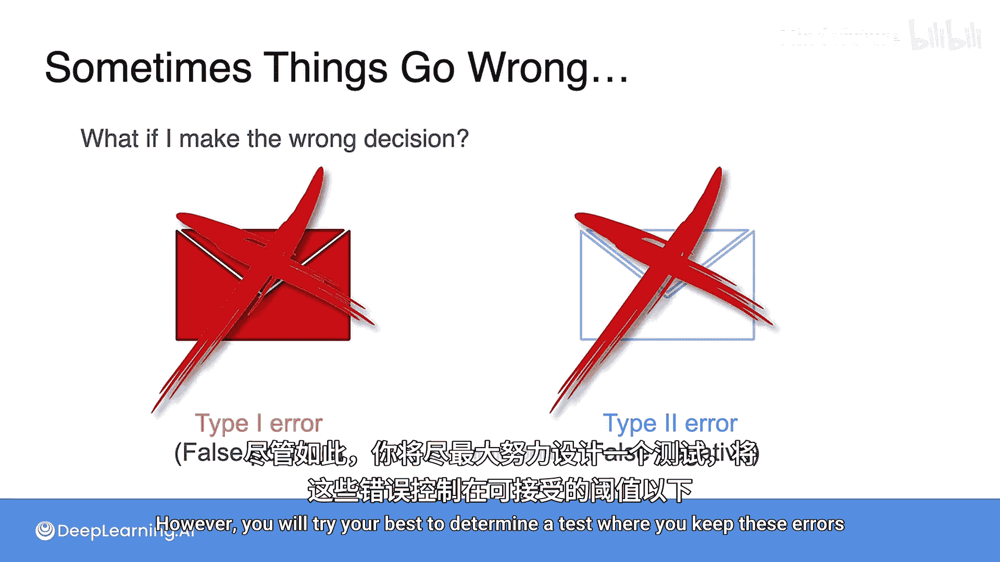
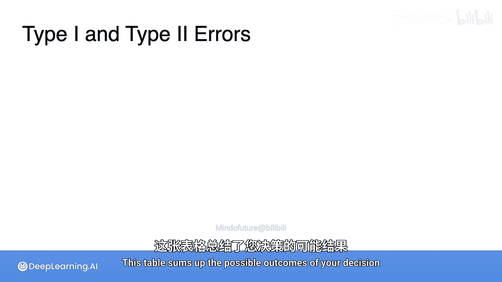
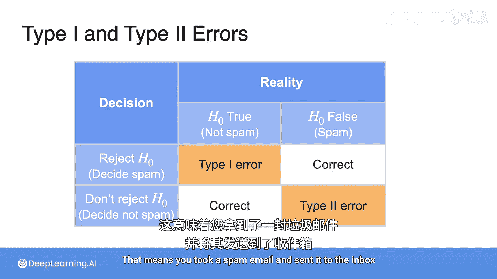
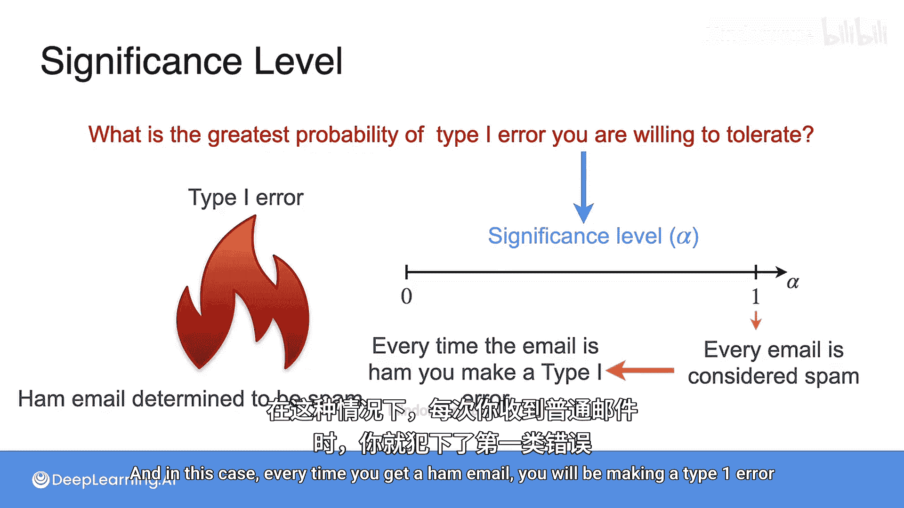
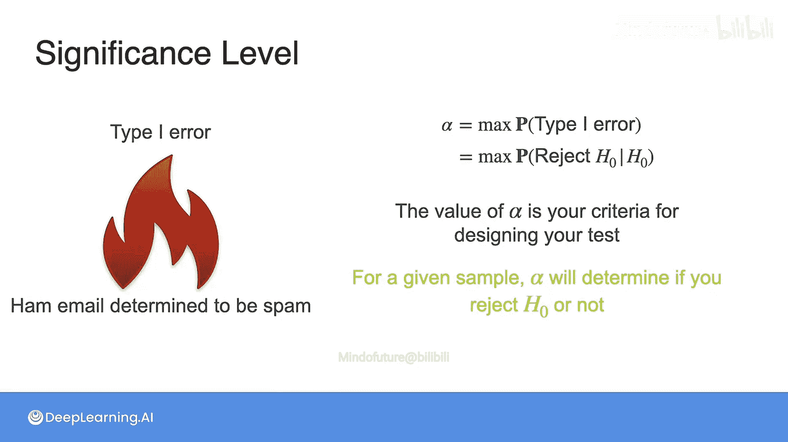

# 【Deeplearning】机器学习和数据科学概率与统计3 ｜ Machine Learning Probability And Statistics 吴恩达 p88 P88_第一类与第二类错误_04_02_02 -BV1c86VBrE93_p88-

So ideally， you would like to always make the perfect decisions。

 unfortunately this is impossible to guarantee due to the randomness of the world and the fact that we only have partial information from the population under study。

So what could go wrong Well， there are two possible outcomes to the test。

 either you send the email to the spam box or you send it to the regular inbox。

Each of these outcomes could be wrong In the first case you send a regular email a ham email to the spam box This is called a type 1 error or a false positive and it happens when you reject H0 when it was actually true the other error appears when you incorrectly determine a spam email to be ham to be a regular email This is called a type 2 error or a false negative and occurs when you don't reject H0 and the hypothesis was actually false。

It is important to understand that you can never know if you are right or wrong about your decision because you don't know the ground truth。

 however， you will try our best to determine a test where you keep these errors below an accepted threshold。

This table sums up the possible outcomes of your decision if the ground truth is that H0 is true。

 that means if the email was actually not spam and you reject H0， you will be commit a type1 error。

That means you send a perfectly good email to the spambox however， if you decide not to reject H0。

 then you would have made the right call that means you send a good email to the inbox like you should。

If in reality H1 was true， that means the email was spam。

 then rejecting H0 will be the right decision， that means if you get a spam email。

 you send it correctly to the spam box。And finally。

 not rejecting H0 will make a type 2 error that means you took a spam email and sent it to the inbox。

Notice that type 1 and type 2 errors don't have the same impact on the problem。

In the case of the email， assuming that the email is ham implies that sending a spam email to the inbox is more positive than sending a ham email to the spam box。

 which is true， you would much rather have a accidental spam email in your inbox than lose a perfectly good email and never be able to read it because the classifier thought it was gonna be spam This means that type1 errors are more severe that type 2 errors The question is than how much are you willing to negotiate here。

 What is the greatest probability of type 1 error you're willing to tolerate or in other words。

 on average， how many times are you willing to incorrectly send a ham email to the spam box in order to have a good spam detector that still sends most of the emails to the correct place。

While the maximum probability of type1 error is called the significance level and is usually denoted by the Greek letter alpha。

 of course since it's a probability it can take values between0 and1 if alpha is0 it means that whatever evidence you get the email is always considered to be ham in that case you never get a type 1 error on the other end if the significance level is one that means every email is considered Pam and in this case every time you get a ham email you will be making a type 1 error。

Of course， both extremes are terrible decision makers。

 What you want is something that is able to define if an email is spam or not and has as few type 1 errors as possible。

 However， as you saw this error can never be made 0 so a typical value to consider is 0。

05 for your significance level This means that an average you will decide that a ham email is spam 5% of the time。

 another value shall encountered is alpha equal 0。01 As we said you want alpha to be as small as possible。

 but however， there's a small cache if you reduce the probability for a type 1 error too much for a fixed number of examples。

 then youre increasing the type 2 error This is what happens when we thought of the alpha will0 scenario to give the proper definition of significance level it is the maximum probability of committing a type 1 error which is the same as the maximum probability of rejecting h0。

ThenH0 was actually true。 The value alpha is your design criterion for this test。

 This means that alpha will determine a threshold to decide if you should reject H0 or not based on your sample。

