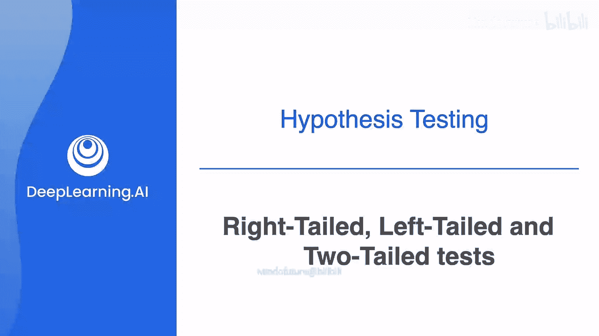
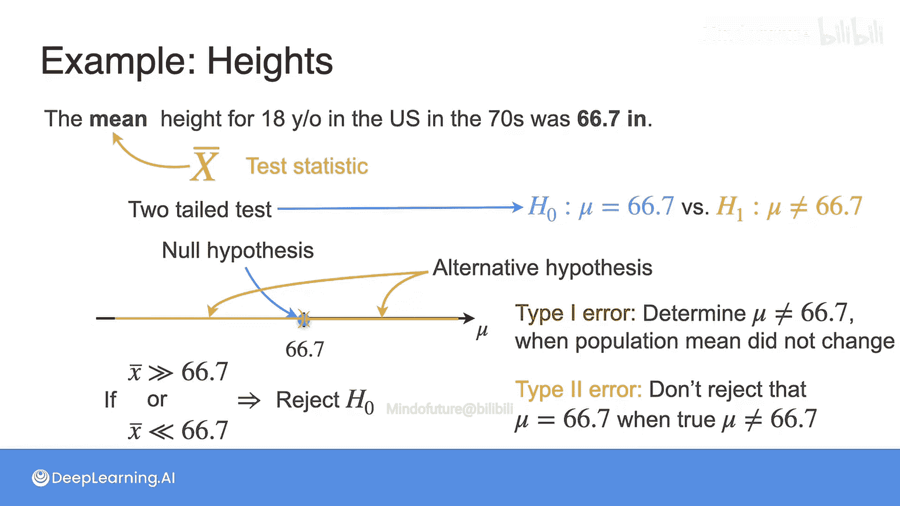

# 【Deeplearning】机器学习和数据科学概率与统计3 ｜ Machine Learning Probability And Statistics 吴恩达 p89 P89_右侧左侧与双尾检验_04_02_03 -BV1c86VBrE93_p89-

So now that you know about hypothesis testing， let me show you how to do it for a population me。

We're going to do both cases again when you know the standard deviation of the population and when you don't。

 when you don't， a familiar term will come up again， which is the student T distribution。Furthermore。

 we're also going to learn a very important concept which is the concept of the P value in order to get a clear view of hypothesisth testing and how the significant plays its role let's analyze another example。

 imagine you are interested on the average height of 18 year olds in the US and consider a sample of the height of 10 people measured in inches if you recall this is the same data set from width two that we use to perform the maximum likelihood estimation for the mean height。

For these absurd values， the average height is 68。442 inches before diving into the hypothesis testing there's one more thing you should consider and that is data quality since your goal is to make a decision based on data then the data needs to be reliable otherwise you will be arriving to false conclusion。

But what does reliable mean， each sample has to be representative of the population。

 the data needs to be completely randomized is to avoid introducing bias into the decision making。

For example， if you're interested in the height of 18 year olds in the US and you take all your samples from the basketball teams of each school。

 you would be introducing bias in the sample because in general， basketball players are taller。Also。

 you should consider the amount of data you have available is the sample size enough to make a good decision a good rule of thumb is considering 30 samples or more。

In the examples that follow we'll be assuming that the samples we have are good enough for the testing。

So historical data says that the mean height of 18 year olds in the US in the 70s was 66。7 inches。😊。

Based on the observed data， can you confirm that the mean height of 18 year olds in the US has increased so the sample mean you have is 68。

442， which is greater than 66。7 but it this enough to confirm the hypothesis let's try to formulate the null an alternative hypothesis your baseline here is that nothing has changed and thus that the population mean for 18 year olds is still 66。

7 inches and the competing hypothesis that the population mean is greater than 66。7 inches。

Note that the hypothesisthe are always formulated in terms of the population in this case。

 population mean and must not involve samples at all Now the hypothesises are based on the population parameters。

 but the decision will be based on the observations that you have。In this example。

 you will base your decisions on the sample mean， which is the average of the random samples X。

If your decision is made on the sample mean， then the sample mean will be your test statistic。

 note that this is a random variable and doesn't yet depend on the particular observations you have。

 On the other hand， the value 68。442 is called the observed statistic and it is based on your measurements。

 In general， a test statistic will be a function of the random samples that gives information about the population parameter you want to study For example。

 if you are testing the mean of the population， a good statistic is the sample mean same thing goes for testing probabilities or occurrence rates。

 If you wanted to test the variance of the population。

 then a good candidate is the s square statistic It is important to mention that the test statistics are not unique。

 for example， the sum square difference between the Xi and the sample mean could also be used to the test staistic for variance。

 you will see an example about this in the following videos In general。

 there are three types of hypothesis。 Let's go back to our example we want to compare the current population mean。

With the population mean from the 1970s， there are three sets of questions that arise under the scenario。

 each of which can be identified with a set of hypotheses。

The first one was has the population height increased in the last 50 years。

 the baseline here is that the mean height remained the same and what you want to prove is that the population mean actually increases。

😊，This means your h0 is that mu is 66。7 and H1 is that mu is bigger than 66。7。

This one is called a right tailed test because the alternativeum hypothesis extends to the right of the null hypothesis。

Namely， because a number bigger than 66。7 is to the right than 66。7。

The second question is whether the population mean decreased during the last 50 years。

 this leads to the nu hypothesis that muu is 66。7 and the alternate hypothesis that mu has to be less than 66。

7。😊，This kind of hypothesis is called a left tailed test because the alternative hypothesis is to the left of the null hypothesis namely a number less than 66。

7 is to the left and 66。7。😊，And the final question is whether the mean height has changed at all。

 either became bigger or became smaller in this case the h0 is again that mu equals 66。

7 and h1 is simply that mu is different than 66。7 and the null hypothesis is the same and this is a two tail test because it says that the mu has changed and has either gone to the right of 60。

7 or to the left of 66。7。So notice that for these cases the nu hypothesis or the baseline is always the same。

 but the alternative hypothesis is changing depending on what you want to prove now let's consider the first set of hypothesis this is called a right tailed hypothesis because the alternative hypothesis to the right of the known one。

Here is H0。The null hypothesis and here is the alternative hypothesis。

Now since you're trying to make a conclusion about the meaning of the population is natural to consider your sample mean as a way to get close to the population mean。

 there is another way you might see right tail tests where h0 states that mu is less than or equal to 66。

7 both tests are equivalent so for simplicity let's skip the original formulation。

If your sample mean is much greater than 66。7， which is H0， then reject H0 and accept H1。

What are the two errors we can have here， well type 1 error will be determining that mu is greater than 66。

7 when the true value was actually 66。7 a type 2 error will happen when you determine that the population means stayed the same。

 but the true value was bigger。Now let's look at the second set of hyposes here H0 is still that the population mean is 66。

7 and your alternative hypothesis is that the value actually decreased over the years。

 this is a leftt hypothesis because the alternate hypothesis lies to the left of the null hypothesis and again you might see the test written as follows H0 says that mu is greater than or equal to 66。

7 and in this case if your sample mean is much less than 66。7 then you would reject H0。In this case。

 a type 1 error happens when there was no change in the population mean but you accepted the hypothesis that mu is less than 66。

7 while the type 2 error happens when you dont reject at0 while there was actually a decrease in the population mean height。

Finally consider the third set of hypothesis， this is called a two tail test because the null hypothesis spreads to both sides of the hypothesis。

Mu equals 66。7 is that hypothesis。In this case， you will reject h0 when the sample deviates a lot from 66。

7 since the difference can be in any direction， a simple way to represents this is simply taking the absolute value of the difference between the sample mean and the value in H0 66。

7。In this case， a type 1 error happens when there is no change in the population mean but you accepted the hypothesis that mu was different from 66。

7 while a type 2 error happens when you don't reject H0 while there was actually a variation in the population mean height。

