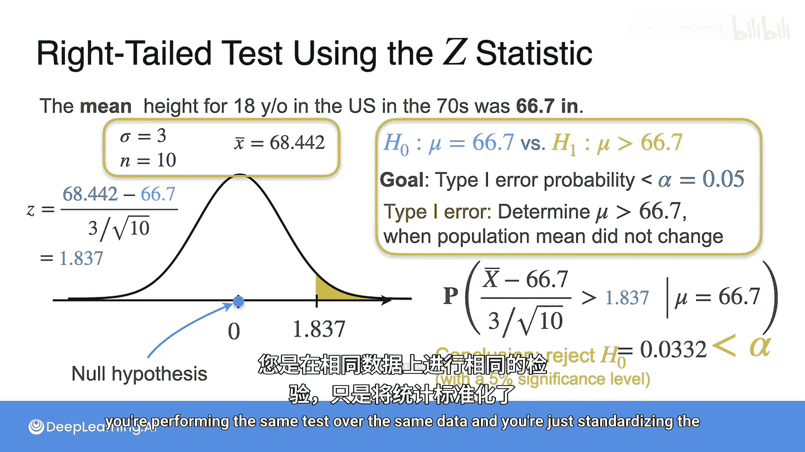

# 【Deeplearning】机器学习和数据科学概率与统计3 ｜ Machine Learning Probability And Statistics 吴恩达 p90 P90_p值_04_02_04 -BV1c86VBrE93_p90-

So far the intuition is that if your sample mean falls too far away from the null hypothesis then you reject h0。

 but what does2 far mean remember that H0 is that the population mean is 66。

7 inches so suppose now that the standard deviation or the height is 3 and that there was no change throughout the years remember also that you had a sample size of 10 In that case if h0 is true then the sample mean has a Gaussian distribution with parameters mu equals 66。

7 and variance for 3 squared divided by 10 this is because we have a sample size of 10。

Right now we're assuming that the value of standard deviation sigma is known and I know that it is not usually the case but don't worry later on you will learn how to deal with an unknown standard deviation now that you have a distribution for the statistic now you can answer the question how likely was your sample if H0 the null hypothesis is true if your answer is very unlikely then this is grounds to reject H0？

Consider now the right tail tests for the mean of a population with the Gaussian distribution。

 remember also that the sample mean was of 68。442 which is bigger than 67。

 but is the difference big enough to be statistically significant。

 remember that your goal is to make a decision with a type 1 error probability of no more than the significance level alpha which in this case we're going to pick 0。

05。Now in this case， a type1 error happens when you determine that the population mean has increased when the true value of mu is still 66。

7 it makes sense that if you consider that an observed sample mean of 68。

442 is enough to reject h0 then of course you would also reject H0 if you saw a sample mean greater than 68。

442 so what does this mean in terms of the type 1 error probability well if you reject h0 every time you observe a sample mean greater than 68。

442 then the probability of a type1 error is simply the probability that the sample mean greater than 68。

442 given that mu is 66。7 the probability you're looking for is the shaded area which has a value of 0。

332。Notice that this value is less than 0。05， so with this proposed rejection criteria。

 the maximum probability of incur a type 1 error is below the 0。

05 threshold you are willing to tolerate。It then makes sense to reject the null hypothesis。

 by the way， the probability use calculator is called the P value。

So what's a P value Forly the P value is a probability assuming H series true that the test statistic takes on a value as extreme as or more extreme than the value observed this means that from the observed value you move into the direction of H1 in this example since it was a right tail tests a value as extreme or more extreme than the observed sample mean meant that you had to consider all the values greater than 68。

442。The P value measures how well your sample is mared under the null hypothesis a small P values says that your sample landed on the tail of the distribution under h0 so they are pretty unlikely to happen if h0 was true so the P value is a good metric to create a decision rule for the test this decision will ultimately depend on the significance value you choose if the P value is less than alpha you will reject h0 and accept H1 is true。

If the P value is bigger than alphapha then you decide the evidence is not strong enough and you don't reject H0。

So what do P values look for each type of test from a general case called T the test statistic you define T observed as the observed value of the statistics and mu equals mu0 the null hypothesis where mu is the parameter you're looking to test for right tail test you just saw the P values the probability of the test statistic being greater than your example under the assumption that h0 is true for two tail tests you want the probability of all points that are distance from mu0 greater than the observed value in both directions Finally for left tail test。

 the P values the probability that the test statistics is smaller than the observed value always assuming that h0 is true。

Now let's see what the P value is for the two tail test。Remember that the observed sample had a 68。

442 me。In this case， the type 1 error occurs when you accept that mu is different from the baseline 66。

7 inches， so in this case， the P value is a probability that the difference in absolute value between the sample mean and 66。

7 is greater than 1。742 given that H0 is true。For this case we have to consider both tails since you're considering the absolute value。

 this gives a probability of 0。0663， which is twice as much as what you had for the right tail test in this case the P value is greater than 0。

05 so you conclude to not reject h0。😊，Finally， consider the left tail test。

The original sample with sample mean 68。442 won't do because it is larger than the baseline value so let's imagine a instead that the average mean in your sample was 64。

252 in the case of the left tail test the type 1 error happens when you reject that mu equals 66。

7 when it was actually true so the P value is the probability that the sample mean is less than the observed value64。

252 which is the shaded area over here and it gives a probability of 0。

0049 this is clearly smaller than alpha equal 0。05 so you conclude to reject h0 and accept the hypothesis that the population mean has decreased over the last 50 years notice that this P value is not only smaller than 0。

05 but it is also smaller than 0。01 which is another commonly used significance level。

It tells us that even with the more conservative alpha of 0。01。

 you would have rejected the hypothesis。So far， all the tests we perform using the statistic h bar。

 which if H0 is true， has a Gaussian distribution with mean mu 0 and sigma 3 squared divided by 10。

 however， there is an alternative way to design the test using the Z statistic。

 which is simply the standardized version of X bar， in this case if H0 is true。

 then the Z statistic follows a standard normal distribution。

 let's see how this looks using the right tail test。

Remember the example from before you are looking at the right tail test for the population mean。

 let's try to see how we can formulate the same problem in terms of the Z statistic。

 remember that you had a population standard deviation of 3 a sample size of 10 and an observed sample mean of 68。

442 and the P value was the probability of the sample mean being greater than your observed sample mean under the assumption that mu equal 66。

7 which had a value of 0。332 notice that the hypothesis and the type 1 error interpretation need to remain the same also your sample data doesn't change。

Let's see what the C statistic looks in this case， the observed statistic is then 68。442 minus66。

7 divided by 3 square root of 10 which is 1。837 how do you transform the event x bar bigger than 68。

442 so that the probability of type 1 errors is stated in terms of the C statistic and its observed value first subtract the population mean under h0 from both sides and they scale everything by 3 divided by square root 10 the right hand side is the observed statistic 1。

837？Also， since you are now working with the Z statistic then you need to adjust the PDF so that it's the PDF of the standard normal distribution。

 therefore the 66。7 turns into a0 and the observed sample mean of 68。

442 turns into the observed C statistic value 1。837。

 of course the result of the P value has to be the same because you're performing the same test over the same data and you're just standardizing the statistic。

