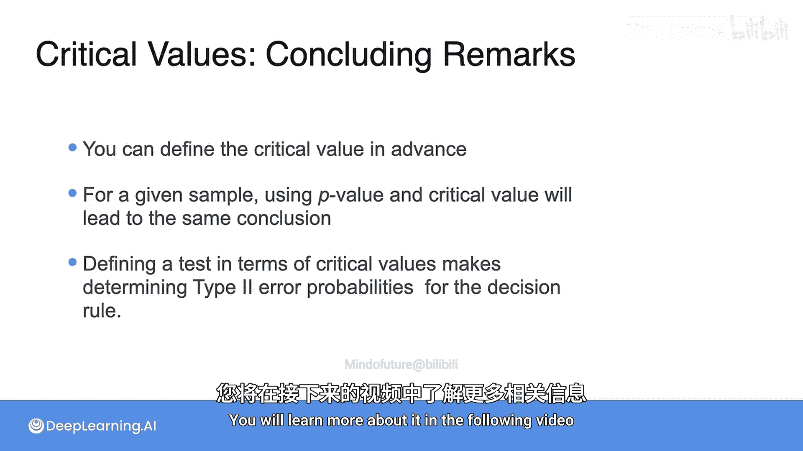

# 【Deeplearning】机器学习和数据科学概率与统计3 ｜ Machine Learning Probability And Statistics 吴恩达 p91 P91_临界值_04_02_05 -BV1c86VBrE93_p91-

So far you learn to make decisions based on the P value of the observed statistic。

 if the P value is smaller than the significant level alpha。

 then you reject an nu hypothesis and accept the alternative hypothesis as true。

One thing you could ask yourself is what is the least extreme sample you could get so that you would still reject H0 This is the sample that has the p value of exactly alpha anything less extreme than that sample wouldn't satisfy the condition of the P value less than alpha This is called a critical value noticeice that it depends on the value that you choose for alpha  different alpha determine different critical values The critical value is usually referred to as k alpha to emphasize this dependency One cool thing about a critical values is that any observed statistic which is more extreme value your critical value will always achieve a p value of alpha or less so you can create a decision rule based on the critical value。

Let's go back once again to the right tail test example about the mean height of 18 year olds。

 the hypothesis being age 0， that the population mean is 66。

7 and H1 is that the population means greater than 66。7。For this example。

 you were working with a sample size of n equals 10 and a population standard deviation of sigma equals 3。

Consider that you're interested in an alpha of 0。05 you need to find the value k0。

05 which has a p value of exactly alpha equal 0。05 but this is nothing more than the value that leaves an area of 0。

05 to the right which means that the critical value is nothing more than the quantile 1 minus0。

05 now when the population mean has a value of 66。7 which corresponds to an nu hypothesis the sample mean follows a Gaussian distribution of mean 66。

7 and a standard deviation of 3 dividediv by root 10 for this distribution the critical value 68。

26 now that you have the critical value you can make a decision rule you can reject h0 if the observed sample mean is greater than 68。

26 one cool thing about critical value is that you can define your decision rule before having to collect any data once you do have your data you can calculate the observed statistic and make a decision from that。

In our example， the observed sample mean is 68。442 which is greater than the critical value 68。

26 In this example you will reject the null hypothesis when a significance level of 0。

05 This is exactly the same conclusion you reach when using the P value method Now what will happen if you change your alpha for 0。

01 Well since 0。01 is smaller than 0。05 then k0。01 will definitely move it to the right That means you need more evidence against h0 to reject it and the critical value would be 68。

91 decision rule will now be to reject the null hypothesis if the observed sample mean is greater than 68。

91 with your data this means that you cannot reject the null hypothesis when a significance level of 0。

01 Now let's see what critical values look like for each type of tests for righttail tests K alpha is the value that under the null hypothesis lift an area of alpha to its right。

That means that the critical value is a quantile1 minus alpha of the statistic distribution when a0 is true。

A decision rule becomes reject0 if the observed Statistic T is greater than the critical value。

For left tail tests， the critical value will be the one that leaves an area of alpha2 to the left so that it corresponds to the quantile alpha in this case the decision rule is to reject the null hypothesis if the observed statistics is smaller than the critical value and finally we get the two tail tests in this case the probability of error needs to be divided between the two tails of the distribution which means you will need to find two critical values k alpha1 which leaves an area alpha2 to its right and k alpha 2 which leaves an area of alpha2 to its left。

They correspond to the1 minus alpha over 2 and the alpha over 21 tiles respectively。

 you will now reject h0 if the observed statistic is greater than k alpha 1 or smaller than k alpha 2。

So to sum up critical values you can define the critical value in advance since you don't need the sample to get it。

 you only need to know the design conditions like the sample size and any information you may need about distribution of the population you're studying it is very important that the P value method and the critical value method must always lead you to the same conclusion as we mentioned with critical values you can define the decision criteria beforehand and then make the decision once you have your data this makes it possible to determine the type 2 error probabilities since you have a clear decision rule that does not depend on the observations you can find the probability of making a type 2 error very easily you will learn more about it in the following video。

