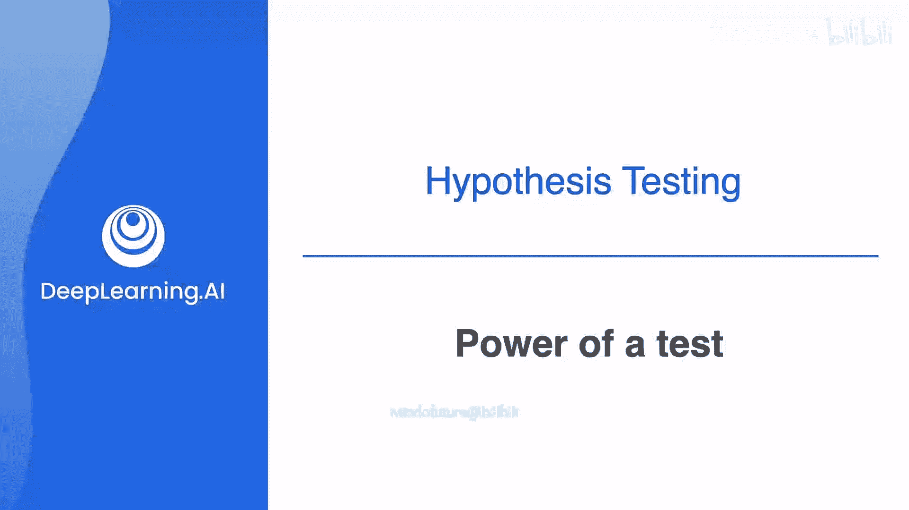
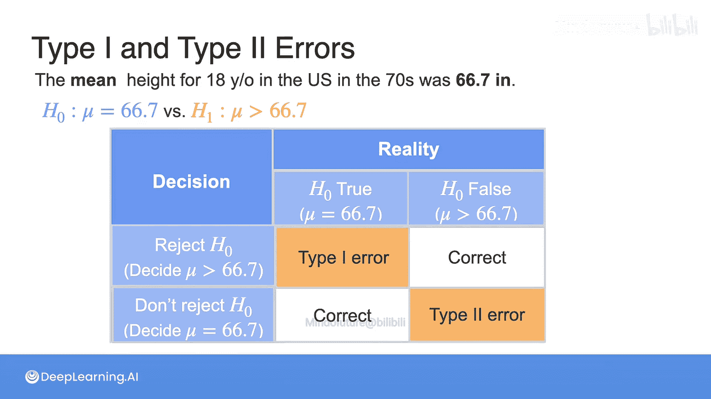
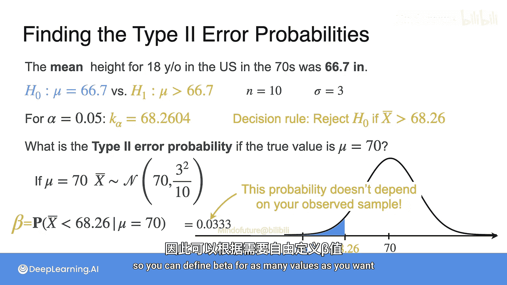
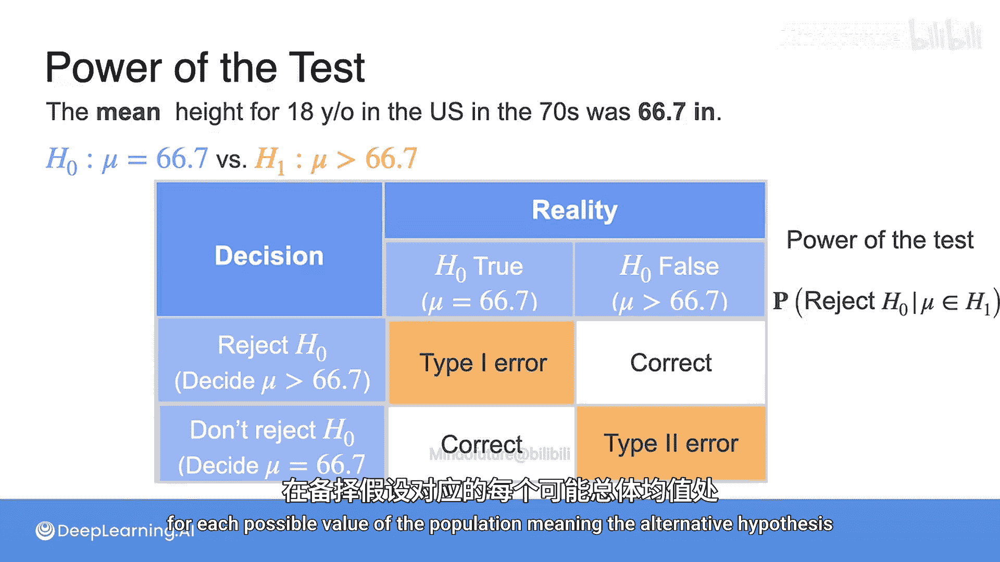
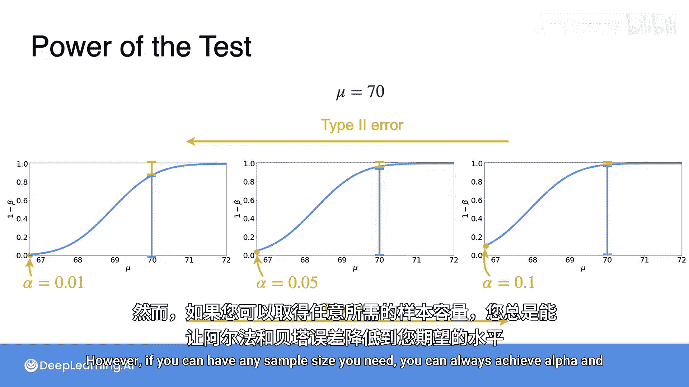

# 【Deeplearning】机器学习和数据科学概率与统计3 ｜ Machine Learning Probability And Statistics 吴恩达 p92 P92_检验功效_04_02_06 -BV1c86VBrE93_p92-

So remember the beginning of the lesson we defined type 1 and type2 errors so far we've been focusing on type 1 errors to the significance level。

 consider again that you want to test where the population mean for the height of 18 year olds in the US has increased in the 70s when it was 66。

7 inches a type 1 error happened when you rejected the null hypothesis that the population mean still 66。

7 when it was actually true。Now you're concerned about the other type of error which happens when you fail to reject the null hypothesis when it wasn't true。

Note that type 1 errors can only happen for one value of the population mean， in this case， 66。7。

 however， type 2 errors can happen for any population mean value which is bigger than 66。7。

For this example， remember you are working with a sample size of 10 and a standard deviation of three。

In the previous video you found that for a significance level of 0。05， the critical value was 68。

26 so that the decision rule was to reject the null hypothesis if the observed sample means greater than 68。

26。You can ask yourself what is the probability of incurring in an error if the true value of the population mean was 70 that's the probability of a type 2 error what you're looking for is the probability of Norject H0 given that true population mean is 70 with a proposed decision rule this is the probability that the sample mean is smaller than 68。

26 when the population mean is 70。So remember that if h0 is true and the sample mean had a Gaussian distribution with mean 66。

7 in standard deviation of3 divided by square root 10 however。

 if the true value of the sample mean 70 then that is no longer true in this case the sample mean following a Gaussian distribution but this time with mean 70 and the same standard deviation and the probability of not rejecting h0 is this blue area over here for value smaller than the critical value of 68。

26 which has a value of 0。333 this probability of type 2 errors is usually called beta a very interesting thing is that the probability does not depend on the observed sample only on the significance level that you chose for the test note here that you consider mu equals 70 but you can get the type2 error probability for any value and mu in the alternative hypothesis so you can define beta for as many values as you want now you should have a better understanding。

Ding about type 1 and type2 errors but many times you want to characterize the chances of actually making a good decision in particular。

 it is important to focus on this quadrant of the table where you are making the right call by rejecting the nu hypothesis this information is gathered in the power of the tests which is a function that tells you for each possible value of the population meaning the alternative hypothesis。

 the probability of rejecting H0。

Remember that the type 2 error probability is the probability of not rejecting h0 when H0 is not true this was called beta now we have introduced a concept of the power of the test which is the probability of making the right decision and rejecting the null hypothesis when it's not true these probabilities complement each other so the power of the test can be written as one minus beta to sum up for each value of mu and H1 the power of the test is one minus the probability of making a type 2 error。

This is what a typical power of the test looks like for right side of test at the very left of the plot you have mu ele 66。

7 and the height of the graph is exactly alpha since it's the probability of rejecting h0 for that particular value of mu。

😊，For this plot alpha equals 0。05 was considered All other values of mu in the graph correspond to the alternative hypothesis that the population mean is greater than 66。

7。 Consider mu equal 68 then the height is the power of the test at mu equals 68 and it exactly the probability of rejecting the nu hypothesis if the true value of the population mean was 68。

 The height between the graph and the value is the complement and that corresponds the probability of a type2 error if mu is actually 68 inches。

 same thing happens to be considered that the true value of mu is 70。

 the height of the graph is the power of the test while the difference between1 and the curve is the probability of the type2 error this graph has an interesting pattern as the horizontal axis values increase the curve also increases getting closer and closer to 1 This makes sense because remember that the value of mu determines the mean of the distribution of the sample mean So as mu increases the probability that the。

Sample mean is smaller than the critical value decreases。

 Let's see how the power of the test looks for three different alpha values。 On the left。

 you have the power of the test for alpha will 0。01。Next for 0。05。

 which is the one from the previous slide， and finally you have the power of the test for a significance level of 0。

1。From left to right， you have an increasing alpha。

 which is the type1 error Now consider the value of the function for mu equals 70。

ItTurns out that as the value alpha increases so does the power of the test for mu equals 70。

 this is true for every value in the curve。Now in contrast， let's take a look at the type2 error。

This time the behavior is exactly the opposite if you get too restrict with the type 1 error you end up increasing your type 2 error probability for X fixed sample size。

 there is always a tradeoff between type 1 and type 2 errors， however。

 if you can have any sample size you need you can always achieve alpha beta as small as you want。

