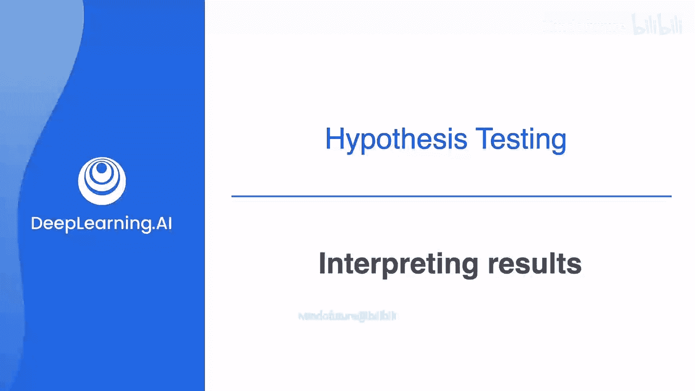
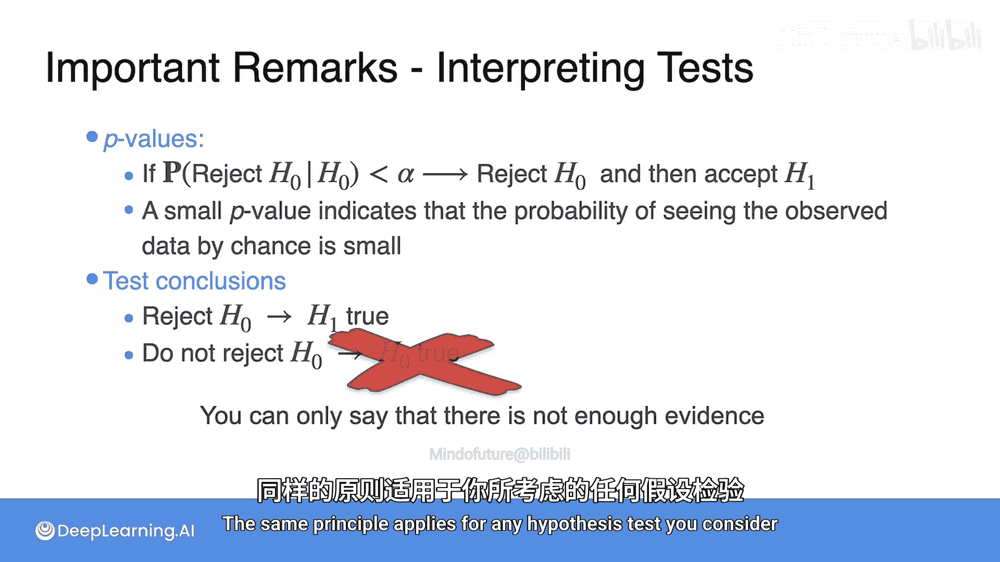

# 【Deeplearning】机器学习和数据科学概率与统计3 ｜ Machine Learning Probability And Statistics 吴恩达 p93 P93_结果解释_04_02_07 -BV1c86VBrE93_p93-

Let's sum of the steps involved in hypothesis testing first step is to state your hypothesis。

 this involves defining the null hypothesis which is your baseline for the current example this is H0 that the population mean of the height of the population is 66。

7。You also need to define the alternative hypothesis which usually corresponds to the statement you wish to prove in the heights example you've been working on this could be H1 that mu the mean of the height of the population is bigger than 66。

7。The next step is designing the test。This means deciding on the statistic you're going to work with。

 this could be the sample mean and defining the significance level of the test。

 the most common value is alpha equal 0。05 remember the significance level is the maximum probability of making a type 1 error and should always be small。

Step 3 is computing the observed statistic based on your samples for all the previous examples you work with an observed statistic of 68。

442。And finally the last step is the decision making this is when you make your decision based on your data。

 one common way of making decisions is based on the P value the P value smaller than significance level you define in step2 then you can reject the nu hypothesis and accept the alternative one however。

 reaching a conclusion is not as simple as it seems and people often make mistakes。

Let's take the time to refresh some definitions and facts about the errors in the test。

A type 1 error happens when you reject h0 when H0 was actually true while a type 2 error is when you fail to reject the null hypothesisage0 when the alternative one was true。

 your design parameter is the significance level alpha and by definition it corresponds to the maximum probability of making a type 1 error。

 you want this value to be as small as possible。However， be mindful that for a fixed sample size。

 the type 1 and type 2 error probabilities are entangled。

 so be mindful when choosing alpha because you might be forcing a type 2 error probability that is too high now that you have the concepts fresh in your mindless look at the correct interpretation of the results as well as some common misconceptions。

Let's begin with P values。P values are a criterion for making a decision based on the data。

If the P value is smaller than the significance level。

 then we reject H0 and accept H1 what does the P value represent？

Is it true that P values represent the probability of H0 being true， well， this is not the case？

While it is true that a small P value rejects the neural hypothesis。

 it does not represent the probability that the hypothesis is true。

The P value represents the probability of seeing the observed data by chance。

 basically a small P value tells you that the null hypothesis is not a good model for your data because the chances of observing it are small。

Now， let's move to test conclusions if you reject the null hypothesis。

 you accept the alternative hypothesis as true。But is it true that not rejecting H0 means that the null hypothesis is true This is also false remember the spam email example。

 you don't really say that the email is ham the most you can guarantee is that there was not enough evidence to show that the email was spam。

The same principle applies for any hypothesis test you consider。

