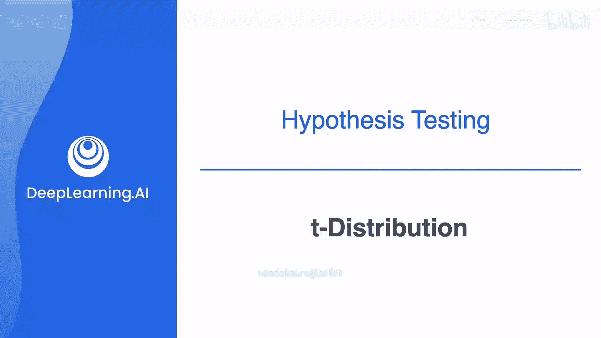
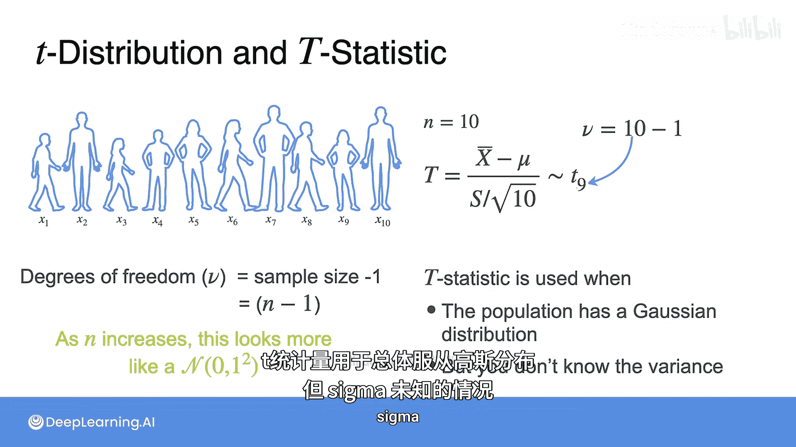

# 【Deeplearning】机器学习和数据科学概率与统计3 ｜ Machine Learning Probability And Statistics 吴恩达 p94 P94_t分布_04_02_08 -BV1c86VBrE93_p94-

Remember that you learn about the T distribution in the previous lesson in the context of confidence intervals。

 now let's review how T distribution plays a role in hypothesis testing。

 consider the example of sampling the height of 10 18 year olds。As mentioned in the previous week。

 people's heights can be modeled as a Gaussian distribution with parameters， mu and sigma squared。

 as a consequence， a sample mean will follow a Gaussian distribution of the same mean。

 but a smaller standard deviation because now we have 10 samples so the standard deviation is sigma divided by square root of 10。

This is true if you know the parameters of the distribution。

 but what happens when you don't know the values of mu and sigma？

Well if mu and sigma are known then you already learned that the sample mean minus mu divided by the sample standard deviation follows standard normal distribution this is simple standardization this statistic is called the z statistic but what is sigma is unknown which is a more common case then knowing that the sample mean is a Gaussian with standard deviation sigma over square root1 not very useful because you don't know what the value of sigma is what you do in this case is to replace the value sigma in the standardization formula by its estimate s remember that s was defined as almost the variance of the sample except you divided by n minus1 instead of n so it was the square root of the sum of square difference between sample and the sample mean divided by n minus1 the resulting statistic is called a T statistic Now does it follow a standard normal distribution the answer is sadly nu。

It turns out that the T statistics follows something that we've already learned previously。

 the student T distribution or simply the T distribution， so let me remind you what this looks like。

 notice that it's bell shaped similar to the Gaussian， however。

 if you compare the T distribution PDF to that of the normal distribution you can see that it has heavier tails distribution probil accounts for the uncertainty introduced when replacing the population standard deviation with its estimation。

Now， what are the parameters of the T distribution。

 it only has one and it's called the degrees of freedom。

It's usually denoted with the Greek letter new。The degrees of freedom control how heavy details of the distribution will be this notation means that x follows a t distribution with new degrees of freedom and let's see what the distribution looks like as the degrees of freedom increase。

 notice that as new increases and gets closer and closer to 30 the Gaussian PDF and the TPF looks almost exactly unlikelike and that's a reason why we like to have 30 samples because then the t distribution of the Gaussian are very similar。

Now let's go back to the example from the beginning of the video in here you have n equals 10 samples now you know that the t statistic x bar minus mu divided by s over square root 10 follows a t distribution with new degrees of freedom but what should the value from mu be the degree of freedom mu is simply 10 minus1 that's the number of sample minus1 which gives us 9 degrees of freedom in general if you have a sample size n then the degrees of freedom is n minus1 notice that the degree of freedom is independent of the population mean variance and only depends upon the number of samples you collected。

The relationship between the sample size and degrees of freedom implies that as n increases。

 the distribution of the T statistics looks more and more gausian。In conclusion。

 the T statistic is used when the population has a Gaussian distribution with unknown sigma。

