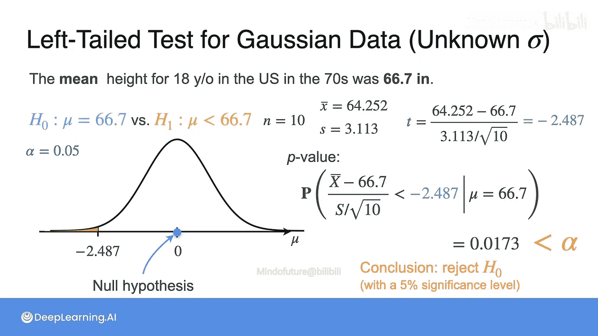

# 【Deeplearning】机器学习和数据科学概率与统计3 ｜ Machine Learning Probability And Statistics 吴恩达 p95 P95_t检验_04_02_09 -BV1c86VBrE93_p95-

Consider again， your sample consisting of the heights of 10 18 year olds with the means 68。

442 and the three sets of hypothesises that we talked about in the previous videos。

In the example from the previous videos， you knew that you had 10 samples and that the population standard deviation was 3。

What this meant is that if H0 is true， then the sample mean distributes normally with a mean 66。

7 and a standard deviation of 3 over square root 10 The difference now is that you don't know sigma which in turn affects the distribution of the data is no longer this normal one over here so what can you do now well if you remember from the previous lesson we introduced the T statistic。

Which was used in cases just like this one。The small drawback is that all the computations will have to be made in terms of the T statistic rather than the sample mean directly。

 so instead of plotting the distributions around 66。

7 you will need to draw them around 0 under H0 this T statistic follows a T distribution with 9 degrees of freedom and this is corresponding PDF the goal now is to repeat the three tests using the T statistic instead。

Let's begin by considering the right tail test for the mean of the Gausian distribution with a known sigma。

 the data now is n equals 10 sample mean of 68。442 and we need to add the sample variance which when we calculated is 3。

113 the observed T statistic is then 1。77。To get the P value for this test want the probability that the T statistic is greater than 1。

77， given that H0 is true。This is the shaded area which has a probability of 0。

0552 since this value is greater than 0。05 you should not reject h0 This is the exact opposite result you got from the right tail test when sigma was known this has to do with the uncertainty added from not knowing the populations variance suddenly the evidence you had was not enough to reject h0。

Now let's repeat the process for the two tail tests。

The P value is now the probability that the T statistic is in absolute value greater than your observed data in this case the observed statistic is positive so it's correct in the general case you would need to add an absolute value in case the observed statistic is negative。

You now need to include the left tail because now you're looking at absolute values this gives the probability of 0。

1103 notice that once again this is double the P value you had for the right tail test this P value is greater than 0。

05 so the conclusion is again to not reject h0。And finally consider the left tail test。

 so let's consider again that the sample you had achieved has an average of 64。252。😊。

Also imagine that the sample standard deviation remain the same in the case of a left tail test。

 the P value of the probability that the T statistic is less than the absurd value negative 2。

487 given that each zero is true and that is this shaded area over here which gives a probability of 0。

0173。For this sample， you obtain a P value smaller than 0。05。

 so the correct conclusion is that you should reject h0 and accept the hypothesis that the population mean has reduced。

