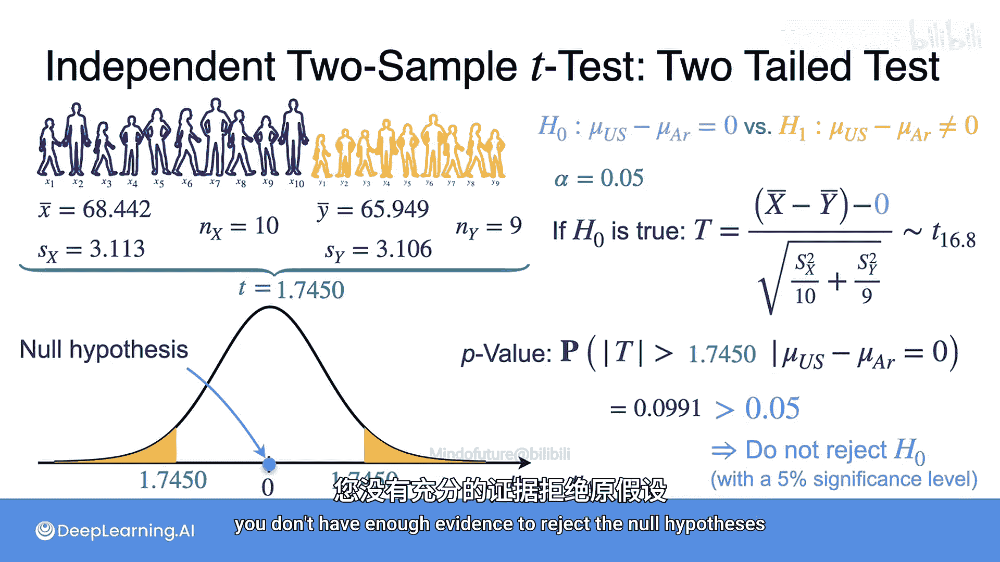

# 【Deeplearning】机器学习和数据科学概率与统计3 ｜ Machine Learning Probability And Statistics 吴恩达 p96 P96_双样本t检验_04_02_11 -BV1c86VBrE93_p96-

So far， all the hypothesis testing we've done has been with one sample in one population。

 but what happens if we want to take different samples in different populations， for example。

 let's say I have two countries and I believe that the people in this country are taller than those in this country。

 but I can only take samples。2 sample hypothesis testing is going to tell us how to compare samples on different populations In the following videos you're going to learn about comparing two populations consider for this example that you're interested in comparing the heights of 18 year olds in the US with the heights of 18 year olds in Argentina for the first group you have 10 samples x1 up to x10 which with the values shown above have an observed sample mean of 68。

442 inches and a sample standard deviation of 3。113 for the Argentinian group you have only  nine samples y1 up to y9 with an observed mean of 65。

949 inches and a sample standard deviation of 3。106 inches。

Your goal is to determine if the population mean from the US is different than the population mean from Argentina。

So just as with sample tests you can define three types of hypothesis in all three cases。

 you will consider the null hypothesis that both population means are the same first you can consider the alternative hypothesis that the population mean of 18 year olds in the US is bigger than that in Argentina you could also consider the alternative hypothesis that the population mean in the US is smaller than that in Argentina and finally there's an alternative hypothesis that both population means are simply different writing this hypothesis in terms of the difference mu US minus mu Argentina you get a right tail test。

 a left tail test and a two- tail test。Now let's use the following assumptions。

 the first one is that all people in the sample from the two groups are different that means that there is no one measured that belongs to both groups。

The second one is that each height measurement from each person is independent from the other ones。

 the third one is that the populations for the height in both countries are normally distributed。

 this means that all measurements x coming from the US have a Gaussian distribution with mean new US and a standard deviation Sigma US and the same goes for the samples coming from Argentina which have a mean new Argentina and standard deviation Sigma Argentina you can then define the sample means for each group x bar will be the sample meanme for the US population and y bar the one for Argentina。

Another the same question is， how does the difference between both sample means distribute？

Since it's a linear combination of Gaussian variables then it will also be a Gaussian。

 but with which parameters， the mean will be the difference of the population means and the standard deviation will be the square root of the variances of each sample mean if you don't quite remember with the result。

 you can go back to week2 lesson 1 where this result was explained。

Of course you can standardize the difference between X bar and y bar to get a statistic that has a standard normal distribution。

 however， since we don't know the population standard deviation from any of the two groups。

 then the best we can do is to replace Sigma US and Sigma Argentina with the sample standard deviation from each group。

So that you have the statistics given by x bar minus y bar minus mu US minus mu Argentina divided by the square root of Sx squared over 10 plus sy squared over 9。

This statisticst also has a T distribution because it corresponds to a statistic for the mean of a Gaussian population with an unknown sigma unfortunately the formula of finding the degrees of freedom is very cumbersome but don't worry about it a bunch of software packages will do this for you replacing Nx and Y S X and X y by those values you actually get that degree of freedom of 16。

8 Now after all that math let's briefly refresh the problem statement you have two groups of samples。

In this case， one corresponds to 10 samples of height of 18 year olds in the US and the other one to nine samples of height of 18 year olds from Argentina。

From the UF sample， you observed a mean of 68。442 inches and a sample standard deviation of 3。113。

Al Argentian sample has an observed mean of 65。949 inches and a sample standard deviation of 3。106。

Let's begin with a right tail test with null hypothesis mu US minus mu Argentina equals0。

 an alternative hypothesis that mu US minus New Argentina is positive。

This means that the population mean from the US is greater than the one from Argentina also let's consider a significance value of 0。

05 from last slide you know that if H0 is true then the statistic T equals x bar minus y bar divided by the square root of Sx squared divided by 10 plus S y squared divided by 10。

 where these are the sample variances has a t distribution with 16。8 degrees of freedom。

Replacing the observed values in the statistic you get that the observed statistic is 1。

7459 but what's the p value for this sample well because it's a right tail test the P value is a probability under the null hypothesis that the statistic T is greater than the observed statistic this corresponds to this area under the Pdf and has a value of 0。

0495 since the p value is smaller than the significance level of 0。

05 then the decision is to reject the null hypothesis and to accept that the population mean the US is bigger than the one in Argentina Now let's see what you can say about the two tail tests all sample values are the same as is the significance level and the test statistic what changes now is how you calculate the P value in this case you want the probability under H0 that the statistic is in absolute value greater than the observed statistic which is the sum of these two areas and has a value of 0。

0。991In this case， since the P value is greater than the significance level。

 you don't have enough evidence to reject the null hypothesis that the population means are the same。

