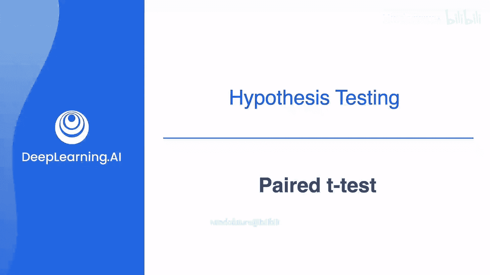
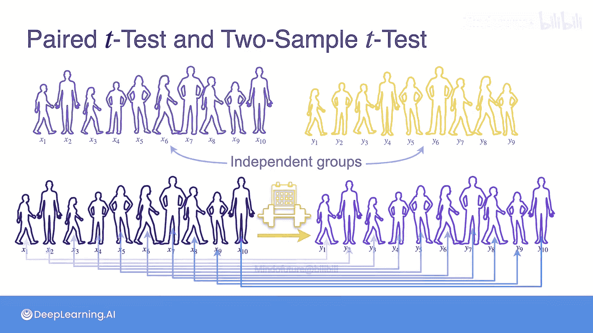
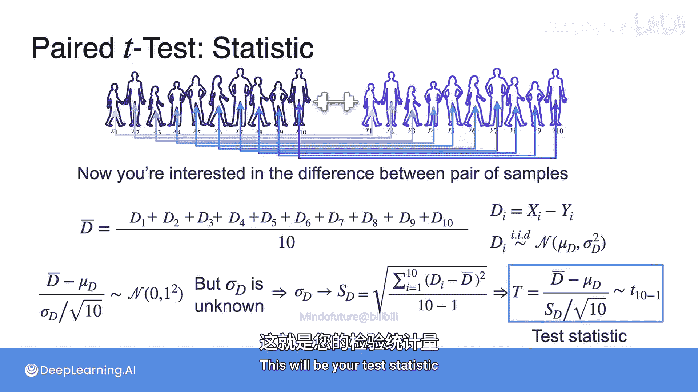
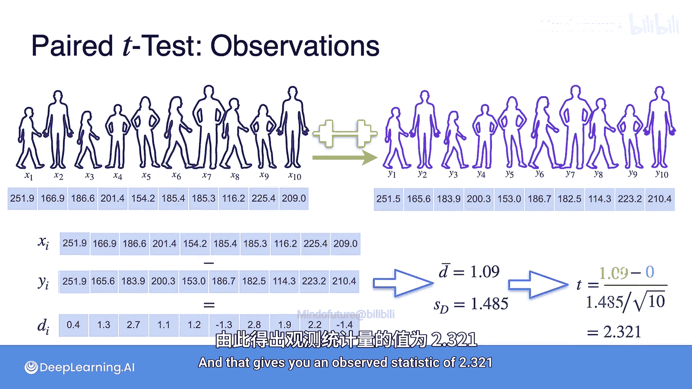
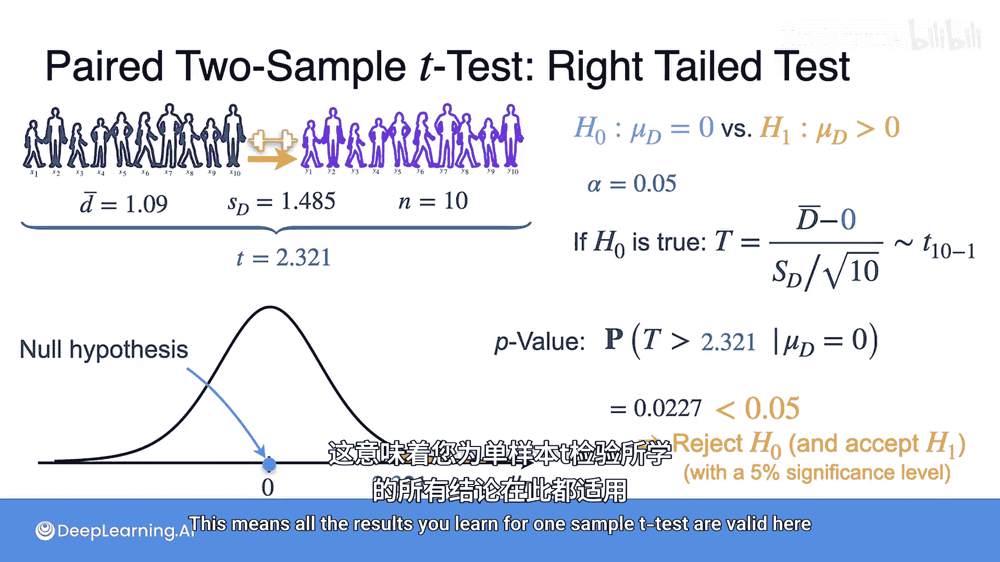

# 【Deeplearning】机器学习和数据科学概率与统计3 ｜ Machine Learning Probability And Statistics 吴恩达 p97 P97_配对t检验_04_02_13 -BV1c86VBrE93_p97-

In the previous video you learn about two sample T tests where you wanted to compare two populations where the two groups being compared were independent there's another situation where you also have two groups but they are not independent so imagine let's say that you want to test the effectiveness of a training plan to lose weight the first group will be the people before the training program after four weeks you wait each to participant again so these two correspond to another person and so on and in this case you say that the samples are paired。

Now what you're interested here is in the difference between pairs to determine if the training program was good for weight loss。

 you can do that by studying the mean difference between each member of the group so you will have the weight before minus the weight after the program for the first person for the second one all the way to the10 Since you're interested in the average behavior you will sum all these difference and divide them by the number samples in each group which is 10 It is common to define a new variable D to represent difference between x and y so you get x1 minus y1 is d1 x2 minus y2 is d2 and so on and so forth all the way to x10 minus y 10 is D10。

And this is the number we're going to study。The sample mean of these variables is going to be called D bar now if x and y were to come from a Gaussian population。

 then D is Gaussian as well。Standardizing Dbar， you get a statistic that has a standard Gaussian distribution。

However， again the population standard deviation is unknown。

 so just as you've been doing in the previous test the best thing to do is to replace the population standard deviation by the sample standard deviation and this is again the T statistic you discovered a few videos back it has a T distribution with 10 minus1 which is 9 degrees of freedom that's going to be your test statistic。

Whether you want to consider a right， left or two taild tests。

 your no hypothesis will always be that there is no weight difference between the groups。

 so replacing mu D by 0。This will be your test statistic。

 so let's figure out what the observed statistic looks like。

 you have these 10 weight measurements from the before group and then these 10 measurements after the training program。

So if you get the XI observations and subtract the Yi observations one by one。

 then you get these differences over here those are the difference in weights from before and after for each one of the1 participants。

Now with these values for the observations from the difference。

 you have an observed sample mean of 1。09， that's the average of all the D's and a sample standard deviation of 1。

485， and that gives you an observed statistic of 2。321。

Now for the first set of hypotheses， consider the right tail tests with null hypothesis。

 mu of d equals0 and alternative hypothesis mu of d is positive， that being said on average。

 the training program is good for losing weight。Also consider a significance value of 0。05。

Now from this last slide， you know that if H0 is true。

 then the statistic t equals d bar divided by the standard deviation of the sample mean has a t distribution with 10 minus1 equals the 9 degrees of freedom。

But what is the P value for the sample well because it is the right tail test and the Pvalue is the probability under the null hypothesis that the statistic T is greater that the observed statistic 2。

321 which corresponds to this area under the P and that has a value of 0。

0227 since the P value is smaller than the significance level of 0。

05 then the decision is to reject the null hypothesis and accept that the population mean for the difference of weight is positive that means that the training program is good for losing weight if you paid close attention you might have noticed that once you start working with the variables D I which are the difference of weights before and after the training program the statistic reduces to the case of a single sample of size N this means all the results you learn for one sample T test are valid here。

