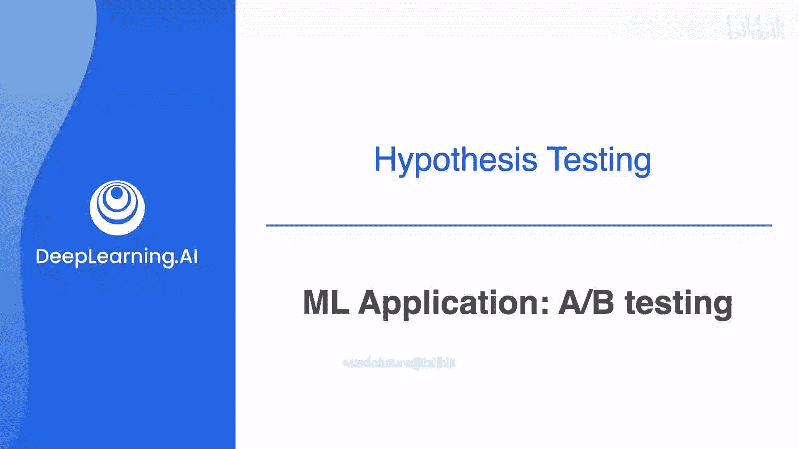

# 【Deeplearning】机器学习和数据科学概率与统计3 ｜ Machine Learning Probability And Statistics 吴恩达 p98 P98_机器学习应用A_B测试_04_02_14 -BV1c86VBrE93_p98-

Now I'm going to tell you about AB testing， which is a really cool application of two sample hypothesis testing。

Let's say that as a data scientist you are studying a website and this website has a particular conversion rate now let's say you improve the website and you want to see if the conversion rate when up or down for this you can use AB testing let me show you how suppose your company has a web page and it wants to test two different placings for the buy now button let's call each of these strategies A and B and you go to the trimm of switching the strategy B leads to higher purchase of Ms to do this you select a group of people as customers come in they are randomly assigned to design A or design B the common rule of AB testings to send a smaller proportion of customers to the new design because you don't know how good it will be So in this case you select that 80 customers for strategy A and 20 for strategy B When you look into the purchases of each group you see that strategy A has an average purchase of 50 with a sample standard deviation of $10 while the group exposed to strategy B has an average purchase of $55。

With a sample standard deviation of $15 now that you've designed your experiment and gathered the data。

 you can go ahead and use the tests you've already learned to make a decision。

Your nu hypothesis would be that the mean purchase with option A and the mean for option B are the same while the alternative hypothesis that the mean purchase for strategy B is larger than the one for strategy A this hypothesis can also be written in terms of the difference of means。

 you also need to set a value for alpha which in this case is going to be 0。05。

Now suppose for the sake of the example that the purchase amounts follow a Gaussian distribution in that case。

 or if the number of samples is large enough， then you can make your decision using a two sample T test。

 notice that if H0 is true and according to the T test the statistic follows a T distribution following the formulas you learn from the independent2 sample T tests。

 the degree of freedom is 23。38。Replacing the observed values in the statistic。

 you get that the observed statistic is a negative 1。414。What is the P value for the sample。

 well in this case you have a left tail hypothesis so is the probability of the standard normal is smaller than negative 1。

414。And that has a value of 0。085， so with this value you won't reject h0 because the P value is greater than alpha equals 0。

05。😊，So what's the difference between AB testing and T tests while AB testing is broader than just T tests it's a methodology for comparing two variations while the T tests are a statistical tool AB testing encompasses many more steps this includes proposing the variation to tests randomly splitting your sample subjects and presenting each group with a different variation measuring the outcomes and determining metrics to use this means are you interested in mean behavior and proportions。

 dispersion etc the very last step in AB testing is using statistics tools to make a decision based on the data gathered。

This is where the T test comes in also in the previous example you used the T test because you were comparing means for Gaussian populations if that were not the case you would use another statistical test to make the decision Now imagine that you want to test a whole new website design for your online purchase platform you have the old version A and the new version B。

You're interested in knowing if B has a higher conversion rate。

 which is simply the proportion of visitors that actually make a purchase。

 so once again you need to split your sample randomly between the two groups。

 one will be exposed to version A of the website and the other one to version B。

Suppose that you consider 80 customers for group A and 20 for group B。

And 20 customers from group A make a purchase while the number of group B was8。

So the hypothesis will be quite similar as the previous example for the null hypothesis you have that both conversion rates are the same well for the alternative hypothesis you have that the conversion rate in strategy B is bigger than in strategy A if this is the case then you would like to deploy the new webage again let's consider an alpha of 0。

05。You're interested in conversion rates， so you're recording a number of customers that make purchases from each group。

 These variables actually follow binomial distributions of parameters NA and PA for group A and N B and Pb for group B。

 Now what is the statistic to use in this case Let's look into it。

 Remember that x and y can be seen as a sum of NA and N B Brnoulli variables each and the mean of a Brnoulli variable is simply the probability of success B。

 This means that by the law of large numbers， you know that x over na is similar to P as the number of samples gets bigger and the same happens for y over N As you learn in the previous week by the central limit theorem。

 these quots have a normal distribution So x over N as a mean Pa and a standard deviations Pa times 1 minus P over NA and y and B will have parameters mu equals Pb and sigma squared equals Pb times 1 minus PB。

Divided by N B。And that's because this is the standard deviation for the binomal distribution。

These are good approximations for PA and PB so x over NA minus x over Nb will make a good approximation for PA minus PB Since x over NA and y over N are approximately Gausian then the subtraction of these two should be Gaussian as well in this case you will be the difference PA minus PB and sigma squared will be the sum of variances of each and if you're wondering how we get there take a look at the reading item one very common way to express this is by standardizing the distribution。

Now， if H0 is true， then PA equals Pb， which you can directly call P。

So you can replace P and Pb by P in these statistics now let's see if we can rewrite the expression into something nice first notice that you have a common term p times 1 minus p in both terms and also1 over NA plus 1 over Mmb can be written as NA plus mmb divided by NA times Nb。

You cannot replace it in the statistic which still has a standard Gaussian distribution because you perform some algebrabiic manipulations The problem is that while PA and PB are the same you still don't know the value of P so you will need to replace it by an estimation since x and y come from the same conversion rate P the best you can do to estimate P is aggregate all the observations so that x plus y is now divided by NA plus M What you're doing here is considering that you have NA plus MB samples from a Bernoullia parameter P。

So the sample proportion now has to consider all these samples。

Now replacing p times y minus P by P hat times1 minus P hat， you get the test statistic。

After all this math let's go back to the problem we're solving you have two webage designs AMB for the design A group you have 80 observations with 20 conversions and for the design B group you have 20 observations with eight conversions remember also that X and Y follow binomial distributions each with their own sets of parameters you are interested in determining if the conversion rate for the new design is better so this gives you the left tail tests。

You also consider a significance level of alpha will 0。

05 and as you just saw from the previous slides if H0 is true then the test sta follows a Gaussian distribution with the data you have。

 this means that the observed statistic is the negative 1。

336 what is the P value for the sample well it will be the area under this Gaussian PDF which has a value of 0。

091。Since this is bigger than a significance level。

 you can reject the null hypothesis and accept that as true that the conversion rate of design B is bigger than the one for design A。

Alright， to close out this week， you' have a few final activities First。

 you'll have the final exploratory data analysis and graded lab This week you will be back in the right share data applying the concepts you've learned around confidence intervals and hypothesis testing Next you'll have this week's graded summative quiz which covers all topics in this week。

😊，Finally， you have your final graded programming assignment which is an application of the AB testing concepts you just learned about。

 good luck with the final activities of the week and in fact of this entire specialization and I'll see you when you're done to bring this week to a close。

