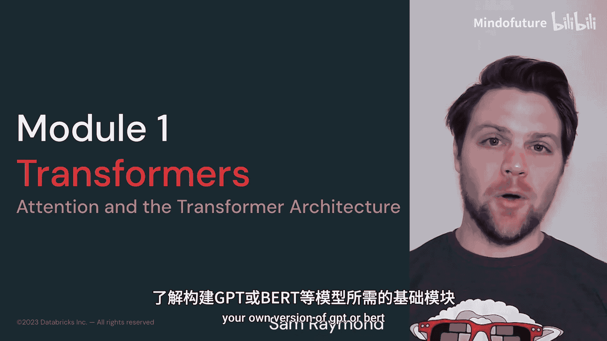
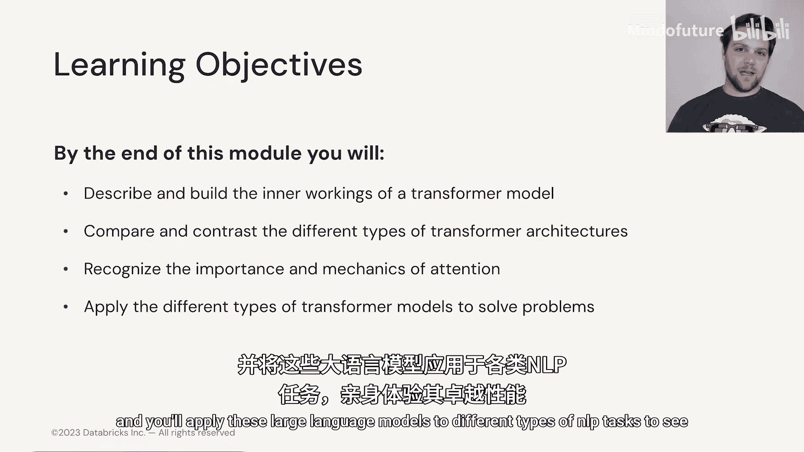
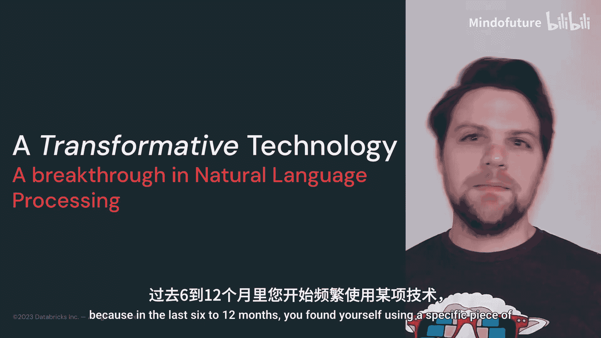
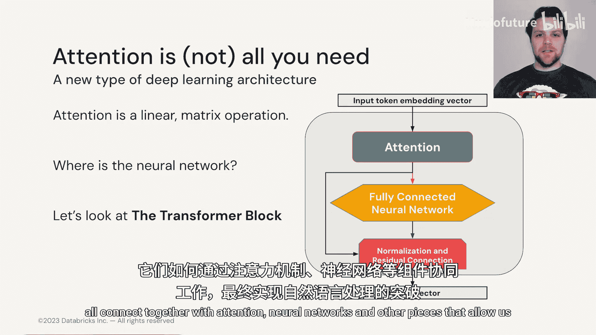

# 【Databricks】Llm模型底层基础 ｜ Llm： Foundation Models From The Ground Up p03 P03_模块_1-Transformer-1.2_模块概览 -BV1LZp9zXEab_p3-

Welcome to module1 in this module we're going to talk about transformers in particularly we're going to pick apart a transformer model and see what it's made of。

 We're going to look at the different building blocks that you can use to build up your own version of GPT or BerRT or any other type of transformer based model。

😊。

By the end of the module， you'll see exactly how to do this with Python code。

 you'll also know all of the different building blocks that go into all of the different types of transformer architectures that are out there。

 from encoder models to decoder models to encoder decoder combined models。

You'll also get a better sense of what attention is and how it works and why it's so important and unlocked large language models to be what they are today。

 and you'll apply these large language models to different types of NLRP tasks to see just how well these can perform。

😊。

Let's take a step back there。One of the main reasons that you're probably taking this course is because in the last six to 12 months。

 you found yourself using a specific piece of technology， most likely ChatGBT In 2022。

 OpenAI released ChatGBT to the world and it was the fastest adopted technology in human history。😊。

It signaled that we're entering this new golden era of AI。In 2023。We've seen an explosion of ideas。

 concepts， and innovations in this realm of large language models in AI。

 and they're continuing to amaze us with what they can come up with。

ChatGPT and others like it represent a new type of interaction that humans have with technology。

Because they're based on natural language processing。

 we're able to communicate with them much more naturally than we would with other different types of technologies。

 but their broad set of skills and deep technical knowledge also enables us to be better at what we do in our day to day lives。

We've actually seen an innovation like this before。

 for those of you who are familiar with the world of deep learning for the last 10 years or so。

 you might have noticed that we went through a similar type of craze moment at the start of 2010。

 2012。This was when the computer vision world was shaken up by the innovations that led to the convolutional neural networks。

 that innovation was the convolutional layer which enabled us to look at images in different spatial patches to try to understand what's going on inside an image。

This， as you can see the image here meant that we could compete with older technologies and completely blow them out of the water。

With the image net test。Convolutional neural networks were easily able to dominate the competition and saturate the results with every model being based on convolutional neural networks since about 2012。

Natural language was waiting for this kind of development and we got that around 2018。

The big innovation that unlocked the power of large language models was something called the attention mechanism。

Attention as the word implies。Allows a computer or a transformer in this case to see exactly how one word relates to the others in a certain sequence。

It gives a score of how important each other would is in a sequence to each other。To you and me。

 this seems like an obvious concept， it's something that we develop early on in life。

 but it's a vitally important piece for natural language processing to unlock abilities that it wasn't able to achieve before。

😊，Now， while attention was a huge step forward in our abilities to master natural language processing。

 it was actually only one piece out of a few that were required to build the transformers and the models that we see these days。

In the next section， we're going to dive into what's called the transformformer block and look at how each of these pieces from the input token to the output of the next selected word all connect together with attention。

 neural networks and other pieces that allow us to conquer NLP。

