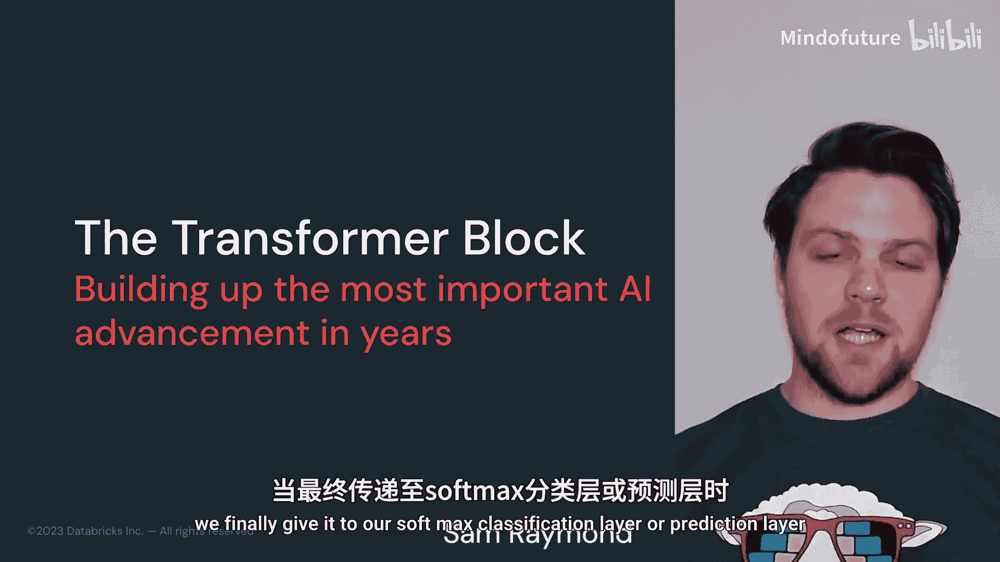
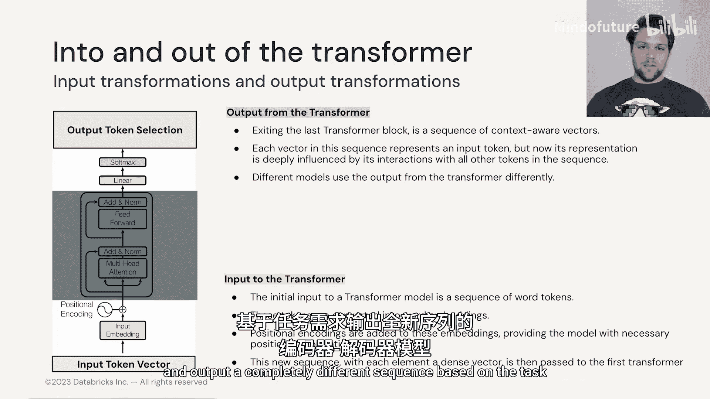

# 【Databricks】Llm模型底层基础 ｜ Llm： Foundation Models From The Ground Up p04 P04_模块_1-Transformer-1.3_Transformer_块 -BV1LZp9zXEab_p4-

Transformers， like most language models， are used to try and predict the next word。

The way transformers do this is different to the way most other language models do it。

But they still work on the same underlying principle。

They'll take in a sequence of tokens and then do something with that sequence。

Change the information inside that sequence so that that sequence can be used to predict whatever the next word or token is in the vocabulary。

In a transformer， we take the input tokens and convert them to word embeddings so we have a vector of different word embedding vectors。

We then go through a series of enrichment phases so that those vectors get transformed and build in more and more context and more information for each vector so that when we finally give it to our softm classification layer or a prediction layer。

 it has a lot of information to work with。

If we look at the transformer blocks。In which the tokens are enriched and then moved into the next sequence。

 we can see what actually happens in the schematic。

If we're considering a transforma with just one transforma block。

The process would look something like this， we would take an input sequence of tokens。

Transform them into word vectors so that we would have a series of word vectors。

We would then add extra information like positional encoding， which we'll talk about in a moment。

Which gives information about the relative positions of each。

Token to each other token in that sequence。And then we pass that into the transformer block。

 The goal of the transformer block is to enrich every token in that sequence with as much contextual information as possible。

 It does this through both the attention mechanism and with the transformations。

Using a neural network。We then process it further by。

Adding a residual connection and normalizing the vectors in the sequence。

 and then those vectors are used in a linear and softmax combination at the output of our transformer to then try and predict the next token or classify the sequence。

Most transformers will have many hundreds of transformer blocks， but the process is exactly the same。

At the end of the transform block， the sequence now bearing little resemblance to the。

Natural language input that we started with， but still with the same size and format is passed on to the next transformer block。

Let's look step by step at how this preparation， enrichment and prediction stages work。So firstly。

 we have the all important attention mechanism。Now the role of attention is to measure the importance and relevance of each word compared to each other word。

In a sequence。Now this concept gets stretched slightly as we go from one block to another block and higher in the traditional transformer architectures we might have dozens if not hundreds of transformer blocks。

 and so after the first block you're not really comparing one word to another。

 but you are looking at the exact same sequence and positions that each token started with。

They have extra contextual information given to them by the previous blocks。

 and we're still looking at how different。Blocks。Pass the sequences differently。By doing this。

 by adding more and more layers of transformer blocks。

 we're able to enrich these vectors and look deeper into how the sequence interacts with each other。

ypical sequence lengths are on the order of many thousands， if not tens of thousands these days。

 and so there is a lot of information to be processed。

 and so a single transformer block is unable to capture all of the information in say a multiparagraph context。

In addition， attention being a linear operation and we'll see exactly what that looks like in just a moment doesn't add any of the deep learning so far to this model。

 in fact transformers are almost not really spoken about in terms of deep learning。

 however the majority of the parameters inside a large language model are taken up by the feed forward network that's used at each attention block。

Now the feed forward neural network in a transformer operates slightly differently to what you might expect。

As we said before， the tokens that are given to the transformer are turned into word embeddings and they'll have a particular dimensionality。

 let's say 100， and so that means we'll have a sequence of vectors。

 each of them being 100 dimensions long。The position wise feed forward neural network。

 as they're referred to as in the Transer， will be 100 neurons wide at the input。

And so what this means is that we pass each token to the neural network one by one。

The weights and the structure of that neural network is identical every time it's applied to each vector in the sequence。

And so this position wise， which means it moves each position， feed forward neural network。

 is applied to each token so that it can transform them into the right format to be then given to the next block in the transformer or to the output block at the end of the transformer。

This allows for nonlinear transformations and also enables the。

Transformer itself to build up different levels of complexity and understanding as we go from the initial understanding of。

 say， how a noun and a verb might be related at the lower levels of。

The transformer blocks all the way up to the sentiment of the context。

Right up the end of the transformal blocks。We'll see more of this as we play with the transformformers in the notebooks to follow it。

Another really important part of the transformer block architecture are the residual connections and layer normalizations。

Now， the residual connections in particular are very important because they allow for both gradients to flow freely backward during back propagation。

And they also make sure that the signal of the input sequence isn't lost during the processing of these vectors as they become more and more enriched。

 and so we have an uninterrupted pathway for the original structure of the input sequence to go all the way through the transformer。

The layer normalization is also vitally important as transformers typically take a long time to train。

 and so ensuring that we have stability in our training is something that layer normalization allows us to do。

Now let's talk about the input and the output of the whole transformer itself。

Let's start with the input。As I said before， we start with a series of natural language tokens that are converted to word embeddings and then in order to make sure that we preserve the order of those tokens in the sequence。

 we also attach to our word embeddings， a type of positional encoding Now there are a number of different types of positional encodings and we'll explore some of these in both the notebooks for this module and in module3。

Once we've got our tokens enriched to word embeddings with positional encodings。

 we then pass them into the transformer blocks。They then work on adding different types of enrichment and complexity and hopefully understanding to the vectors in the sequence。

 and then they pass it to the output of the transformer。At the output of the transformer。

 we have our vocabulary and a linear neural network that selects using the softmax function。

 which token is either the next token to be generated based on the。

Sequence vectors that we've been building up in our transformer blocks。

 or they'll classify it using some classification scheme that we've developed for the particular application。

Now there's a number of different ways that you can use the transformer blocks that we've been describing in this section and in the next section we'll talk about some of those different approaches those will include encoder models where we don't actually do any generation of new tokens。

There are decoder models where we only focus on generating the next token。

 and then there are encoder decoder models where we take one sequence in and output a completely different sequence based on the task。

