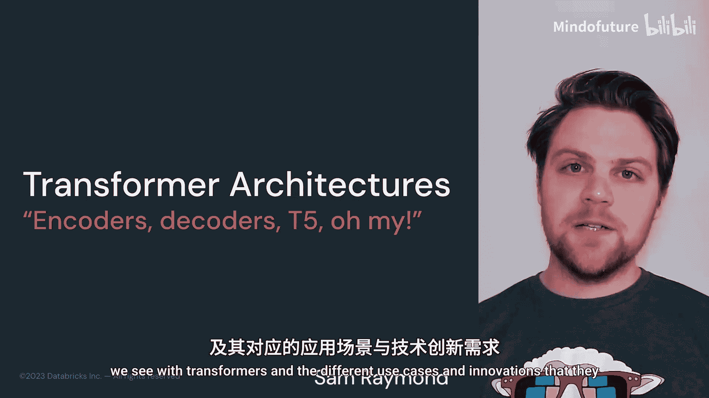
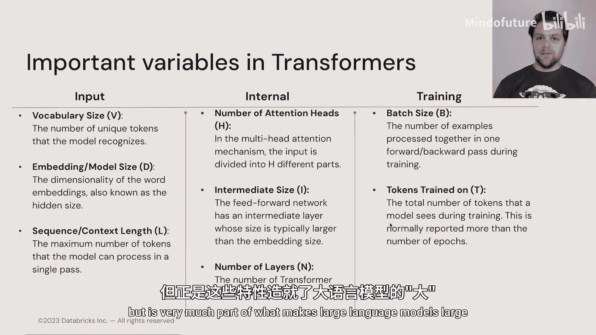

# 【Databricks】Llm模型底层基础 ｜ Llm： Foundation Models From The Ground Up p05 P05_模块_1-Transformer-1.4_Transformer_架构 -BV1LZp9zXEab_p5-

Up until now we've been fairly generic about the type of architecture that a transformer could take we focused on what the transformer blocks are and what they're comprised of。

 however， there's a lot of different ways we can construct a different type of transformer by the way that we organize these transformer blocks。

In this section， we're going to look at the different types of common architectures that we see with transformers and the different use cases and innovations that they require。

If we take a look at the current state of the Transformer family tree。

It's pretty big and pretty messy。But we can separate these into three distinct categories we have on the left here encoder only models and we'll talk about what it means to encode with a transformer just a moment on the far right we have decoder only models and you'll see some familiar names there like Claud or GT4。

And in the middle， we have the encoder decoder models。And if you look carefully。

 you'll see that we have a very familiar G letter representing Google for the encoded decoder models。

 very prevalent in the middle。And there's a very good reason that Google is so prevalent in the encodecodo decoder model space。

😊，In the original transformer paper titledAttention is All you need。

 the researchers from Google presented an architecture based on an encodeder decoder approach。

The reason for this is that they wanted to do machine translation between English and German。

The goal there was to input a sequence of English tokens and output a translated German sequence at the end。

The way that they achieve this goal is by taking an encoder series of blocks。

 so these would be regular transformer blocks as we've seen so far。

 they would put in the English tokens， transform them and prepare them in the way that we saw in the previous section。

And then at the end of the transformer blocks。The vectors that we have at the output of the different sequence vectors that we produce after they've gone through the transformer blocks are actually used for the attention mechanisms in something called cross attention。

 for the decoide of things。That they presented in their model。Now。

 the way that this would work is that the model would first look at the words that it had produced as the decoder side of things。

 and then when we move up to the point where cross attention is needed。

It would compare the word that it had at the middle of its transformer block and look at the。

Cress attention vectors from the encodeicide of things。

We'll look at how attention takes these different types of vectors and combines them together in just a moment。

 but you can think of it as first the encoder takes the English language and transforms it into some sort of enriched vector。

And then it uses those enrich factors and learns how the German words relate to the English words to be translated。

So encodeter decoder models typically take one type of language task and convert it to a different type of language。

 this could be translation or conversion， or it might be some kind of halfway in between。

 such as taking input from English or natural language of some kind an outputting it as say code language。

 or it might be one programming language to another programming language。

 or it might be summarization。There are a number of different use cases for encodeder decoder models。

 and they're based on the concept of cross attention。

 we'll dive deeper into what cross attention is and how it can be used later on when we talk about the attention mechanism in detail。

But essentially， what the encoder does is it provides an extra source of signal for the decoder so that it can achieve the task that it is given and that during back propagation it learns to rely on the signals from the encoder to achieve its task。

The next part of the transformer architecture family is the Incurter model。Now。

 Google also produced a second transformer architecture a couple of years after the original transformer was released。

 and this was the bidirectional encoding representations from transformers or but。

There are a couple of new innovations that Bert released with。

 one was segment embedding so you could take one sentence。

Separate them with the SEP variable and then put in a second sequence or a second sentence。

 and Bert would be able to compare the two sentences together。

The way we trained Bt was also different as they would intentionally mask different words in the sentence。

It would also allow you to。Incorporate next sentence prediction。 And by that。

 it would be able to tell whether or not the next sentence precede was preceded by the first sentence that it saw。

 It could give a true or a false， whether or not the sequence。

 the first sequence it saw LED then to the second sequence or not。

Bt was excellent for fine tuning and has been used and still dominates many of the state of the art techniques for different types of natural language processing。

 B is excellent for things like question and answering， named entity recognition。

 and other more traditional types of natural language processing tasks。

But is still in use today and is much more lightweight than some of the larger models that we typically see in the news。

Speaking of these types of models， the third type of architecture that was produced based on the transformer architecture are known as the decoder only models。

 the most popular and well known version of this is GT。GPT generative。

Pretrain transformer is a type of transformer， as the name suggests， that generates new words。

 You've probably heard of the buzz term generative AI。 And GT is the reason for that buzzword。

The whole aim of a decoder only model is to try and predict the next word based on the sequence that it's currently processing。

In GT， it'll take in all of the vectors that it's been working on and enriching and use the classification Somax layer at the end of the transformer blocks to try and predict the next token or the next word。

We've seen a huge amount of applications based on these GPT or decoder based models。

 and you'll be familiar with probably chattGPT， but Claude， Lamer， MPT and the list goes on。

We'll be focusing a lot on GPT in this course， but also the other encoder decoder models and encoder only models also very valuable and worth spending some time becoming familiar with。

Now that we're at a point where we can look back over what the transformers are and how we might build them。

 it's also important that we take it into account some important variables that we'll hear again and again。

Let's start with the input side of things， the vocabulary size is the number of tokens that a transformer was trained on and that encompasses its speech。

 it enables it to combine tokens together to create new words。

The embedding or model size is a very important。Variable in transformers and relates quite often to the size that the transformer will take up。

 We'll talk about parameter count a little later， But one of the most important variables in determining what a parameter count will be for model is the embedding or model size。

 These are the dimensions of the word embeddings that we use。

 Many of the matrices and the neural network sizes that are inside the transformer blocks are directly related to the size of the model or embedding dimension。

The sequence or context length is also vitally important less to the number of parameters that a transformer has。

 but to the amount of compute that you will need to actually run the transformer。

We've seen context lengths change from 512 from the original GPP model all the way up to hundreds of thousands with new models like Claude。

If we look at the internal variables， we'll also have to keep in track of the number of attention heads。

 so we'll talk more about attention in the next section and the number of heads that you have in multiattention is also an important part to keep track of。

The intermediate or internal feed forward network size。

It relates to the intermediate or internally hidden layer of the position wide feed forward neural network。

These position wise feed for neural networks take up about 66% of all of the parameters that are learned in a transformer。

The number of layers is also vitally important as that's the number of transformer blocks that a transformable have。

And then when we talk about training。The batch sizes for all of these models is also very important to keep track of。

 And， in fact， while transformers are very much a deep learning。Entity。

 you'll notice that a number of things are quite different。

 it's not uncommon to see things like an epoch of just one or a batch size of just one or two。

 typical for these sorts of models。In addition， the number of tokens that a transformer is trained on reaches the millions。

 billions and trillions in transformers， this is something that we haven't seen in deep learning up to this point but is very much part of what makes large language models large。

