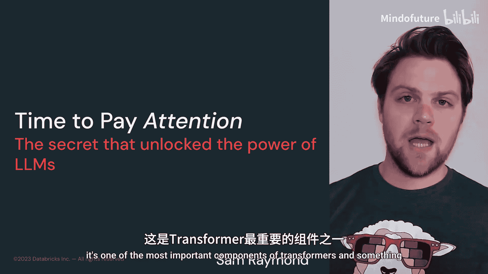
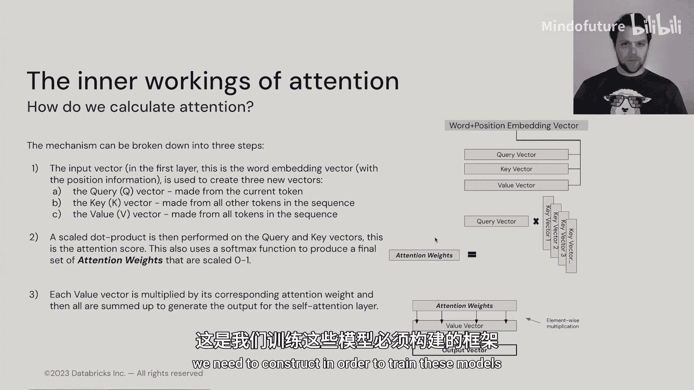

# 【Databricks】Llm模型底层基础 ｜ Llm： Foundation Models From The Ground Up p06 P06_模块_1-Transformer-1.5_注意力机制 -BV1LZp9zXEab_p6-

One of the goals of this module is to understand how we can build and train our own base or foundation transformers。

 however before we get into that let's take a moment to talk about attention。

 it's one of the most important components of transformers and something that can be quite complicated if you haven't seen something like it before。

To start with， let's think about how we can take the vector that we're working with。

 That's going to be the current token that we're looking at。

 So let's assume that we're in the first layer where we can directly correlate the input。

Word embedding vector with the vector that we're going to talk about in attention here。

Now attention is built of three vector。Families， the query vector， the key vector。

 and the value vector。Now we actually have one query vector and that's going to relate to the current token that we're looking at in the sequence。

We're going to have a number of key vectors that're going to come from all of the vectors in the sequence。

 and we're also going to have a series of value vectors。

We're going to use a matrix multiplication with the word vector or the enriched embedding vector。

 if you like。Multiplied by this。Query matrixtri to give us our query vector。All of the matrices。

 the query matrix， the key matrix and the value matrix。

Are comprised of weights that are learned during back propagation。

The idea behind attention is that we use a single query vector。

And talk to all of the other key vectors that we generate in this from the sequence。

 And we effectively ask it how much。Are you the key vector related to me， the query vector？

We do this in parallel for all of the tokens in the sequence。

So every time we do the attention calculation， we're focusing on our query vector。

 and we're broadcasting the query vector to all of the keys。By by thought， I mean， the key vector is。

What we're doing is we're saying how similar， how important is this key vector to the query vector？

In the equation that you see here， you can see we take the。Softm of Q times K transpose。 Now。

 Q in this situation is the query vector， and K is a matrix。

Transposed here to make it so that we end up with another vector and we multiply that by the value vector。

Let's take a look at what happens in this situation。So to calculate attention。

 step one is we take our input vector， which if in the first layer is the wording bedding vector with positional information。

And we create three new types of vectors。We create the query vector， the key vectors。

 and the value vector。The query vector， as I said before， is just built from the current tu。

We then multiply that using a scale dot product on the query vector to all of the key vectors。

And what this gives us is attention scores。We're going to have an attention score for each pair of the current query vector to each of the key vectors。

 so we'll end up with an attention score vector， which is the same length as the query vector。

 which is the same length。As the word embedding that we get from the token。

 this is another reason why the dimension。Of the dimensionality of the model that we built。

 so if we remember from the previous sections video。

 we talked about important variables for transformers。

 the model dimension or the model size is very important here。

The size of these vectors is the dimensionality of the model。

So the query times key vectors gives us this attention weights and they're scaled from zero to1。

And then we do a special type of multiplication。So that for each position in our vector。

The attention weight is multiplied by the value of the value vector at each of those indices。

So from zero to the size of the embedding， we multiply a simple scale of product between the attention weight score at index0 with the value vector score at index0。

 and we do that for each of them。This then gives us a full output vector。Of the attention score。

For that particular token across the entire sequence。

We'll take a moment to think about this one more time as attention can be somewhat complicated。

Realistically， you can think of this as some kind of filing cabinet and lookup system where we have our query。

 which comes from the current token， and we're looking through the files to see how well each of the different other files。

 these are the key vectors。Haved the information that we need that would be the value vector。

Once we've figured out exactly how much each key vector should give to the query vector。

 and that's the attention weights。We then combine it all together so we get a full picture。

 this will be our output vector， we get a full picture of how much attention to pay to each other token in the sequence。

And so this is where the notion of attention comes from is that the value in each of the。

Parts of the output vector， the value in each of the parts of the output vector tells us how much attention we should be paying to each token relative to the current torken of focus。

In the next section we'll take attention， we'll take the feed forward neural network。

 and we'll look at how we can actually build our own foundation models。

 what's required more than just attention， the larger architecture that we need to construct in order to train these models。

