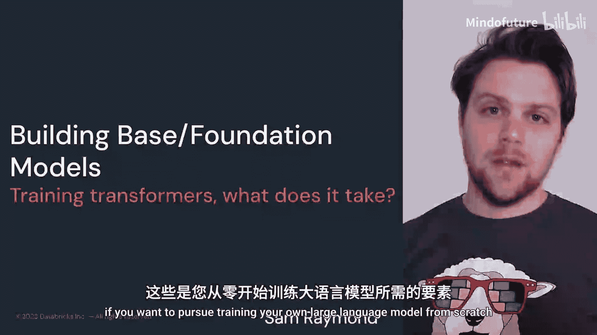
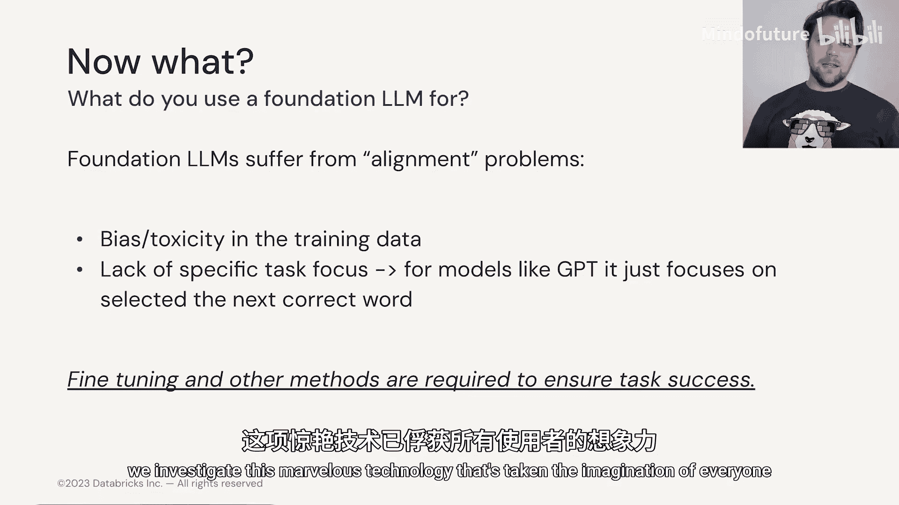

# 【Databricks】Llm模型底层基础 ｜ Llm： Foundation Models From The Ground Up p07 P07_模块_1-Transformer-1.6_基础模型 -BV1LZp9zXEab_p7-

We've seen now all of the different building blocks that go into the construction of creating。

A transformer， large language model。You're then probably wondering how do we build the actual model to be useful。

 how do we train it and construct it and what pieces do we need to actually get everything working in this section。

 we're going to go through all of the different components， including the data。

 the compute and the training procedures that you'll need to follow if you want to pursue training your own large language model from scratch。

Now one thing to keep in mind， you may hear the terms foundation or base model interchangeably throughout this course and in the wider literature these。

Refer to large language models that are trained from randomized weights into just predicting the next word Now you sometimes see foundation models or base models behave in ways that you might think。

 oh， that's not actually what I want my model to do and that's just because what happens when we train a foundation model or a base model is it's understanding fundamentally the syntax and potentially the semantics of what language contains。

So you might ask a foundation model or a base model， what's the capital of France？And rather than。

Answering with the actual answer that you'd expect， it might then ask what's the capital of Germany。

 and that's because it's more often than not seen a list of questions rather than a question answer in the training set。

We'll talk about the different types of training sets in just a moment。

 but keep in mind that for task， specific performance。

 you'll almost always need to fine tune your model。

This requires a much smaller amount of training data and is usually recommended for most people as they'll take a large language model that's been pretrained or produced a foundation version。

 and then they want to find tune on top of that。However。

 for those of you brave enough to get started training your own foundation model。

 let's look at some of the different options that you'll need to go through。😊。

You'll want to think about the model architecture。Whether it's a decoder。

 an encoder or a combination of the two。 And you will also want to think about the type of tasks that you want the fine tune version of this foundation model to。

Perform as well。 This will inform some of the decisions that you make with the structure of your model and also the different types of data。

You'll also want to make sure that you think about how big you want the model to be。

 how rich you want its representation of language to be and needs to be embedding dimensions。

 the number of blocks， etc。And then the type of data and the availability of data that you have and the wrangling of that data。

 most importantly， is going to be one of the most difficult things for you to overcome。😊，Finally。

 actually getting the compute resources， both the amount of time that you have allocated to train the model and the hardware that's available。

 which is not something you can take for granted these days as。GPUs are quite hard to come by。

 particularly the ones that are needed for foundation model training。

Let's think about the different types of architectures。

We've seen already the encoder decoder model that Google produced in the attentioners or unique paper and the different generations that came after that。

 such as Bert， GPT and T5， which we haven't spoken about， but we'll look at more later in the course。

Depending on the tasksa you want， whether it's classification。

 maybe you'll go with something like but if it's generation。

You'll probably want something like GPT translation。

 you'll probably want an encode to deco to like T5。

You'll also want to think about the numbers of la that you have。

And the context size that you can deal with。Most importantly。

 the data is something that you'll have to fight for。

There are a number of publicly available data sets such as the well known P data。

 which is a combination of different openly available text resources。However。

 if you train the same model that someone else has trained on the same data。

 odd's tell you're not going to get much of an advantage and you're better off just downloading the weights of that model。

You'll want to start at least with something like the pile to get a good understanding of at least in this case。

 the English language， but language in general。You then may have proprietary or just curated data sets of your own that are more specific and might include things like transcriptions。

 digitized text， code examples， and other sources that you think is valuable for this foundation model to be trained on。

Once you have all of your data and your architecture and the compute ready to go。

 then you can breathe a sigh of relief as now you're just back to training a regular deep learning model。

Livege language models train more or less like every other deep learning model。

 except they're massive， they take many weeks and months to train to a reasonable state。

 and they often require hundreds of GPUs to do so。However。

 they often rely on fairly typical loss functions like cross entropy and optimizes like Adam W。

 though new optimizes are being researched and developed by the community day by day。

Now that your model has been fully trained， you might then wonder what do you do now Well odds are if you start to interact with your large language model。

 you'll find that it suffers from alignment problems。

If you're unfamiliar with the alignment problem in large language models， in essence。

 it boils down to just a few components。Is the model accurate， is the model？

Does the model behave Well， for what we want it to do， Is it toxic。

 Does it show negative biases or any sort of。Bases that with。

Detract from the performance that we want。And does it hallucinate。

 does it make up situations and examples when we need it to be as factual as possible。

 or maybe you want it to be as creative as possible and it's just not very good at doing that either way。

 the problems of alignment is still an ongoing area where different types of tools and procedures are being investigated。

Really what you want to do after you've built your foundation model is to look at fine tuning methods。

After we finish this module here in module2， Cheyin。

 we'll talk about parameter efficient fine tuning models。

 which is a new area of development where you can fine tune models on different tasks in a very compute efficient way。

Let's take a。Step in a slightly different direction now though。

 and let's talk about the history of GPT from one to four as we investigate this marvelous technology that's taken the imagination of everyone who's used it。

