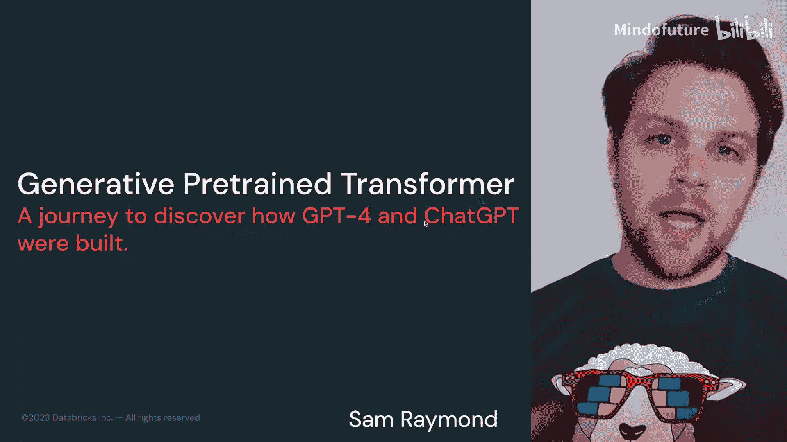
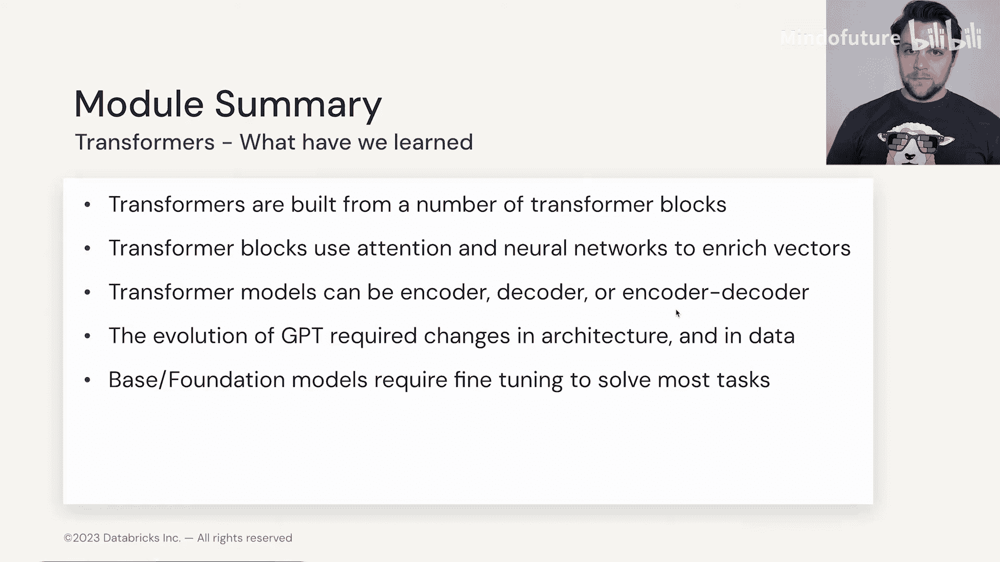

# 【Databricks】Llm模型底层基础 ｜ Llm： Foundation Models From The Ground Up p08 P08_模块_1-Transformer-1.7_生成式预训练 Transformer -BV1LZp9zXEab_p8-

We've spent this module looking at the inner workings of the transformer in general。

 we looked at different types of architectures that you can use the transformer blocks to build up towards be it a encoder model。

 a decoder model or an encoder decoder model and we also spoke briefly about what attention is how it works。

 and what you might need to do to train your own transformer。In this section though。

 we're going to focus on just one specific type， in fact， one specific brand of Transformer。

 but probably one that you've heard an awful lot about and most likely used maybe in the past few hours。

That's going to be GPT from Open AI。GPD stands for generative pretrained transformformer and as its name suggests。

 it's a generative model。 So it's a decoder model， and it's a pretrained transformer。

 So that just means that it's been built and trained like we looked at in the previous section。

In this section， we're going to look at how we went from GPT1。

 all the way up to GPT4 and how chatt GT works。

ChatGT was released in November of 2022。And was a fine tuned version of G3。Or GPT 3。5。

 depending on when you started using it。ChadGPT was one of the first chatbots using a large language model as its base。

And received renown acclaim and usage being， as we said at the start of this module。

 the most adopted technology in human history。ChatGPT is an application of a decoder based transformer model and let's see how we actually got to this point。

The generative pretrain transformers or G were a family of models that were。

Reseearched and released to the wider community after the release of the attention is or you need paper by Google in 2018。

The first GPPT model looked at the encoder decoder model of the Aters or you need paper。

And decided to just work on a decoder model， so they were just looking at the right hand side version of the architecture。

The different families that were built after that original GPT， so this is GP2。

 3 and 4 have more or less relied on the same architecture。

 but just been larger versions trained on even more data。

Now there have been very important innovations and clever changes that have made the scaling up possible。

 but in essence， all of the infrastructure and architecture that we've been talking about have been exactly what they've used to build GPT4 and ChatGT。

Gibb1 started with just 12 transformer blocks， each connecting to each other and passing those enriched vectors。

GBT2 increased the dimension size of the word embeddings to 1024 and also quadrupled the number of transformer blocks。

GPT 3 double the amount of transformable blocks and also double the model。Ebedding size as well。

GPT3 was truly transformative in its ability to perform fu shot learning and complete tasks at a state of the art level。

The data was also something that changed as we went from the different families of GPT。

The original GPT or GPT1 was trained on something called the book corpus。

GBT1 had 117 million parameters。More or less on par with the size of but。

 which was also released around that time too。GBT2， which came out one year later。

 was trained on a much larger data set called webText。

This text was gathered from the publicly addressable web。

And also was the first time that we saw a transformer model released in different sizes。

Starting with the 117。Million parameter model with the same number of parameters as the original GP all the way up to the 1。

5 billion extra large version of GPT2。GBT3， which was released in 2020。

 was pretrained on even newer and larger data set webtext 2， which incorporated 45 terabytes of text。

GBT3 started off with 175 billion parameters。And was found to be exceptional at few shot and zero shot learning capabilities。

GBT4， which we only know some rumored information about， was released in 2023。

While Open AI has not released any of the information to date on how GT4 is structured。

Some estimates are that it is a number of smaller 220 billion parameter models using a mixture of experts approach。

Now we don't know if this is true or not， but we will be covering what mixture of experts is in module 3。

Let's look even deeper into the GPT architecture。So why did GPTs keep getting bigger？

Every time we see GT1， two， three， and four。Increase in size。

 this is largely because it has more and more layers， while the model dimensions do get larger too。

 they don't scale in quite the same way as the number of layers do。

Now the reason that we want more and more layers is because that allows the attention mechanism to focus on more and more aspects when this works in conjunction with the position wide feed forward neural network。

 what we enable。Is conceptually within the model， it's able to see more and more about the text。

If you think about the convolutional neural networks。

They started off looking at edges and then eventually as we get deeper into the layers。

 they could look at more composite features， something akin to this is happening in attention。

The early attention is looking at things like word order， different parts of speech。

 basic sentence structure。 And then as we allow the neural network to。

Reconfigure the vectors into a useful format for the attention block of the next transformer block to pay attention to。

 we're allowing the model to pay attention。To different types of text and speech。

 and so in the middle layers of attention in the middle numbers of blocks。We。

Can think of the model as being able to pay attention to things like meaning relationships between different phrases in the text rather than just within the specific sentences。

And then at the last stages of the attentions in the transformer blocks。

 you can think of it as looking at the discourse， the sentiment， and complex long range dependencies。

When we think about how you interact with chattGPT and other platforms today。

 the context length is increasing more and more， and with that the number of layers also needs to increase so that it can pay attention to more of what's going on in the text and understand more richly what is being conveyed。

And so when we think about why we're getting so many parameters up to potentially a trillion parameters in GPT4。

 this comes from the fact that the layers are increasing。

 the model dimensionality is increasing and the number of attention heads as well。😊。

There are some other factors， and the attention heads per layer doesn't play a larger role as it perhaps could。

 but the number of layers and the modal size。Play a huge role in both the neural network size and the size of the attention matrices。

So let's talk about how you might train GPT and focus a little more on that data。

As we mentioned before， GPT1 was trained on something called the book corpus。

 which is comprised of 7，000 unpublished books spanning various genres。

Which has about 800 million words covering a wide range of topics and styles。

 If you download GT1 from something like Huging face and run it。

 you'll notice that it has this kind of style in its output。

You'll also notice that it tends to output more or less nonsense。

 and that's just because GT is very small and doesn't have quite the complexity that it's larger。

Older and newer generations have。GPT2 was trained on something called web textex and this was the first time that we saw a publicly crawled data set used in large language models This is much larger than book corpus and as you can imagine it encompasses a much wider array of what people talk about on the internet。

Instead of the 800 million words。Web textex is comprised of 45 terabytes of data。

This also meant that the team at Open AI had to do a lot of work in dejuplication and filtering out web pages with low quality content。

 This is still a problem that exists today， finding good sources of data and focusing on cleaning their data and making sure that it's the highest value data for the model。

For GPT3， webtax 2 was used， which is even larger and more diverse in the original webtax dataset set。

If we look at the performance differences between GT2 and GPT3， we can see that this new data set。

 even with the same number of parameters， enables GT3 to perform much better on the task that it's given。

As we move forward into the realm of large language models into the latter half of this decade。

 we'll also see the need for new sources of data， whether come from video transcriptions or other synthetic data sources。

So now that we've looked at how GBT went from one to three and all of the different innovations and changes that needed to take place。

 let's take an overarching look of where we've come so far in learning about different transformer architectures。

We've seen the different types of architectures that you can create using your transformer blocks。

 these could be the encoder only models such as B， decoder only models such as GPT。

 and sequence to sequence transformers like T5。Each of these have different pros and cons and depending on the task that you want to apply your Live language model to and the resources that you have at hand。

 you may need to be strategic about which you choose。While you may just run and。

Put everything into G 4 or5。And probably get some decent results that also costs a lot more both in compute。

 security and other limitations that you may not be able to afford。

If you're just looking at things like sentiment analysis or if you need to control the data。

 or if you have a very small amount of compute， you may be better suited at utilizing something like but or T5 instead。

Take some time when you can to have a look at the different pros and cons for each of these different Live language model frameworks to see which one is best for you。

So now we're at the end of module1。This module focused on transformers and the building blocks that make up the different types of live language models that we see。

We saw that there are both of these transformer blocks and how the transformer blocks combine the attention mechanism and position wide feed forward neural networks to enrich the vectors that we give to them。

Transformers can be both encodecoder models or decoder models。

 and they can even be a combination of the two。We saw that the evolution of GPT from one to four required some slight changes in architecture and a lot of change in data。

Keep in mind that while we want to train these models as base or foundation models。

 if we really want to make the most of them for the tasks that we have at hand。

 we're going to need to do some sort of fine tuning so that we can achieve state of the art performance。

Now let's jump into the notebooks and look at how we can build our own mini transformers from scratch。

