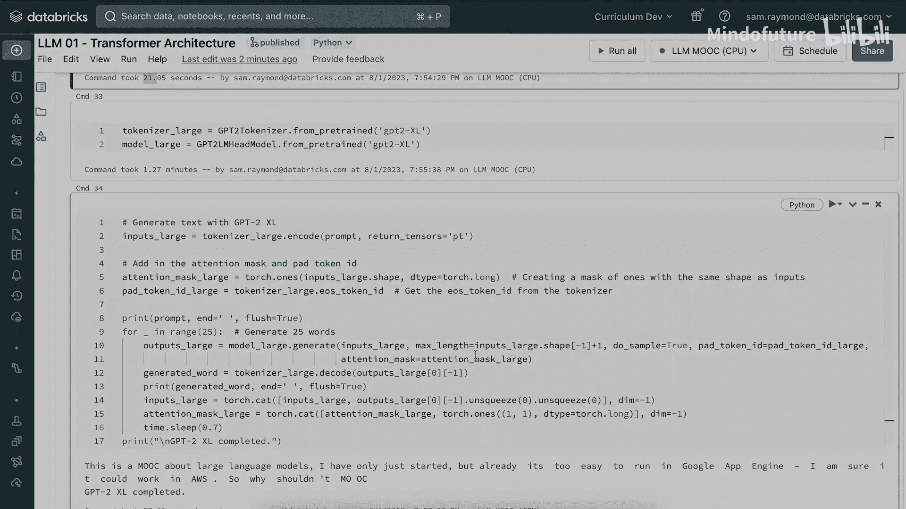

# 【Databricks】Llm模型底层基础 ｜ Llm： Foundation Models From The Ground Up p09 P09_模块_1-Transformer-1.8_笔记本 -BV1LZp9zXEab_p9-

Welcome to the first notebook of this course In this notebook。

 we're going to look deep into how we can build up our own transformer。

 We're going to start by looking at how our input gets formatted from the plain English text to。

Word embeddings and then adding positional encoding on top of that。

 and then we'll look at building a very simple decoder single transformer block。

 and then we'll work our way up to a multi layer transformer that can decode。Text for us。

 and then we'll look at a pre trained model of this GPT2 from Huging face and we'll look at how we can generate some results。

Let's get started as always， by checking that our cluster is running。

And then we'll go and click on the command force cell here to run our classroom setup。

Make sure that you run this classroom setup at the top of all of the notebooks that you do in this course to make sure that everything is configured properly for you。

While this runs， let's also look at some of the libraries we'll be importing。

 we'll be working with Pytorch and we'll be taking some of the neural network functionalities。

We're going to grab the mathth and time libraries， numpI。

 and then a couple of plotting libraries as well。We can see the setup has completed。

 so now let's import our Python libraries。So that we have everything now to get started。

Let's look at how we take our。Natural language and encode them into the right format for the transformer。

Let's start with a simple sentence here， the quick brown fox jumps over the lazy dock。

The first thing that we'll do is split this up into individual words We're going to make an assumption here that each word represents a unique token In reality。

 most tokens use by pairingcoding or different types of approaches so that sub wordss are used as individual tokens。

 but here we can use individual words。And all of the learnings will be the same。

We're going to split each word。And we're going to store that in our word to ID dictionary。

We'll print what this looks like， but before we do that。

 let's also convert the text so that we have indices for each of our words。

This is going to build up our context vector for the input to our transformer。We're gonna use。

Pietorrch to construct a tensor。And we'll be using the Word to ID so that we first loop over all of the words that we just created。

And we're going to store the ID into the inputs ID。

Now we're going to create a word embedding using the neural network embedding function from Pytorch。

And we're going to set our embedding size in just a moment。

We'll return our embeddings from this simple function here。To learn more。

 check out the embedding function from Pytorch。So now let's set some variables。

 we're going to set an embedding size， so this is going to be the dimension of our model。

 and this will be set to 16。Then we're going to create all of our Word embeddings by using the get Word embeddings function that we just defined on line 9。

We'll then print these word embeddings， so let's run this cell and take a look at all of the different things we're going to print。

So we can see the first thing that we have as an output。Is our sentence？

Split into the object here with each word corresponding to an index。

We can then see that we have our Pytorch tensor set up。And you can see that we have。

Labeled each of the words， not necessarily in order。In fact。

 this is an order that has been defined for us。And then we can see that our tensa has the。

Order that we need given to us。 So you can see we have。The index 8。

 which corresponds to the capitalized word the。Then the next index is three。

 and we can see that as quick， and so you can see this is building up the sentence that we had before。

The next output that we have here is the word embeddings Tensor。

Since we set the word embeddings to have a dimensionality of 16。

 that means that for each token or for each word that we have in our sentence。

 we're going to have 16 scalar variables。 So this first。Vectctor that I'm highlighting here。

Is the word embedding that corresponds to the word the。

So you can see for each of the eight words that we have or the nine words that we have。Do we have。

That many word embedding vectors。Now that we have our word embeddings。

 let's define our positional ining。We're going to use the S soilal word embeddings function that was presented and the attention is all you need paper。

We're going to create a position。Encoding。Vectctor。

Which will span the length of the maximum sequence length that we'll find in just a moment。

 And we're also going to set up all of the other components that we need for this particular term。

 We need a division term， which is an exponential divided by the dimensionality of the model。

And then we define our positional encoding vector first we'll start it as a bunch of zeroes。

 and then we need to add the sign version。And the cosine version for each term。To be applied。

To our positional encoding vector。This will be a little bit easier if we can plot what this actually does。

 Now， the reason that we have a positional encoding at all in a transformer is because the architecture itself。

Unlike something like an LSTM or an RNN doesn't know the order of the tokens as they're being input into the model。

The role of the positional encoding function。Is to differentiate each of the tokens so that the model has a sense of the relative positions of each token。

 maybe not an absolute， but a relative one。We can plot a heat map of our encodings。For a position。

 and then we can see here if we look at the output。

We have the token on the Y axis and the positional encoding vector on the x axis。

We can see that for word or token0， we get this particular spread of positional encoding vectors and you can see how it changes for each token in the sequence。

The values change。 and this gives the attention and the neural network an ability to。

Understand where the。Token is located in the sequence， so this piece of information。

 this positional encoding signals to the different parts of the transformer where the token that it is looking at is positioned in the sequence。

We can read a little bit more about what the positional encoding map is telling us and how these are generated by reading this little piece of information here。

You can see that the way we calculate the value of the position for the positional encoding for position P in the sequence。

 given the dimension I of the embedding space Now remember we set that to 16 and so that is why we end up with 16 different。

Variables for our position encoding。So now the next step is to。

Combine the word embeddings that we've created with the positional encodings that we just showed。

This will give us our final embeddings so that we can start to then。

Add this vector into our transformer block。And so you can see here we now end up with the。

Ebeddings in their final state before we put them into the attention mechanism。In the next step。

 we're going to build our decoder from scratch， we're going to build a single layer transformer。

 which is really for demonative purposes only as this won't perform particularly well。However。

By building these from scratch， you'll be able to get a good sense of what is required to build one of these in reality。

So let's。Build a decoder block using Pytorrch。We're going to define the decoder block。

 which is an internal component of the transformer。

 the transformer also has to deal with the input and the outputs from the decoder block。

 but let's start with building the decoder block， which we saw in the lecture as well。

The format for defining neural network transformers in Pytorch has a fairly standard form these days。

 we're going to start by defining our in， which will take some input variables。

 the dimension of the model， the number of attention heads。The hidden dimension size of our。

Neural network and whether or not we use dropout and what rate we use。For our decoder block。

 we're going to have a multi head attention， which comes from the Pytoch library。We're going to。

Give it the dimensionality of our model， the number of heads， and the value that we set to drop out。

We're going to have a normalization layer as well， a dropout layer。

 and then we're going to set our two neural network fully connected layers here with the input of the neural network。

 This is going to be our position wise feed for neural network。

 The input will be the dimension of the model。And then an internal hidden dimension size。

 which is typically something like four times the dimensionality of the model。

And then we'll have a second linear layer of fully connected neurons。

 which will take the dimensionality back down to the dimensionality of the model。

We then have our normalization layer and a final dropout。And so that is how we define the initiation。

Of our decoder block， the next step is to define how this。Will work in the forward method。

 so that's how we take our model。And then run it as I was inferencing or trying to inference。

And so we're going to give our forward method to inputs X， which is our input tensor。

 which is the vector or the sequence of all of our word embeddings。

 And it's also going to take something called a target mask。

 We'll talk about what the mask does in just a moment。If we look at our forward function。

 we can see here the first thing that we do is we call our self attention。

 we're going to pass three copies of X and that is to create our query key and value vectors and we're also going to set our attention mask。

We then。Put dropout into the output of what we get from attention。

 and we store that into a new version of the vector。

We then pass the vector through the normalization layer。

 and then we pass the output of our normalization into the first linear layer of our multi layer perceptron。

And then take the output of this and put that as the input to our second。

Multilayer perception on layout。This gives us the output of our position wise feed forward neural network。

We add another drop out location， and then finally we normalize x and return x。

Outside of this decoder block。So this code here represents everything that's going to happen in our single layer of our transformer。

 so a single decoder block。If we're doing something like an encodecoder。

 we'd also have to worry about cross attention， but for simplicity。

 this is how the decoder block works for decoder models。

Now let's move on to another component that we'll need to build our full transformer model。

 and that's using our positional encoder。We saw how to do some position encoding before。

 but this time we're going to turn this into。A function and class that we can use as we move forward through our transforming neural network。

 So we're going to take largely what we did before， but just format it in the way that we can。

Use for our transform。So， we're going to。Create a dropout class。

 and we're also going to have a position encoding function。

 which is indeed the name of the class itself。Yeah。So we'll create our positional encoding。

 which is just initialized as zero。And then we create our division term， which we saw before。

And then we create two dimensions of vector here， the sine and cosine。

Values that we are going to give to our positional encoding vector。

And then we will return the positional encoding by。Transposing the。Functions that we've just defined。

So then in the forward pass， it's very simply just going to take the input X and then add to it the positional encoding that we've defined between lines 5 and 50。

So now we have our position encodeder setup， we have our decoder set， our decoder block setup up。

 and now we can build our full transformer。So we'll start by creating an embedding layer。

Adding our position encoding and then sending that encoded sequence into the transformer decoder block。

We'll then take the output of our decoder block and pass it into a final layer with a softmax to classify the next token to output。

So let's look at our transformer decodder class。We're going to take a number of inputs。

 the vocabulary， which we'll need for our softmax function， the dimension of the model。

 the number of attention heads are hidden dimension size for the position wide feed forward neural network。

And the rate of drop out that we want for this model。You can see here we have our。

Construction of our embedding layer， our position encoder， the transformer block。

 and then the output linear layer and our softmax layer。

And so you can see here in the forward statement or the forward function that we're defining here。

 we take x as our。Tokenized input。It， it passed through the embedding layer。

It is also passed through the encoder。 So this is added to the embedding layer from before。

We're then going to create our target mask。Then we will pass the target mask and the。

Encoded sequence X to our transformer block。Take the output and pass it through the linear layer。

 take that output， pass it through the softmax， and then return the output for whichever token in the vocabulary it deems is appropriate。

So let's talk about the mask as we've talked about almost everything else in the decoder。

So we need to remember that for a decoder， it is not allowed to see any of the tokens ahead of it in the sequence。

 remember the goal of a decoder transformer is to predict the next token in a sequence。

If we think about something like an encoder and if you recall the model that is produced from encoders。

 which is the bidirectional encoding representations from transformers or Bt in Bt。

The attention mechanism is allowed to look at both sides of the token left and right in the sequence。

This gives it a fantastic understanding of what is encapsulated in the sequence。 However。

 for something like a decota， By definition， it doesn't know what the next word is going to be。

 It has to generate it。 And so the goal of the mask is to make sure that in the attention mechanism。

 the。😊，Future is blocked away， and so let's look at how we actually do that。

If you recall in attention， we use the Softmax function。And so， we look at。

The scores that are related when we do softftmax， if we actually create a mask like the one that you can see here。

 where the maximum size is more or less infinity for the mask value。

 that means that when we apply softmax to it， we get a value of 0。

 And so then no attention is paid to any token， which is further along in the sequence than the current value that we're looking at。

If you want to learn more about different moss and how transformers use moss for different approaches。

 check out some of the links that we've provided in the additional resources。

Now that we have our mask， we have our decoder， we have our embeddings and our encoding。

 let's make our first full transform。We're going to define a vocabulary size of 1000。

 we're going to use a dimensionality of 512。 we'll have just a single attention head。

 we won't split it into multiple attention heads for this situation and we'll use a multiple of two for our hidden dimension size for our position wide。

Feed forward in neural network。We'll have a dropout rate of 10%。 We'll use 10 layers。

Our contact length will be 50 and we use a batch size of one。Well create our transformative decoder。

We will create a randomized。Input Tensor， so we're actually just using a vocabulary size without a real vocabulary behind it。

 we'll make an adjustment in just a moment to see if we can connect this to a real vocabulary。

And what we'll do is basically just send a signal from our input tensor here into the output of the model。

And you can see I have not run one of the decoders here， so let me just scroll back up。

And you can see this cell doesn't have an output。 and that's because I didn't run it when we were reading through it。

 Now if we go back。And run this cell。I also didn't run the。Positionally encode just above it。Okay。

Now we're all fine to go， let's run this。And looks like one more thing I didn't run as well。

 which was the decoder block。Be sure that whenever you're running your code。

 you run them sequentially， the cells sequentially in your notebook just to make sure you don't run into this issue。

These are all very simple problems to solve。 So let's run this again and take a look。

 And you can see here， we've got our output in C， which is。A。Contex， length and batch size。

 So we've now。Output a。Tensor containing the predicted word indices。

And so you can see we've got our torch tensor of size 50。Now， this is。

Useful in the sense that we've tested that we can send a signal through our transformer， however。

 you may have noticed that we have a variable up here of the number of layers。

 and we didn't actually pass that through to our transformer decoder。

That's because we've created a single layer decoder。In the next section。

 we're going to build a multi layer。Model， which will allow us to use this number of layers variable。

Before we do that， let's just take a look at the number of parameters that this model has。

So you can see here we've got 3 million parameters。

Let's take a look at the output that we just created from our softftmax layer。

And can see here that on the X axis， we have the word indices for the 1000 tokens that are in our imaginary vocabulary。

Now， the goal of many decoders and there are some variables that you can change within decoders to change their behavior。

 but their role is to select the token that it thinks is the highest probability of being next。

 So you can see here we have a couple of options around 400 and around 100。

 That would be good candidates for the next token whatever it happened to be in this hypothetical situation。

But you can also see that theres a lot of other tokens that have a probability of about 70% of these large tokens too。

So you would say that this model has a high sense of perplexity。

 it has some sense potentially of what token it should pick， but not a good sense。In a model that is。

Low in perplexity， you'll see a very flat probability distribution with a peak at one or two good tokens to pick next。

Sometimes you might even want to intentionally not pick the most obvious next word。

 and that is the value of temperature that you sometimes see in。

As an option for interacting with large language models。

 and that means it gives it a sense of variability of creativity by picking the non not necessarily the most obvious next token。

Let's keep going and see what else we can do with a multilay decota。

To introduce the concept of multiple layers， we can actually reuse much of the code that we already have。

 You can see here in this new class definition。 we have the vocabulary sizes before。

 and we have one new variable， which is number of layers。To build our multi layer transformer。

 well follow the same procedure of first starting with an embedding。From Pytorch。

 then a positional encoder， which we built before。 And now here we just have a list for decoder blocks that we will replicate。

For however many layers that we have， all of the decota blocks will start off architecturally identical。

 And then the idea is that during training， during back back propagation。

 the weights in the attention heads and in the。Neuron network。

Will all be different for each transformer block， each decoder block。

As it gets better and better predicting the correct next what。

After it is passed through all of the different decoder blocks。

 it then gets the output gets put through a linear layer。

 and then the softmax is used to select the best next token。

And so our forward method looks largely the same as that。 We have our embedding， we take X。

 we pass it through the embedding， we pass that through the position encoder。

 We then go through a full loop where we take our target mask。

 and that's also going to need to update as we go through the selection of the token。

And then we pass x through the transformer block。Once we've done this continuously and it's passed through all of the blocks and become more and more enriched。

 we then pass the enriched vector or sequence of vectors x into the linear layer。

 and then finally through the softmax output。Let's run this cell to define our new multi layer transformer decoder and then build a new one。

We're going to set our vocabulary 10，000。 We're going to have a larger dimensionality of our model。

 We're going to stick with a single head。We're going to define our hidden dimension to be four times that of the size of the model dimension。

 we'll keep 10% of our dropout， We'll pick 10 layers and we'll have a context length of 100。

We'll do the same as before by creating a。Randomized input tensor。

 which is going to represent a sequence of word vectors。

And then we'll instantiate our model using the class that we've just built。

 and then we'll take account of the number of parameters that this model actually has。

We'll also look again at that probability distribution and see how well this model does。

With selecting the next word。This will take just a moment to run as now it has to build a much larger neural network。

 You can see here， we have instead of。A few million parameters， half a billion trainable parameters。

And we could change this number by changing the vocabulary size， the dimensionality of the model。

 the number of。Layers。It's really up to your how you want to play around with this to see how many parameters you can have your model create Do be advised though once you get above 1 billion or so。

 the compute resources will start to complain as you'll run into out of memory errors。

If we look at the distribution。From this particular model。

 you can see it actually has a much lower perplexity and it is quite sure about the next token to be selected。

 Now these are all randomized variables， randomized parameters， so don't read too much into this。

 However， this is just an example of how you can have different output distributions for your vocabular。

Let's take a look at the actual model itself and see what Pytorch has stored this as。

You can see we have our embedding and our positional encoder with dropout。

 We then have our module list of all of our decoders。

 So we have decoder block 0 all the way up through to。😊。

9ine as we have nine deco block10 decoder blocks starting from zero。

 we then have our linear layer where we take in 2048 as the dimensionality of our model and the output is the size of the vocabulary that we have and then we have our softm function as the final part。

Okay， we've been doing a lot with randomized vectors。

 so let's go one step further and add a real vocabulary to our model。So we're going to have a。

Real vocabulary， so we won't actually set that value as a number。

 we're going to count the number of distinct words in our vocabulary。

We'll have a dimensionality of our model to be much lower here with just 100。

And we'll keep some of the values the same， we'll keep fewer layers this time。

 and a context length of much smaller。Now we're going to start to add some realism here by putting in a somewhat real vocabulary。

 we're going to add just a bunch of different particip and simple words from the English language。

And we're going to create a dictionary from this vocabulary。

This will allow us to take a sentence and then convert it into indices of that vocabulary。

It'll also allow us to actually select one of these words and generate them as real output。

We'll create our model like we did last time。Well create a。Input sequence。

 which is just going to be a bunch of words from our vocabulary。

And then we'll create our input tensor based on this sequence。

 and so you'll see that we actually create our indices based on the word to ID function that we defined before。

We're then going to generate a sequence of words using this sequence as the starting point。

We're going to run through a loop。 And so this is how chat CT or other sort of models like it work。

 You run through more or less a full loop with a。Sequence that you start with。

 and it will then look at predicting the next word。 It'll take that word that it just predicted。

 Add it to the sequence that it generated and then repeat the process。

 So let's see if we can make this model talk。So now you can see it's giving us words one by one。

 just like it's speaking to us now。You can probably tell this doesn't mean anything and a lot of these words are just nonsense and that's because we haven't actually trained this model to know anything about language In fact。

 the sequence that we gave it also was complete nonsense。However。

 we're building up our complexity of our model piece by piece so that you can see exactly how these models behave。

Let's assume that we were able to create a large vocabulary。

 we gathered all the compute that we needed and we went through the process of training with that propagation。

 our model with Pytorch。Well， we can do this with some work that people have already done before us。

 And that's by taking advantage of pre train model weights。 So we're going to take the。

Transform his library from Huging F。And。Download G 2。We'll run this cell and download the code。

 which includes the weights and the tokenizer for GPT2。This will take just a moment to run。Great。

 now that we have this。 we can define a prompt。 So this is going to be similar to that sequence before。

 However， now that we're dealing with actual。Language and a train model。

 we tend to refer to these more as prompts。So we're going to say this is a MOC about large language models。

 I' have only just thought about already。And then we'll leave it up to the model to determine what to say next。

So this is how we will do this。 We will create our input based on the tokenizer that we just downloaded。

 this is the tokenizer small because we're using the smallest version of GPT2。

We also need our attention mask， which is going to be the same as we saw before。

We're also going to have。Some special IDs for the end of sequence token。

 and this will tell it when to stop generating extra words。

This is based on learning where these end of sequences occur in natural language based on the training data that it was used。

When training。We're going to add the output from the transformer to the end of our prompt here。

And now we'll go through our full loop to get the output of this model。 So the output will come。

As a range of Is， we then use our torkenizer to decode our output。

 And then we're going to take that generated wood and append it to。

The sequence that we are the prompt that we started with。So let's see what G2 says。

So you can see that this is what we started with， and you can see already my knowledge of this syntax structure seems solid。

 solidified。The go。Is to teach people about languages。Syntax。And their meaning。Sir。Well。

It did a pretty good job， but also consider the GPT2 is a very small model。

 particularly this version of GPT2。 and so its understanding and its comprehension and its ability to replicate。

More。Refined human speech is perhaps a little bit lacking。

 but I think it did quite well in this situation。 However， we can go a step further。

While you saw before that we could change the number of layers and the number of tension heads and all of these other variables。

 you that was also done by open AI when they released G2， they released a number of different sizes。

 the largest of which is known as G2 extra large。 So let's download that model and see if that performs。

Better when given the same prompt。As this is a larger model。

 it'll take a little bit longer to download。Okay， that took about a minute and a half。

 and now we can start to look at what GPT2 extra large can do with the prompt that we started with for GPT2 small。

Again， we're going to take the prompt that we started with and tokenize it。

We'll then pass this prompt into the model， and then once we get the output of the model。

 as it'll just generate the next single token， we need to add that token back。2。The prompt。

 and then add that again into the model， so it'll keep building upon itself。

Let's run this cell and see what GPT2 extra large says。So you can see already it's。Too easy。Tan。In。

Google。So you can see it does take quite a lot longer for the model to process the words and to output with these words。

 we are adding a sleep function for both GT2 extra large and small。

 but it's the same pausing just to give it a sense of re and like it is actually giving out speech but also do realize that GT2 is much larger GT2 extra large sorry is much larger than GT2 small。

 and that's what we're seeing here in that it takes more processing power literally takes longer for it to go through and calculate the enrichment of the vector as it goes through all of the different layers。

So this is being this is the reason that this takes much longer to do this output 57 seconds for this command compared to 21 seconds for the smaller one。

You can see here that the。Text that it outputs is actually a bit more nuanced and flows more easily than perhaps GP2 small。

This is just one example of how you can take these different models and apply this kind of。

Speech like behavior。 And this is the。Underlying mechanisms that tools like ChatyBT， Claude， Bod。

And all of these other chat based tools are using。I hope this has been exciting for you in the lab notebook。

 you're going to work on something similar， but in this case， but in that case。

 you're going to use the encoder model to understand more about what's going on。

Under the hood for the inter type models。

