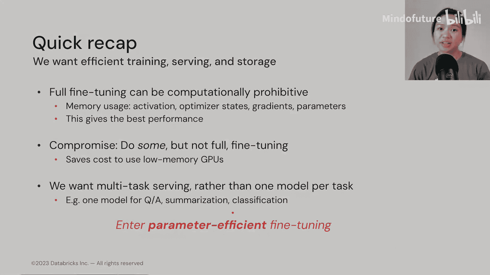

# 【Databricks】Llm模型底层基础 ｜ Llm： Foundation Models From The Ground Up p11 P11_模块_2-高效微调-2.2_模块概览 -BV1LZp9zXEab_p11-

In module1， we learn about the inner workings of transformers and the attention mechanism that infiltrate almost every LM architecture is out there。

As you might recall， a large language model is called large because of both the large amount of data it's trained on and also because of a large number of trainable parameters that it has so naturally that prohibits many individuals and organizations from training an LOM from scratch as such we to doing fine tuning which is a way of updating only a subset of model parameters。

In this module you will learn what fine tuning is and why we do it。

 you will also learn how we do fine tuning in a parameter efficient way and the limitations that come with that。

Lastly， since data power， all IOMs will' also talk about data preparation best practices that you can take home with to find tune in your own model。

Let's first start by demystifying what fine tuning is in a realm of deep learning。

 the term transfer learning is everywhere， it refers to when we apply a general pretrain model to a new but related task。

A common analogy that you might have heard about is playing sports if you know how to play tennis。

 you can probably pick up volleyball more easily because both require power。

F tuning falls under the umbrella of transfer learning。

 it simply means that we are training that model even more。

You may hear some differentiate both by saying fine tuning applies when we changed or modify the architecture of the base model where we unfreeze a few top layers of the base model and train those layers in addition to the new layers that you have just added。

But there's really not much need to differentiate them such so finding， and in fact。

 most people reference them interchangeably， including Andrew g and also And Kaarti as well。

You can think of fine tuning simply as training a base model even more and or training a base model on more data or different data。

The pretrain model that we talked about is also often called as a foundation model or a base model。

 especially in the context of LRMs， generally speaking。

 there are three ways of leveraging these foundation models The first way is simply to use them as they are and the examples of this pretrain models are everywhere you know including T5 GBT4 Bberg GT。

The second way is to use the output of these foundation models as a feature in this instance we can use the output embeddings from the base model and feed that into another machine learning model to generate predictions so this is a very common use case of bird embeddings。

The third way， which is what we'll focus on in this module， is fine tuning。

 where we may update only a few top layers of the base model or update all layers or add some layers before we use the model to generate our desired predictions。

We'll look at one of the newest LM examples in this category， which is a model called Goat。

Unsurprisingly， another farm animal。It is a fine tune version of Lama to perform aromatic operations。

 so we'll return to gold in a few slides。Why fine tuning。

We want to have better performance in a downstream task we can find tune a specific pretrain language model on a task specific data。

 adapting to a specific style and vocabulary。And this can also help us to achieve regulatory compliance as well。

But this idea is not new at all， in fact， in 2018， Jeremy Howard and Sebastian Rur published a paper on fine tuning techniques that we can use for any NLP task。

 and one of them is to fine tune a classifier layer on a target task by gradually unfeeezing layers。

To put it simply， fine tuning means we are updating model weight or model parameters。

Usually when we update more layers， we get better model performance。And typically。

 when we do full fine tuning， which means when we are updating all the model ways。

 we produce one model per task。On the right image over here。

 you will see that we can find tune bird on different data sets， on Sat which is a Q&A data set。

 a name entity recognition data， a multigen natural language inference data set。

Each of these fine tuning processes would give us a new model。

 so we serve one model per task at deployment time。

But this means that we need to deal with many copies of the same foundation model。

 and this is especially undesirable when our models these days are much bigger than this 110 million bird model。

Disk space is cheap these days， but some models like Lambda， which is a family of models。

 specialized for dialogues， takes almost 500 gig of disk space。

So another question is that we need to consider at deployment time。

Do we have that many input requests for specific tasks？Next， for full fine tuning。

 it may also produce an undesirable consequence called catastrophic forgetting。

 which is when the foundation model that we trained or we leveraged before already forgot how to perform other pretrain tasks。

So full fine tuning is expensive， how do we avoid doing it there are two methods。

 one is skillshot learning， the other is parameter efficient fine tuning。

Before we go to parametermeter efficient fine tuning， which is why we often abbreviate as PAed。

 we'll briefly look at what fuel short learning is。

Fuual learning is when we provide several examples of new tasks in a text prompt。

 we typically use this when we don't want to do fine tuning or when we lack label training data。

 but we can easily write out a few examples for the LLM to learn from。

So this process of writing out instructions in a form of text is called a prompt and we iteratively write different prompts to find out the best prompt to pass to an LOM and this is a process called prompt engineering。

So this process of developing prompts can also be called as prop design。

And especially important for this particular module well be referring to prompt engineering as heart prompt tuning or discrete prompt tuning。

 so just know that whenever I refer to heart prompt tuning or discrete prompt tuning。

 I'm really talking about field shot learning。And the main distinction that we should make between field shot learning and fine tuning is field shot learning doesn't update any model weights。

 whereas fine tuning updates model weights。F shot learning is also commonly known as in context learning because we provide LOM some context to learn from。

Or to leverage during its output generation process。

The pro for such few shot learning is that there is no need for label training data。

And we don't have to create any copy of model for each new task。

 so this can greatly simplify our model deployment process。

Probably the nicest advantage of all is that the tax prompts that we pass in can be very easily understandable because those are the inputs that we humans craft as text to pass to the LN。

But the con is that even though we get the advantage of being able to interpret a tax prompts。

 everything is manual and labor intensive。The prompts can also be highly specific to models。

 which means when you change to a different model， you may need to develop a new prompt altogether。

 and we also often encounter the limitation of context length。If we were to add more examples。

 then that would give us less space for instructions。

But if we were to use a model with higher context window or larger context window。

 then that will also give us higher latency as serving time as well。

There is also a recent research paper that shows that。Longer context windows may not be the solution。

 for future ROMs， because ROMs tend to also forget the middle portion of the contact that we provide。

So lastly， this is really the reason why we turn to fine tuning。

 which is that even with field shot learning， the model performance might still be lackluster。

So here is an example of fine tuning that outperforms field shot learning。

 which is our goat 7 billion parameter model。The foundation model is Lama and is trained on a million synthetic data examples。

And we find that the accuracy outperforms the few shot learning as model over here， Palm model。

 which is a 540 billion parameter model。He also outperforms GT4 on aromatic tasks as well。

But in fact， GPT4 almost doesn't do that well across all the aromatic tasks。

We also see that this goat model can achieve sit of the art result on an aromatic benchmark。

So this is a model that falls under a supervised instruction fine tuning realm。

 is trained using a paed technique called Laura and is a technique that will dive into a couple sections later on。

Before we move on from Go， I want to call out two important things First is that it's an instruction fine tune model。

And the secondly， it can perform multiple tasks at serving time。So the first task is addition。

The second task is subtraction， but mixing it with some natural language。

The third task is multiplication。And the fourth task is division。

 so you can see that there's no need to produce one model for each of the mathematical tasks over here at serving time。

 where're using one model to rule all of the Ametic tasks that we're providing。To the LOM。

Now let's look at a couple other examples of popular instruction to multitaask LOMs。

 the first is called Fl， which stands for fine tune languagegu net。

The foundation model is a 137 billion parameter model and is fine tuned on over 60 NLP data sets with different task types。

An example of different fl flavored models is T5， Fln T5， or flt palm。Another model。

 example in this category is Dolly， where the foundation model is Pythia 12 billion parameter model and is fine tuned on 15。

000 pairs of prompts and responses。Now that you have seen a few examples of fine tune models let's recap the goals that we want to accomplish with these fine tune models we want efficient training。

 we want efficient serving and storage， usually full fine tuning is computationally prohibitive for many organizations even though this gives them best model performance so the compromise for those with smaller budgets is to do some fine tuning but not full fine tuning。

We also want this LOM to be able to do multitask serving rather than serving one model per task at deployment time。

So we will enter parameter efficient fine tuning in the next section and we'll go over some of the most popular techniques here。

