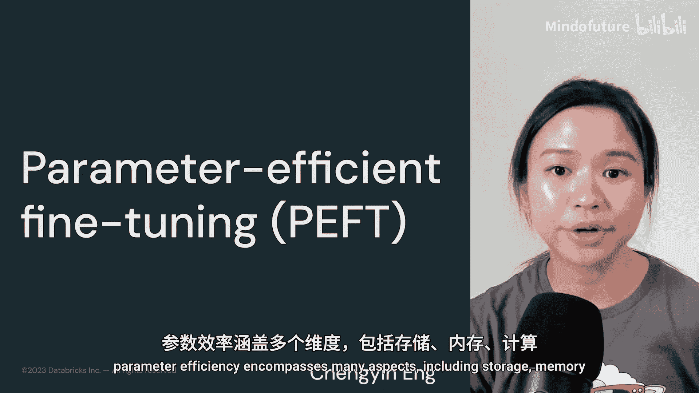
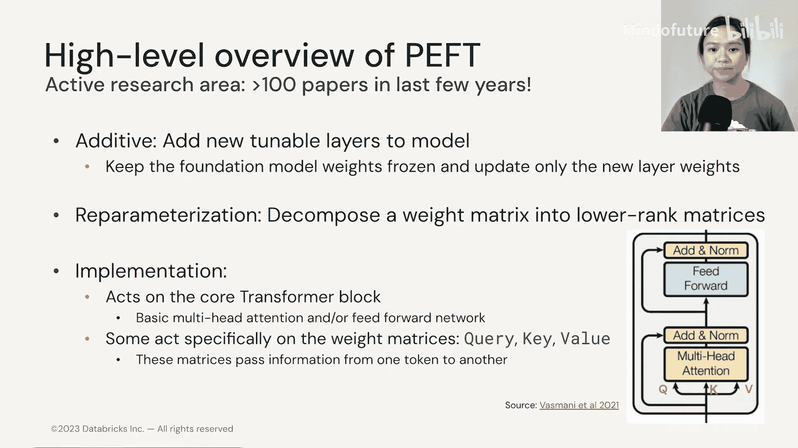
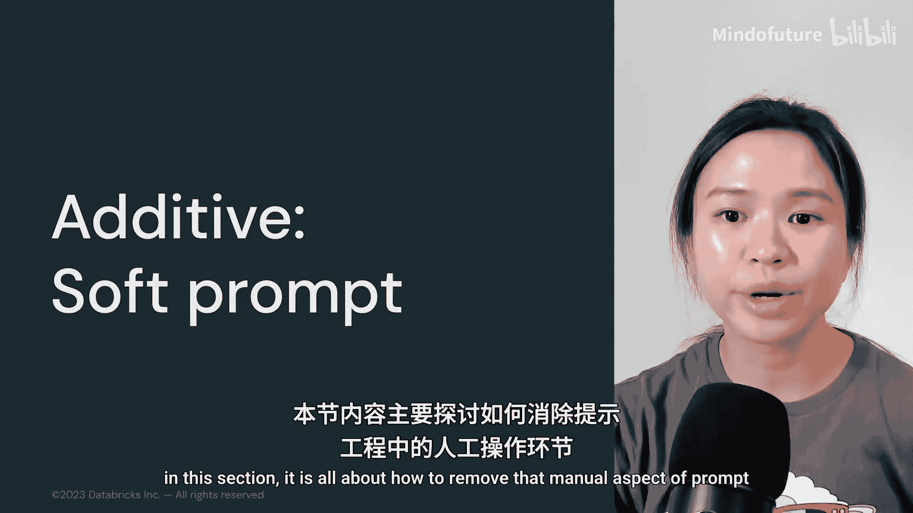
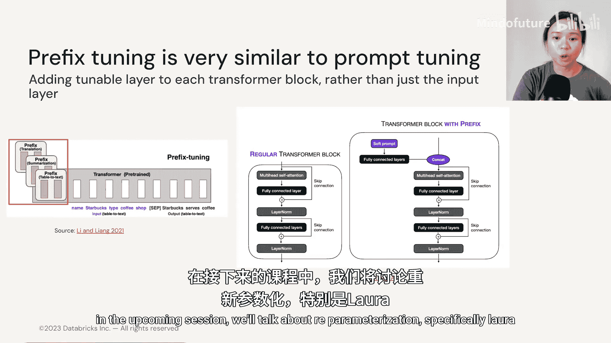

# 【Databricks】Llm模型底层基础 ｜ Llm： Foundation Models From The Ground Up p12 P12_模块_2-高效微调-2.3_PEFT_和_软提示 -BV1LZp9zXEab_p12-

In this section， well talk more about what parameter efficient fine tuning is parametermeter efficient fine tuning is often abbreviavated as PEft。

Prirameter efficiency encompasses many aspects， including storage， memory， computation。

 and also performance。

There are three categories of Pft， including additive， selective， and reparaization。In this course。

 we'll focus only on the first and the third category。

 which is additive and also reparametererization because a selective category is found to be not as good as the other two。

But if you are interested in the selective category methods。

 feel free to check out the links that've provided in the slide deck。

Pth has been a very actively researched area。At its core。

 additive methods include adding new tunenable layers to the model。

 and during fine tuning process we only update those new layer weights while keeping the foundation model weights frozen。

Reparameterization involves decomposing a weight matrix into lower rank matrices。

 will dive more deeply into all of these methods in a slice to come。Fundamentally。

 these methods act on the core transformer block， some act specifically on the query key value weight matrices that are responsible for passing information。

Without further ado， let's talk about soft Pro。If you recall from the last section。

 the manual act of writing text prompts is also called hard prompts or discrete prompts in this section it is all about how to remove that manual aspect of prompt engineering but use soft prompt instead。

Adding soft Prom means that we're adding virtual token store our inputs。

Take a look at the graph fake over here where I have text inputs。

 so we often call this as text embeddings。These chips are tasty。

 but soft pranged means that we are now adding virtual tokens。

And we'll talk a little bit more about virtual tokens in the next slide as well。

 but for now just know that these virtual tokens are task specific。

 so whenever I mention soft prompt you should immediately think of soft prompt as virtual tokens and they are synonymous。

So the soft prompt has the same dimension as our input embedding vector。

 so you can see that it spans the same length over here from top to bottom。

We concatenate this trainable virtual prompt or the virtual tokens or the soft prompt with the input embedding vectors during fine tuning process。

 and we call this prompt tuning rather than model tuning because we are only updating the prompt waste。

 which is the ones in pink over here。So what are these virtual tokens remember that the challenging part with prompt engineering or writing discrete prompts was that it's very manual and very labor intensive and very error prone。

 so instead of relying on humans crafting a perfect prompt in soft prompt or virtual tokens we let the model find the best prompt through fine tuning。

We first randomly initialized an embedding vector that's just made up of random numbers。

And this vector will have the same dimension as our input embeddings。

So this randomly initialize embedding vectors since they are completely random。

So they are not part of any vocabulary， we don't know what text they correspond to。

So on the right hand side， the graphic over here， you can see that when we have real word input tokens。

 we can visualize them in an embedding space and know exactly。

What word it represents or what token it represents。

 but when we look at virtual tokens in an embedding space。

We know that it occupies somewhere in the embedding space。

 but we don't know what text it corresponds to。So it's a little bit like Bitcoin when we know that it functions like money。

 but we cannot touch it like cash， we don't even know how it looks， but it exists and it works。

In some research。We have also seen people initialize these virtual tokens to represent discrete prompts it means that we are providing some minimal discrete prompts for the model to start with。

 and then the model is free to update embedding vectors during the training process so for example。

 my discrete prompt can be as simple as a three word prompt。

 classify this sentence or translate this sentence。

And those discrete prompts will then be free to be updated as the model is fine tune。

So that initialization to discrete prompt is also called as informed initialization。

But what is interesting is that this paper has also found that random initialization。

 which is when we set the prompts to random numbers instead of specific text input。

 is nearly as good as giving an informed initialization。

 which is when we pass in really simple prompt input。Text prompt input。

 like classify this text or translating this text。So in the notebook later on。

 we'll play with both types of initialization， random initialization and this informed or discrete prompt initialization。

 so that will help reinforce or make the ideas of random initialization and informed initialization more concrete。

Let's now first take a look at what prompt tuning involves by comparing it with the full fine tuning scenario。

We're sticking to the sentiment classification scenario。Now， instead of having just one input。

 we are having multiple inputs， which is why we're defining a task batch to be four because we have four sentiments to classify in total。

Notice that virtual tokens are really just random numbers。

 so they don't correspond to any specific vocabulary or specific text。So just like fine tuning。

When we do full fine tuning。We update model weights based on loss through backdrop。

 but the entire foundation model is unlocked or。Un'fro so that we can update all the model weight during the back process。

In contrast to prompt tuning。You can see in this diagram that the foundation model weights are completely frozen。

 so when the model goes through forward pass and also backpro。

 we only update the virtual token weights here。So these virtual tokens or these soft prompts are basically learned through backpro and tune to incorporate signals from any number of label prompts that we provide and we only apply the gradient updates to these virtual embedding vectors。

To recap。When we think about manual prompt engineering or discrete prompt writing。

 which is when we supply， just like in a few short learning examples。

 where we supply some examples and pass in as context to the LOM。

 that' when we are searching the text space over tokens with fixed embeddings。

 but with prompt tuning， we're searching in the embedding space to find the best representation of the prompt that the LOM should accept。

And the best thing all of this is the model learns the optimal representation of the prompt automatically so that removes the manual labor of engineering or discrete prompt。

So far， our example only includes a single example of task sentiment classification。

But what if we have multiple tasks， including Q&A， translation， etca？

That's not a problem because we can treat each task as a prompt for each prompt。

We would specify that for each task， so for each task there will be a different soft prompt altogether。

 so that way at deployment time we don't need to swap in and out the base model or the foundation model what we need to do is to only swap in and out the learned virtual tokens。

The other benefit is that the model can now process a single larger mixed task batch。

And a task batch over here can consists of multiple。

Request you can see now it not only has sentiment classification。

 but it can also take in a Q and A request or a translation request and。

The variety of tasks that is captured in a batch is what we call as a mix。Task batch over here。

What researchers has found is that for larger models。

 especially at more than 11 billion scale parameter scale。

 prompt tuning matches the performance of full fine tuning。

Super gluelue score is a benchmark that's spell after glue that contains a variety of tasks including answering boolean or comprehension questions。

 so the higher the score， the better it is。We can see that soft prompt tuning doesn't perform as well when a model is small。

 which intuitively makes sense because smaller models have smaller capacities to learn。

But when the model gets larger， now we can see that with full fine tuning versus prompt tuning。

 we can see the performance actually is very similar。

And I also want to call up with this image that prompt design is referring to the manual prompt engineering that we have to do。

Prompt length also doesn't really make that much of a difference for large models performance。

 so what is prompt length？You can see in this example。While we initialize our virtual prompts。

 there are only two embedding vectors over here， so this is a prompt length of two。

Larger models do well， even when the prompt length is one。

 and in fact there seems to be diminishing return， diminishing return in model performance as we increase the prompt length。

A prompt length of 100， which is the green one over here， seems to be the sweet spot。

 but also notice that the confidence bar for the scores。

 for the super gluelu score is also quite wide， so soft prompt tuning has the problem of unstable performance。

Let's recap the advantages of prompt tuing。Unlike field shot learning。

 where we have to do manual prompt engineering， we are not limited by the number of examples that we can pass to the model context。

We also eliminated a challenge of crafting the best prompt manually we can use backpro to ask a model to help us find the best embedding representation of the task specific virtual prompts We don't need to have multiple copies of the same model。

We can afford to have multitask serving。And lastly， it is also resilient to domain shift。

What this refers to is since we freeze or we lock the foundation model ways。

 prompt tuning prevents the model from modifying its general understanding of language。

 therefore it reduces the model's ability to overfit on your fine tune data。By comparison。

 our learned soft prompts also have a much smaller number of parameters so they can be more generalizable to variation of inner task at inference time。

Of course， as we saw earlier， prompt tuning has some disadvantages。

You probably have been wondering the whole time or even in the beginning too you know how do you know what these virtual tokens are the answer is we don't really the best attempt interpreting them is to use some cosine distance or some distance metric to find our nearest neighbors so we can estimate or guess what words they might represent so it is much less interable compared to discrete prompt。

The second disadvantage as we saw just now is promptmp tuning can have unstable performance。

Under the category of soft prompt， theres another very similar method called prefix tuning。

 so prefix tuning is very similar to prompt tuning。

It also allows task specific prompts where each prefix represents a different task。

 the only difference is that these prefix layers are added to each transformer block rather than just the input embedding layer。

So this wraps up our discussion on the additive category of Pft， which is soft prompt。

In the upcoming session， we'll talk about ray parameterization， specifically Laura。

