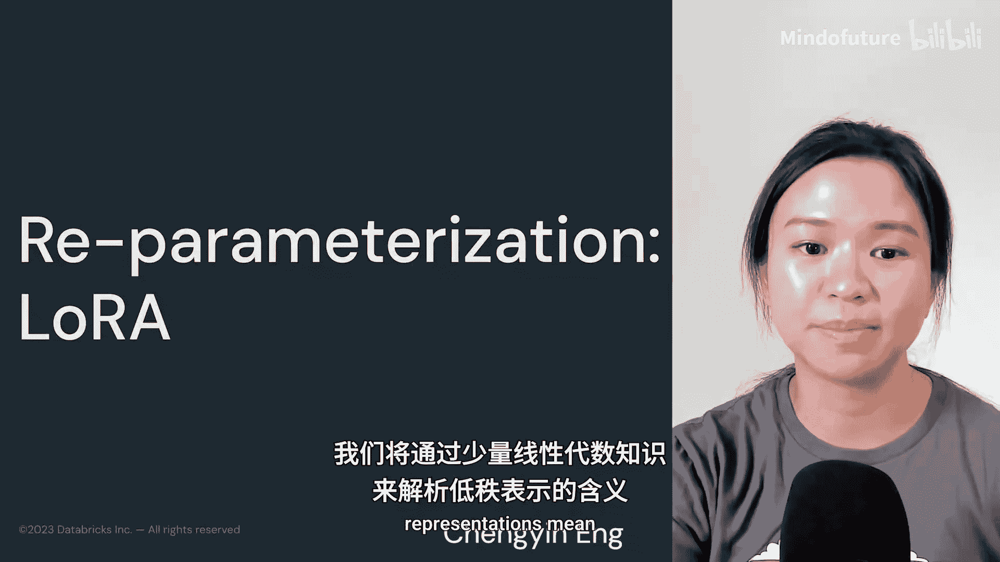
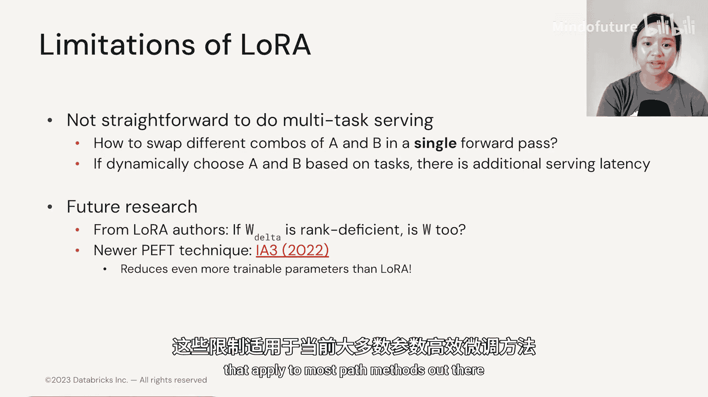

# 【Databricks】Llm模型底层基础 ｜ Llm： Foundation Models From The Ground Up p13 P13_模块_2-高效微调-2.4_重参数化-LoRA -BV1LZp9zXEab_p13-

In this section we'll talk about one of the most popular techniques today in PET。

 which is Laurara Lora is a re parameterization method。

 which means it leverages low rank representation to minimize a number of trainable parameters will cover a small amount of linear algebra to dissect what low rank representations mean。

In fine tuning or any general model training scenario。

 we update the model weights as we go through forward and also backward path。

The idea behind Laura is that we can decompose the weight Dlta metric matrix into two low rank matrices。

What difference does it make， you may wonder， before we can answer that question。

 let's now briefly revisit linear algebraar basics to understand what matrixtri ranknk is。

Rannk refers to the maximum number of linearly independent columns in a matrix when you have a full rank matrix。

 it means that the matrix doesn't have any redundant rows or columns that can be expressed based on other combinations or columns of columns。

So take a look at an example of below over here， since column two and column three can be obtained by multiplying column one with a constant。

They are not linear and they are not independent； therefore the column rank is one。

The same applies to the second row as well because we can gather the second row by multiplying the first row by three。

So essentially， we are trying to make sure that we represent information in a matrix without any redundancy。

So how does weight matrix decomposition work？The observation that inspires Laura is that the rank of the attention weight matrix change。

Is lower than the actual weight delta matrix， so when we do any fine tuning。

 we can freeze the pretrain weights。And only update the two lower rank weight matrices as demonstrated by WA and also WB over here。

But how does this reduce the number of trainable parameters， Let's take a look at a dummy example。

Say that W Dlta has dimension of 10。Times 100， we can decompose that to two smaller matrices。

 W A with100 times two dimension and W B with a dimension of two times 100。

When we multiply these two matrices together， they still give us the same shape as 100 times 100。

 which is the same shape as W delta。And this is really important because we can now then concatenate the results of these matrices with the original pretrain waste and pass that to the subsequent layer。

And this decomposition method。Dramatically reduces the number of parameters。

 so a total number of parameters that we see over here is 100 times 2。Plus 2 times 100， which is 400。

 but if we were to get the number of parameters from this original W delta matrix， then we have 10。

000 parameters altogether， so this brings us to a 96% of reduction in number of trainable parameters。

Researchers found that Laura matches the performance of fine tuning and sometimes even outperformed fine tuning with just 0。

02% of the original parameters of GBT3 over here。The next natural question to ask is。

 how do we determine the rank of these matrices？We can treat that as a hyperparameter to search over generally。

 rank sizes produce roughly similar。Validation acuracies， at least for GP3， intuitively speaking。

 though， small are likely won't work for all tasks or data sets because in cases where the downstream tasks are much more different than。

The original task that the base models train on。But the researchers have also played with updating different combinations of weight mattressrices for decomposition。

 but there were no clear trends to take away from。In a nutshell， Laura， just like prompt tuning。

 locks up or freezes the majority of the model weights。

 you can share or reuse the same foundation model， you can improve training efficiency since you don't have to compute most gradients or optimizer states It also adds no additional serving latency because we can merge WA。

And also WB， literallyly。We can also combine it with other PA methods as well。However。

 the existing Path library from Huging F doesn't allow a combination of path methods to be concurrently used yet。

In the lab notebook that we'll be exploring later， you will be asked to apply Laura as a fine tuning technique。

Now let's talk about some of the limitations of Laura。

Even though we could theoretically just swap different weight update matrices at serving time。

It is not really straightforward on how to do so using when we have a single mixed task batch。

If we want to dynamically choose which combost of weight matrices A and B as serving time。

 then there's additional serving latency。But there are also， of course。

 other open research questions as well such as why do we only decompose W Delta？

Can we decompose other matrices like the original weight matrix。

 or can we reduce the number of parameters even more？And in fact。

 there is already a newer path technique called IA3 that improves upon Laura that can reduce even more number of trainable parameters。

In the next section， we'll do a general walkthrough of PA limitations that apply to most PA methods out there。

