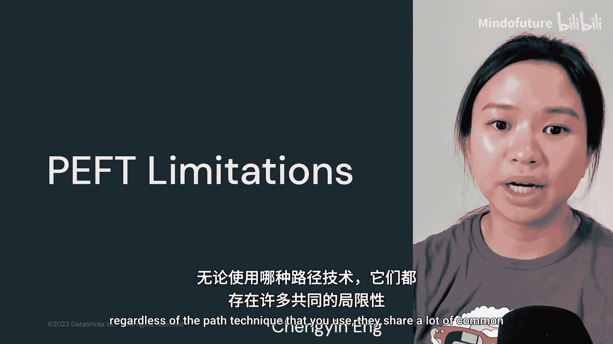
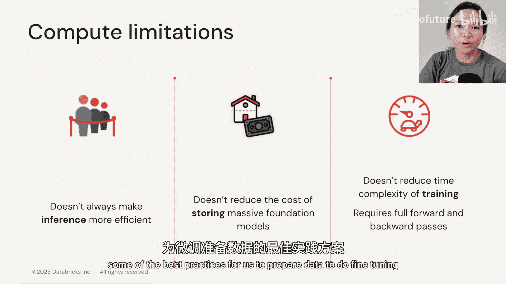

# 【Databricks】Llm模型底层基础 ｜ Llm： Foundation Models From The Ground Up p14 P14_模块_2-高效微调-2.5_PEFT_局限性 -BV1LZp9zXEab_p14-

As trendy and as promising prompt tuning or Laura sounds， Path in general is not perfect。

 regardless of the pathth technique that you use， they share a lot of common limitations。

 so let's first look at it from the angle of model performance。

Even though in many instances they can match the performance of full fine tuning。

 it is really hard to have stable performance that can outperform full fine tuning all the time because path can be very sensitive to hyperparameter changes it is also not very clear why we choose to use PAft where we use them currently。

 for example， why do we only apply p to attention rate matrices。

And perhaps we should not give up on full parameter fine tuning yet。 So far。

 Pft has been focusing a lot on storage reduction in terms of how we can reduce the storage of multiple copies of the same foundation model。

 but storage is only one of the pieces。 There is a group of researchers。

They just released a research paper in June this year that invented a new type of optimizer called LoOMO that can reduce memory footprint to only 11% of the original footprint that it requires。

The second angle that we can look at is the compute limitation。

It doesn't always make serving or inference more efficient。

And it doesn't remove the cost or reduce the cost of storing the single copy of massive foundation model。

And lastly， we still have to undergo the same time complexity of training because we require full forward and backward passes for PAth as well in the next section。

 which is the last section of this module， we'll be looking at some of the best practices for us to prepare data to do fine tuning。

