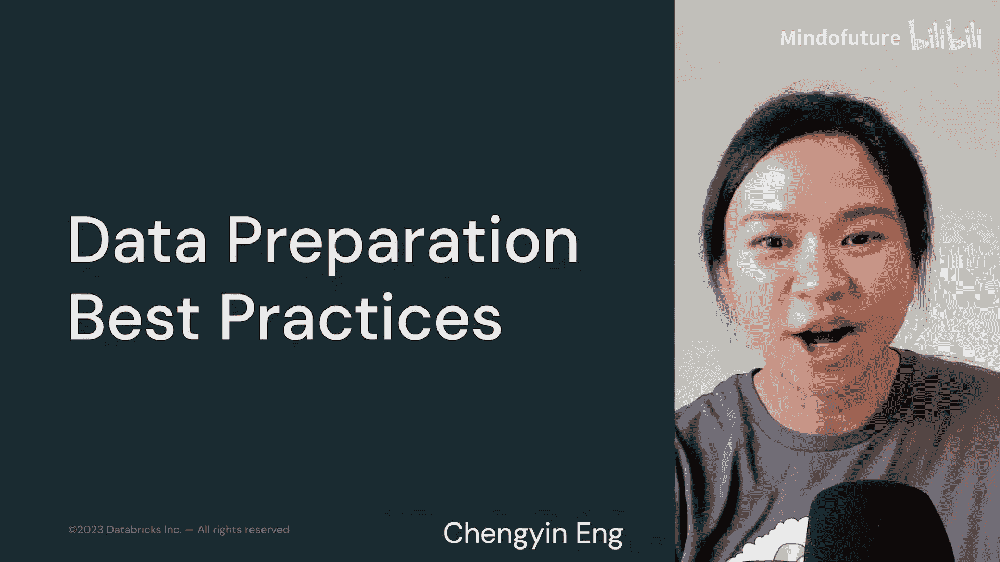
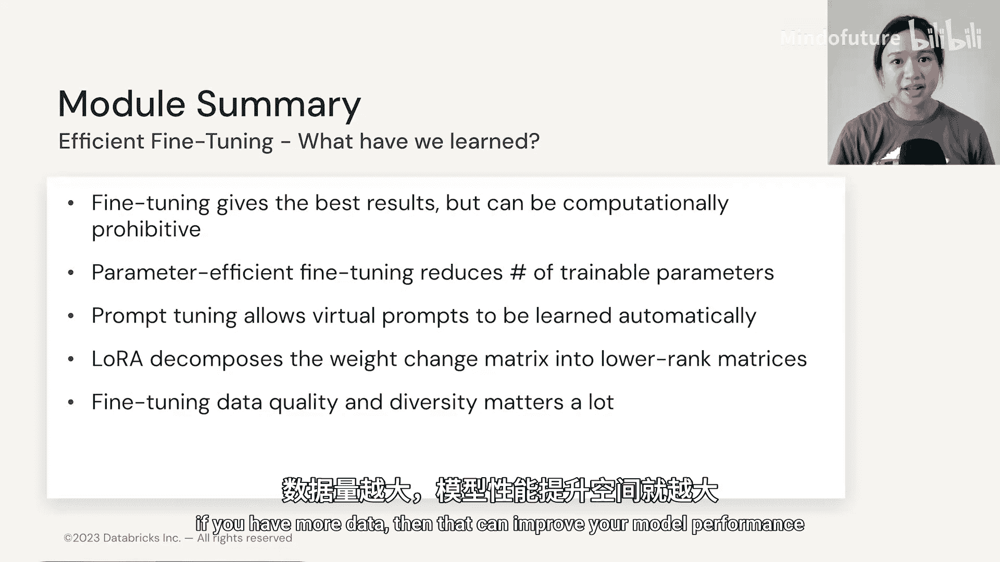

# 【Databricks】Llm模型底层基础 ｜ Llm： Foundation Models From The Ground Up p15 P15_模块_2-高效微调-2.6_数据准备最佳实践 -BV1LZp9zXEab_p15-

Finally， in this section， we'll wrap up with data preparation。

Best practices， which is the prerequisite to doing any good fine tuning。

 This is often the most challenging part in any M project。 How do we collect data。

 How do we prepare the data well。

Hopefully I don't need to convince you that better models come from better training data。

 Many high performing LOMs that we hear a lot about these days involve a lot of intentionally curated data for example。

 the MPT series and Alma series both use an improved version of the common C data set called C4 C4 stands for a colossal clean C corpus can click on a link on this slide to learn more about C4。

GBT Neo and GTJ， which are the open source alternatives to GT3 are trained on the dataset called the pileL。

 which consists of 22 diverse and high quality dataset sets GTJ is on par with GT3 for zero shot use cases and GT Ne is better than the ADA variant of GT3 for sentiment classification。

Training data does make the biggest difference。If we look at another example of LOM that caused quite a big whip in the news press。

 which is Bloomberg GPT， we'll realize that Bomberg curated its own data set of English financial documents。

 spending over 40 years of data and augment that data with public data。The result is remarkable。

 it outperforms existing models on financial tasks。So now you may think to yourself。

While all these models leverage a huge amount of data， like billion scale tokens。

 do I have enough data？You might be surprised that some research papers demonstrate that you only need a couple hundred high quality label examples。

 and this is from a use case study of Lama's 65 billion parameter model。

But when you scale up the data quantity， you also need to make sure that your data covers the diversity of use cases that you wish to leverage your model for。

From Open AI， they also recommend at least a couple hundred use cases。

 but if you were to be able to double the data set size。

 it can usually lead to a linear increase in model performance。So how do you get more data。

 perhaps synthetic data is the way to go。You can either do a synonym replacement or rewrite。

You can do some word deletion where you remove some adverbs， probably。

You can also swap word positions。And the last one might come as quite surprising to you where we add noise intentionally。

 where we introduce typos in our data set。But above all。

 if you want to tune your best instruction following model。

 the same best practices also apply when there's more diversity of use cases that you expect then you need a higher quantity of data samples。

But all of those samples should be of high quality。Open AI did release more tips on formatting。

 so feel free to click on the link reference below this image over here。 But generally。

 you can see that there's。Not really any need to provide very detailed instructions。

 you only need to provide your prompt in your completion。

 and you can use different demeters or separators to inform the model when the prompt ends and when the completion begins。

But the separator shouldn't appear anywhere else。On the right hand side。

 you can see a group of researchers have also manually compiled high quality prompts before fine tu their model。

Preparing data is definitely a non trivial task， we need to manually verify data quality。

 remove any undesired data， including offensive and toxic content。

 or any private or confidential information。Lastly。

 I want to call out that using LM output as though data is not always the answer。

Because these downstream models or imitation models tend to learn style rather than the content that you pass into the model and this is also consistent with another research paper that just came out as well where knowledge of a model is largely learned during pretraining。

So if you want to find your model， make sure to pick a foundation model that's trained on tasks or data sets most similar to your downstream task。

Now let's recap what we learned in this module。We talk about how fine tuning often gives the best results but can be computationally prohibitive。

 if that's not an option for you， then that's where we explore parameter efficient fine tuning because it can reduce the number of trainable parameters by a lot。

One of the methods that we look into is called prompt tuning。

 which falls under soft prompt or the additive category。

 it can allow virtual prompts to be learned automatically。

 removing the knee of manual prompt engineering。The second method that we looked into is called Laurara。

 which is a re parameterameterization method that can decompose the weight Dlta metrics into lower rank matrices。

Lastly， fine tuning data， quality and diversity matters a lot if you have more data then that can improve your model performance。

Now let's turn over to some code to look at how we can apply prompt tuning in our demo notebook and how you can then apply Laura in your lab notebook。

