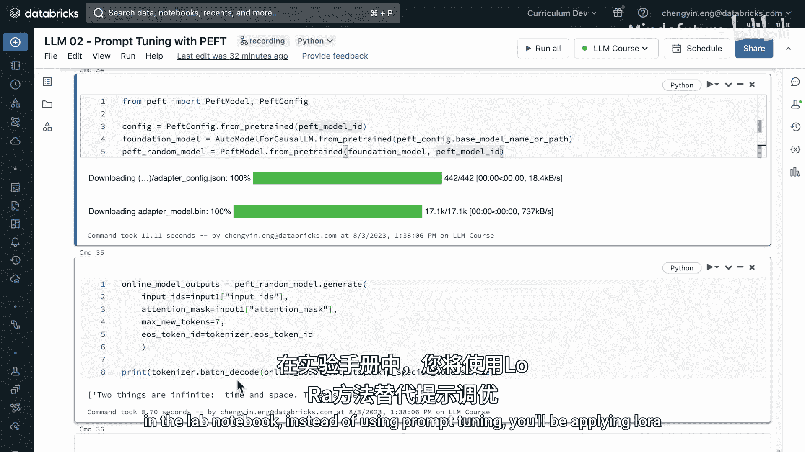

# 【Databricks】Llm模型底层基础 ｜ Llm： Foundation Models From The Ground Up p16 P16_模块_2-高效微调-2.7_笔记本 -BV1LZp9zXEab_p16-

In this notebook we'll be using a library developed a hugging phase called parametermeter efficientff finening abbreviated as Pft This pathft library supports multiple methods of Pft if you are curious what。

Methods hugging phase is implemented， you can check out that documentation。

 scroll down to the bottom left， and youll see that they have Laura prompting and also IA3 implemented。

In this demo notebook， we'll be using prompt。There is also only a subset of models and tasks that are supported by this library for time being and if you're interested to learn more about it。

 definitely check out their documentation as well。So first of all。

 we will download Paft and also download the classroom setup。Once this is done。

 we can proceed with the Excel cell where we are calling the auto classes to help us retrieve。

The relevant model and tokenrs。Some of you might have seen these autocast before。

 it is a very convenient class by hugging face to help us to automatically retrieve the relevant models and organizers given the pretrain models that we are interested in。

We'll use a causal language model or also known as autoregressive model to generate text。

And this pretrain or foundation model that we're using is called Bloom Z。

If you're interested in checking out Bluezy， definitely read more about the model here。

 it is trained on a multidi lingo data set span across 46 different languages and also programming languages as well。

So we are going to load the tokenr and also foundation model from Bloom Z on Hing face。

In this notebook I want my model to be able to generate inspirational English quotes before doing any fine tuning。

 I'm going to see how my foundation model currently performs on the input sentence that I provide without doing any fine tuning so that's what we would do in the following cell over here。

Where we provide input。Of two things are infinite and will'll ask the foundation model to generate the output text。

And you will see over here that the output text is。The number of people and the number。

So you will see that this is not too bad of a response。

 but I'm curious to check after we fine tune this foundation model based on inspirational English quote data set。

 whether the model will give us more inspirational quotes。

So the data set that we'll be using is called English quotes。

Let's check out what this data looks like。So it's a data set that has quotes from famous people and we are going to basically。

Fine tune our Blooms Z model on this data， hopefully by the end of the fine tuning process it will learn something about being inspirational or philosophical so that outputs can also have such characteristics as well。

The speed of the fine tuning process will fine tune only on 50 examples of the inspirational quotes。

So now that we have our data set and also our foundation model ready。

 we are now going to start with fine tuning。Well apply prompt tuning as our first path technique。

 remember that prompt tuning allows both random initialization and text initialization。

In this section， we'll first use random initialization and then text initialization so that we can compare the tax output differences。

Without further ado， we are going to start with random initialization and all we need to provide as you can see over here。

 is the length of the soft prompt， which is denoted by the number of virtual tokens。

 and we're also going to specify the task type which is causal language modeling and specify that we want random text random initialization。

And just like that， we're able to dramatically reduce the number of trainable parameters to less than 0。

01%。And this is the beauty of PAft because it's really easy to use。

 we can apply pathF to our model of choice and it will help us to reduce the number of trainable parameters。

Next we are going to use hugging phase traininger class and also training arguments to define our fine tuning configurations you can see over here that our training arguments would tell hugging face where to save our outputs。

 what is the batch size and what is the learning rate。

I want to call out that the learning that we are using over here is much higher than what we would do for typical full fine tuning because we're now using only a subset of parameters to fine tune。

 and that requires a higher learning rate to be more effective。

And here we are going to use a somewhat small number of training epochs。

 and epos just means the number of passes for the model to go through the entire fine training data set。

Now that we have the training arguments ready， we can pass this into to our trainer class Trainer class is a convenient class provided by hugging F so that we do not need to write our custom training loop。

If you' are curious about it， you can also check out their documentation。

They are trainer class over here， and you can also choose to write your training code using native Pytorch code as well if you wish。

But this is going to be easier if you don't have a lot of customizations that you need。

So in our trainer class， we are going to pass in our pathth model， our training arguments。

The fine tune training asem。And also how we are going to batch our data records。

 So data Col is a function that can help us to form batches and inputs to pass in the data。

 to pass into the model for training。We are also going to toggle this MLM flag to be false where MLLM stands for mass language modeling。

 remember that we are now using causal language modeling as our task so we will need to turn MLLM to be false。

Specifically。This data collateder for language modeling will also additionally add all the input to the maximum length of a specific batch because inputs can have variable length。

And now we're going to start training。So this training process of five epochs might take up to 10 minutes to train。

 and you might also see that when you run this cell， it will trigger a whole new ML flo run。

If you are not familiar with what MLflow is you can check out the documentation that I've linked here。

 it is a tool that can help us to manage end to end machine learning lifecycle and is open sourced。

 so in this case during the training process it will help us to track the hyperparameters。

 any artifacts and also any metrics that we specified。

So this is automatically triggered on Databricks。When the training is done。

 we can now save this model locally。We're going to specify the path。Of the model。

And then we' are going to use the trainer model to save it to this path。Of course。

 the next thing that we can do is to load this model from this local path and then ask the model to generate text based on our input before。

So here， notice that we are loading our foundation model and where we save our path。

And now we can ask hugging face to generate us。The rest of the output based on our input。

So you can see here that to this phrase， two things are infinite。

 now it generates the output of time and space。So this is maybe getting closer to being more philosophical and inspirational and also note that if you run this on your own。

 you might get a different response from what I'm seeing now or maybe even the same response as the foundation model。

 and that's just because we are not really fine- tunening for that long and we are not really providing that big of a fine-tning data example to this fine tune model。

So if you want the performance of this decoding to improve。

 then we should definitely fine tune for longer or provide a bigger set of fine tuning data。

But it does seem like it is maybe getting more inspirational based on time and space response over here and in fact。

 the input above。Two things are infinite is taken exactly from the training data set。

 so from the training data we could see that this is a quote given by Albert Einstein he said that two things are infinite。

 the universe and human stupidity， so definitely much more philosophical。

So now that we have seen how random initialization works。

I want to show you how text initialization works。So the only difference with tax initialization is that we simply add this additional argument of providing some starter prompt for the model to search over。

 so you can see that over here I have my prompt tuning init text to be generate inspirational quotes and I can also specify number of virtual tokens here as well and this doesn't have to match the number of words that you provide in the text prompt over here。

This just provides a starter for the model to start searching over。

 so it will start to learn from this。Genererate inspirational quotes and then find the best embedding representation for your prompt。

So the rest of the steps。Will be exactly the same。So we have our prompt tuing configuration。

Set up by setting up the text prompt and also changing this from random to text。

 and then the rest of the configurations to the trainer class will be the same where we pass in PE model training arguments or training examples and all the same data collateral as well。

 and then continue with training。我放 you。Roughly 10 minutes later， we'll have this。Model ready。

 and then we can also do the same thing of using this model to generate as an output and now let us compare the differences between random initialization versus tax initialization。

So you will see that now our tax initialization output gives us the output of the number of people that you can count。

So this is not too bad of a response either， even though this is not exactly two things。

 but you can see that for random initialization versus text initialization。

 there is really not much difference in terms of the output performance or rather I should say that the evaluation of how good these outputs are can be quite subjective and of course it is really hard to judge objectively how good the models are depending on the initialization based on just a single example。

 so I would definitely say that we need more examples to test on to properly evaluate whether text initialization or random initialization is better。

But the takeaway here is that text initialization doesn't necessarily perform better than random initialization and in fact。

 if you recall from the lecture， oftentimes random initialization can match the performance of text initialization and there is not much performance boost in terms of using text initialization so that is often one reason why people might opt to choose to use random initialization because that removes the manual labor of keeping track of the starter text prompt that you provide to the model itself。

Now let's look at the optional part of sharing this model to Huging F Hub。

 say that you have a model that you are really proud of and maybe you are really proud of the random initialization model that we just produced and we want to share with the rest of the Huging F community so we can choose to push our model to the Huging Face hubub。

All you need to do is to first create a free hugging F account， the sign up process is pretty simple。

 you will first have to go to the Huging F homepage and click sign up on the top right corner。

On the top right corner over here， once you are assigned in。

 then you are able to see that you have a list of models or data sets that you have posted to the Hging Face hub。

But before you can post your model to the Huging F hubub。

 you need to also first generate an access token。So you can go through step two and step three on your own。

 feel free to pause this video to get an access token。

The next thing that I'm going to do is to use databrick secrets to pass in this hugging phase token。

So that it can enormous my hugging face API key behind the scene。

If you are not sure how to use their secrets， you can visit documentation over here。

 or rather more easily Huging face also provides a helper logging method that prompts us to enter our token interactively So when I run this cell over here。

You will see that they asked me to put in my token over here。

 and then I can simply just copy paste the excess token that I've gotten from hugging face。

Put this in and then click login。And then if it recognizes that my talkingken is invalid。

 then it will tell me so， if not， it will stay successful。

 and that is how you can interactively log in to Hgingplace account。

So I'm going to use the hugging face key that I've already stored in my database secretrocope。

And the next step will be that you need to recognize first what is your hugging face username。

 so fill in this， fill this in with your own hugging face username and feel free to leave the rest the same and we are now going to push this model our Pft model to Huging F hubub。

 so I'm going to rerun this cell。And then now when I visit my hugging face H again。

I'm going to click on my top right button and I click on my profile。

And you will see that now I have a model push to my own hub less than a minute ago。

 which is this exactly。This is that model that I have pushed。

I can also go to files to check the configurations and also the model object itself。

So this is how someone can choose to load model from another person's hugging faceH。

 and you might have already done this without realizing before。

So say that now I've pushed my model to Huging Face Hub， which is this one right here。

 and I'm going to use this model from this path to generate my inference。

What I can do is simply provide the same pathth model ID。

And then provide a foundation model that I used before based on the configurations。

And then I will be able to load the model。And then generate output and you will see that the response that I'm getting for this random initialization model。

 time and space is the same as the first model that we saw above because it is the same model just that the location is different。

So there you go， you have successfully applied theft prompt tuning for the first time in the lab notebook。

 instead of using prompt tuning， you'll be applying Laura instead。

