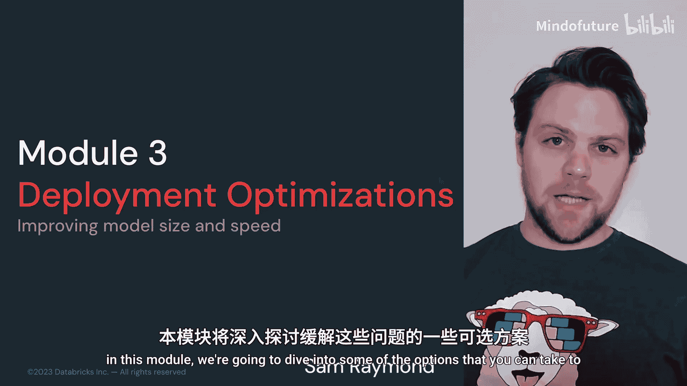
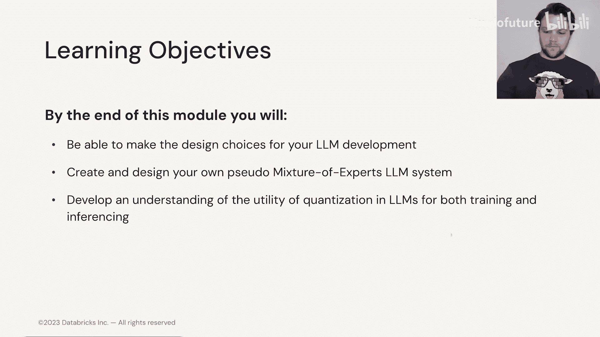
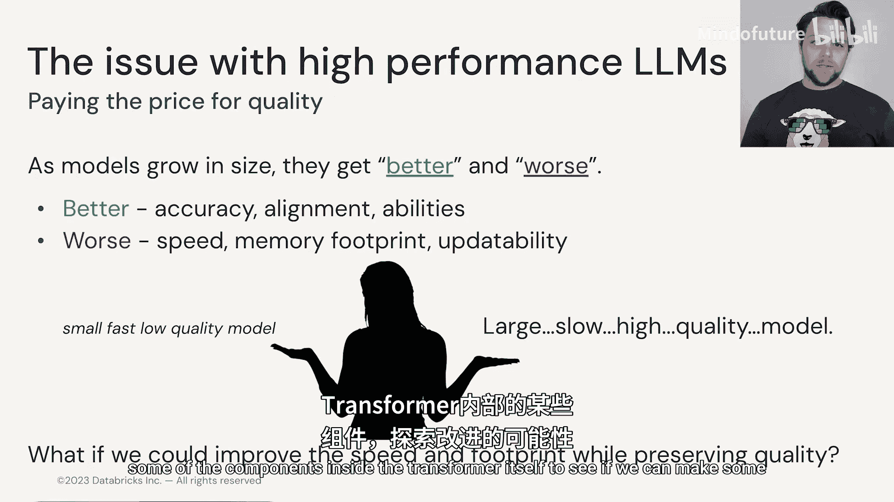

# 【Databricks】Llm模型底层基础 ｜ Llm： Foundation Models From The Ground Up p18 P18_模块_3-部署与硬件-3.2_模块概览 -BV1LZp9zXEab_p18-

Welcome to module 3 In this module， we're going to dive even deeper into some of the considerations that you can make to make the most of the compute and the time resources you have available In module 2。

 Cheang Yin showed us some of the parameter efficient fine tuning tools that we have available to us。

 Now， one of the reasons that we need to worry about these kinds of things is that large language models are truly large。

 in particular， in the sense that they are too large for a single consumer or even that sometimes enterprise。

 piece of hardware to manage。 This means we have to coordinate multiple pieces of hardware。

 And that adds its own complexity， cost and limitations。😊。

In this module we're going to dive into some of the options that you can take to alleviate some of these problems by the end of this module you'll be able to make different design choices not just for how to fine tune your large language model。

 but also to create the foundation or base models if you're doing pretraining。

You'll look at some of the mixture of experts approaches and how that creates a system where we can leverage multiple LLMs。

 but save on the cost of training and inference。We'll also look at how quantization can allow us to utilize large language models that have been trained already and convert them to smaller versions of them without sacrificing too much in performance。

So let's talk about the problem is now that we have with these large language models that're becoming extra large。

What this comes down to is really memory We found that these large language models that have hundreds of billions of parameters don't tend to fit on consumer or enterprise GPUs。

We've seen from our very large language models that as they grow in size。

 they tend to perform better both with the accuracy of their output。

 they're able to be better aligned with what we need them to do。

 and they have much broader range of abilities to solve different types of tasks。However。

 this comes at a cost， particularly of speed which we even saw in moduled 1 when GPT2 extra largege took much longer to produce the output。

 the memory footprint， if you're a developer of live language models。

 then the out of memory error is something you're going to be all too familiar with。

 but also updateability， if we have new data that comes in and we need to keep training our models。

 the larger they are， the harder this is to do。And so we end up with a choice。

 Do we have to pick a small model that it is at least fast but doesn't have the quality。

 or do we try to work with a very large model and spend as much as we can on our compute resources to make use of that high quality。

Or what if we could do both？😡，What we're going to do in this module is we're going to take another look at some of the components inside the transformer itself to see if we can make some improvements and help alleviate some of these issues。

