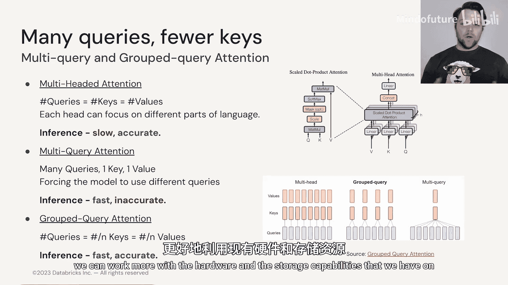
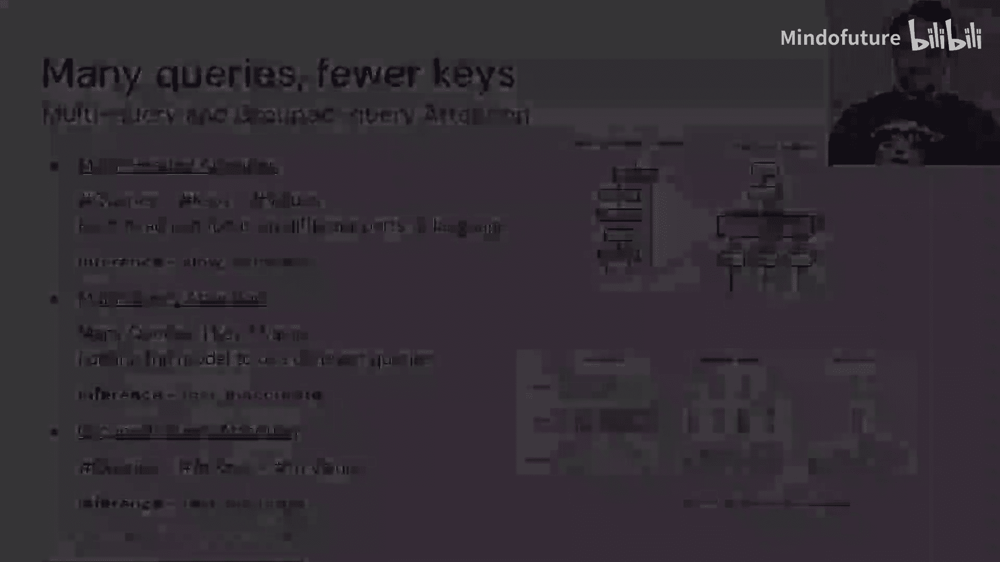

# 【Databricks】Llm模型底层基础 ｜ Llm： Foundation Models From The Ground Up p19 P19_模块_3-部署与硬件-3.3_提高学习效率 -BV1LZp9zXEab_p19-

One of the key pieces of technologies that unlocked large language models to be what they are today is the attention mechanism。

And while this is a wonderful tool that has enabled large language models to interpret text in a way that we didn't imagine possible before。

 it also leaves us with some issues that we've needed to come to terms with and find ways around。

If we think about how we interact with a large language model。

 we have to talk about the context length。That's effectively the amount of information that we put into one of the prompts that the large language model will use to interpret what it's being asked or the type of conversation that's going on。

Like us， we do better with contexts that are larger， so to large language models。However。

 increasing large language model context length isn't as simple as you might think。😊。

If you think about the attention mechanism and how that operates， in theory。

 you can have as long a context length as you want。

 the operations that go through the query key and value vectors。

Spanand across the entire sequence length， there's no limit of what that sequence length can be and that doesn't affect the parameters。

 the parameters are based on the dimensionality that you have for each of your word embedding vectors。

When we increase the size of the context length and we apply an attention mechanism over that context。

 the computing of input values increases somewhat linearly。

 performing the position wide feed forward neural network calculations also increases linearly。

 however calculating the attentions scores themselves， increases quadraically。

 and that's because we have a N by N matrix to deal with。However。

 even worse than this is the fact that if we train on a context length of， say 1000。

And then we perform inferences uncut tank lengths that twice as long as this or three times or10 times。

 the performance of the models is shown to get far worse。

One of the reasons that is likely for this is the positional encoding that we use when we give the information of how one token is related to another in position to the attention mechanism。

We saw in the notebooks that we use the positional encoding using these signss and cosines to give a relative sense of how these tokens are positioned relative to another however。

 it appears that this doesn't allow for the neural network or the attention mechanism to understand very well how these are different when we train on one length and test on a much longer length you can see the perplexity scores which is how well it knows which token to select next。

 get worse and worse as you change the number of context。

We can try and fix this by looking at the attention mechanism itself。

If you think about what is going on in the attention mechanism。

 we provide a query vector and look at all of the keys。Now， one innovation that was introduced。

 which is called alibi took an approach by weighting these particular pairs of vectors。

 the query times the key， and just applied a linear basis。

So that tokens that were one step away from the current query token were given a scale of negative 1 times by some factor。

 It turns out that a good factor and this is M in this case， is a geometric sequence。

You can learn more about this by looking at the paper in the link provided。

 but essentially this just gives a fading off of importance from the current token all the way back to however long that you might want your context to be What this means though is that you can train on a relatively short context length and increase it in inference to almost any size that you want。

This has enabled the context lengths to be at a maximum of something like 4000， all the way up to 32。

000， 64，000， and in some cases even larger than 100，000。

This means that we can add a lot more information into our context length。😊，Including documents。

 code bases and chat histories and we get even more performance from our large language models This is fantastic。

 however you might also then realize based on what we were talking about just before。

 that the compute resources required to have much longer inferences now become an issue。😊。

This is no longer an issue of storing the model on memory just loading the parameters in。

 but actually creating these attention weights themselves。

 they are now an issue that we'll have to deal with。Thankfully。

 this field is full of many smart people， and we've already come up with。😊。

Many solutions that can fix this problem， but in particular。

 the one that is catching most of the attention of the wider community is something called flash attention。

This leverages something that we've seen in linear algebra before。

 where we don't actually need to materialize these large matrices at all。

 we can actually do this in a matrix free operation。

Because we know which index of one vector will need to interact with the index of another vector。

 we can actually just take these individual variables one by one。

The reason that this is an important approach is because we need to look at the hardware that's used when we calculate attention。

If we think about what goes on inside the GPU when we're calculating our attention scores。

 we actually interact with something called the SRAM。

 this is akin to the cache that's on a CPU and it's basically very fast memory that's very small but very close to the compute units。

In the case of large language models， this SRAM gets overloaded very quickly when we try to load in the full matrix of the attention。

If we never actually materialize the attention matrix。

 then we can keep sending the individual variables to the SRAM and line it up so that we never have to go back to the slower memory and incur the performance costs that you would if you had to put the entire matrix onto this SRAM that just isn't large enough。

Using something like flash attention and its later variance。

 we see an order of magnitude speed up in calculating these longer attentions that are coming from the fact that we are now able to use longer contexts。

Looking even more at the attention mechanism， we can think of other ways that we can try and improve this process。

In the first module， we talked about。Attention， but we didn't talk about multi head attention。

 In essence， multi head attention takes the entire attention matrices of the key。

And value matrices and splits them into multiple heads This means that we send a query to a number of different matrices。

 but their sum total is the same size as if we just had a single matrix。

The reason that we might want to split this into multi headeded attention is it allows these different versions of keys。

 queries， and values to focus on different parts of the speech。

By splitting these up into multiple heads， you might have one head looking at nouns。

 one looking at propositions， and one looking at other partss of speech。However。

 while this produces more accurate results as we get a more detailed and enriched version of what we end up with at the end of our attention scores。

 this is slower as we have to do these calculations in multiple steps。

Some improvements to this have included multi query attention where actually we create different copies of our query vector and feed them into just one key and value vector。

The issue with this， however， while it is much faster than doing multiheaded attention。

 it tends not to capture all the differences in the nuances that we need when we're looking at something like a multiheaded attentiontion case。

The happy medium to this is grouped query attention。

 which is what large language models like Lama 2 leverage in this situation。

 while we have a number of different。Heads for our attention mechanism。

 we send them a few different query vectors。Keep in mind。

 these query vectors come from the same token， but they use slightly different projection operations so that we have different versions of those query vectors for the key vectors to look at。

This enables us to leverage the multi headed multi focus version that we get in multihead attention with some of the speedups in the multi query attention。

Grouped query attention is one of the latest innovations that we've seen so far in improving the attention operation。

😊，We'll see more and more as this develops in the field， however。

 we're now starting to find different ways of improving on the transformer as it continues to mature into a more refined version of what we started with back in 2018。

Now that we have all of these different algorithmic improvements。

 we'll also look in the next section about how we can work more with the hardware and the storage capabilities that we have on offer。

😊。

