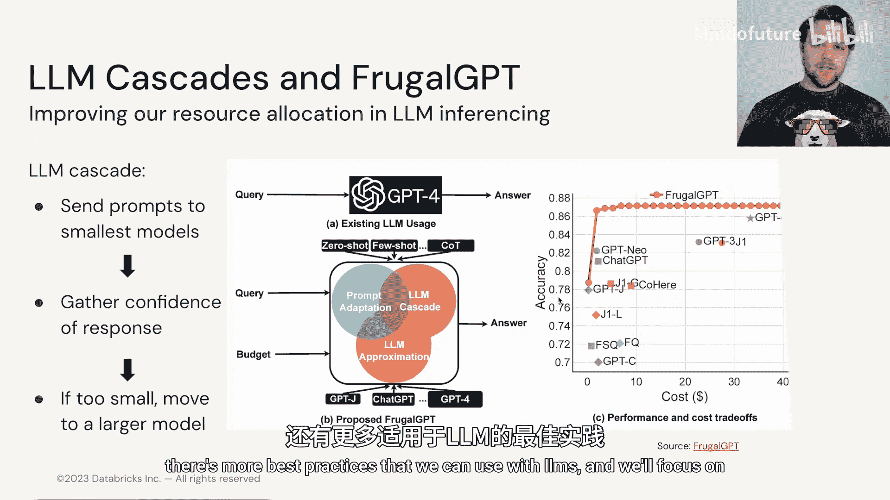
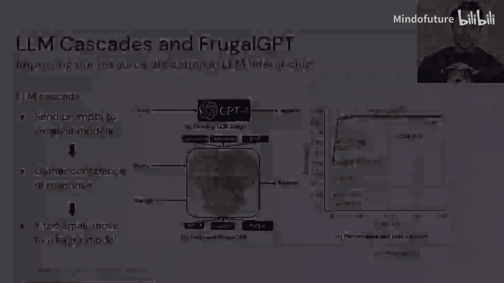

# 【Databricks】Llm模型底层基础 ｜ Llm： Foundation Models From The Ground Up p21 P21_模块_3-部署与硬件-3.5_多LLM_推理 -BV1LZp9zXEab_p21-

Suppose you've already done all the optimizations that you can， or maybe you don't need to。

 maybe you have the compute abilities to handle some of the multi00。

Prameter large language models that are on offer， but you still have more data that you want to train on。

 Where can you go from here， or maybe you have enough access to the large language models。

 but you have a finite amount of budget for inference In this section。

 we're going to talk about how we can use multiple large language models and go through a number of。

Different approaches and styles of using these large language models in both inference and training。

 Let's start with mixture of experts。

The idea behind mixture of experts is that we can typically make use of multiple versions of a smaller。

System that is trained to perform particular tasks this is fairly common in the realm of machine learning and deep learning as it is how ensemble methods work。

The difference with mixture of experts is that an input is sent to a piece called a router。

 and the router is trained and learns how to send one input to a different type of expert。

This doesn't have to be a large language model， it can work in different types of machine learning and deep learning applications。

 but in this situation we're going to focus on mixture of experts in the context of large language models。

When we think about where the parameters lie in large language models。

 more than two thirds of them are present in the position wide feed forward neural networks。

These are present in each of their transformer blocks。

 and they add extra enrichment to the vectors after they've come out of the attention mechanism。

The switchitch transformformer， which was presented by researchers from Google。

 leverages the fact that by using different feed forward neural networks and training them during the training procedure。

We come up with an approach where we can have multiple experts。

Of these feed forward neural networks trained at the same time。

The way that this helps us with our parameter cost is that we could have multiple。

 say 100 billion parameter feed forward networks and train them one at a time。

This would mean that during the training process through different samples in each batch。

 the router would learn which expert to send the signal to。

 it might send it to a couple of experts and then take some sort of aggregate of the outputs。

 or it might send it to just one expert。This is how we could take multiple0 parameter models and piecee them together to make one large ensemble model。

This is how we could easily go from multiple 100 billion parameter transformers all the way up to trillion and multi trillion parameter models。

More research has being conducted into how these mixture of experts approaches work。

 but we've seen excellent results with the Sw transformformer These do require a lot of compute resources and all of the optimizations that we've seen up till now will be useful as we dive deeper into the realm of mixture of experts。

But let's say we're not worried about training per se， we're more worried about inference。

 let's say you have a fixed cost budget and you're only able to interact with large language models through some API。

In this case， you might look at something like an LLM cascade。

In the frugal GPT paper that was released in 2023， the researchers came up with an approach where they would take a prompt and pass it first to the lowest performing model and then look at the results of how that model thinks it performed。

We have access when we output a particular token from a model into the perplexity of that result that gives us a sense of how sure these large language models are about what they just selected。

If the model， which is a low quality model at this stage。

 is unsure or has a high value of perplexity， then we would skip the output for that one and move on to the next complex model。

This cascading effect of complexity and self checking meant that frugal GPT was able to maintain its accuracy far higher。

 but use far less cost。😊，Approaches like LLM cascades and frugal GPT are just the start of a new area of exploration for research and industrial use cases where we'll take the most of what we can with the vast array of large language models that are present in the domain。

There's more best practices that we can use with LLMs and we'll focus on that at the end of this module in the next section。

