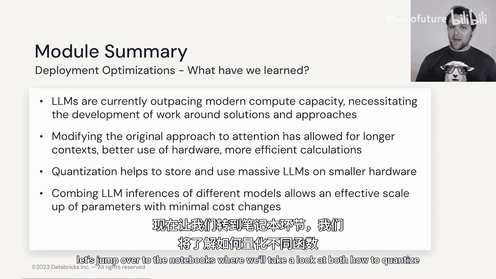
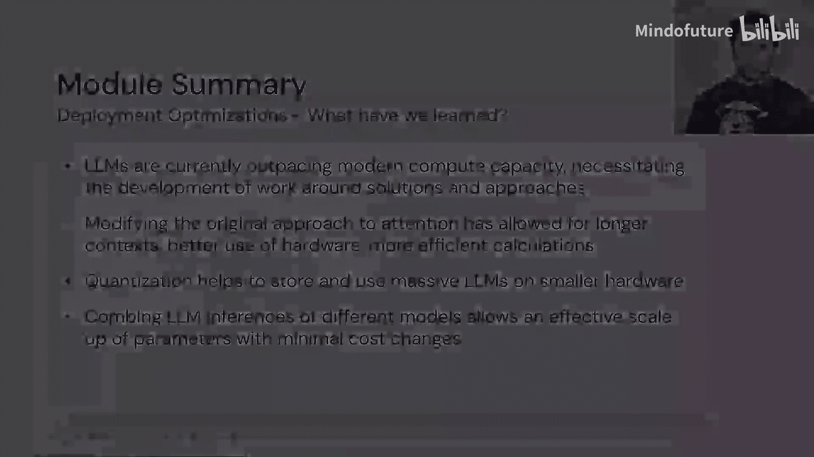

# 【Databricks】Llm模型底层基础 ｜ Llm： Foundation Models From The Ground Up p22 P22_模块_3-部署与硬件-3.6_当前最佳实践 -BV1LZp9zXEab_p22-

Now that we've seen a lot of the optimizations and improvements that you can make for both training and deployment。

 let's put everything together and discuss some of your options now if you want to get into the realm of LLMs either for training or just for reference。

As a list of best practices， if we're trying to train something from scratch。

 we'd recommend making sure that you incorporate alibite so that you can have very large context lengths。

 much larger than what you train on。you'd leverage flash attention so that you don't have to overwhelm the SRAM of your GPU when you calculate attention and allow for much larger context lengths to be used and also leverage grouped query attention so that you can save on the amount of compute resources that you have and the number of parameters that you would need for your attention mechanism。

Depending on your application， you might also be interested in pursuing a mixture of experts approach if you want to have truly v scales for your large language model。

If you're just focusing on fine tuning and inferencing。

 then you're also going to want to leverage tools like Laura or quantize Laura。

And frugal GT and LLM cascades， if you're interested in how to minimize the amount of cost for the particular budget that you have for inferencing。

There's also been some fantastic work by the community to have a look at some numbers that every LLM developer should know This work was collected by Ray with any scale and includes some excellent pieces of wisdom。

😊，In particular。Talking about GPU memory， the general guide that if you double the amount of parameters。

 that gives you a sense of your GPU memory requirements。

 That is to say that if you have a 7 billion parameter model。

 then you're going to want something like a 14 gig。Capacity for the graphics RA for your GPU。

Note that this is for serving for training you'll actually need even more。

If we look at the options that we have available at the moment for the V100s， the A10G and the A100s。

 that gives us a sense that we could use a 5，10， 20 and maybe 40 billion parametermeter model for each of those as we increase the size of the RA that's available。

There are， of course， always going to be improvements in the technology from NVIDdia。

 AMD and others so that we'll continue to get better hardware such as H100s and beyond that's able to provide more resources for us to work with。

Do keep in mind that these will obviously come with a price premium and the availability for GPUs is still quite difficult。

However， that brings us to the end of the module。In this module。

 we focused a lot on the deployment optimizations for both training and inferencing。

We've seen that LLMs are really outpacing the current compute capacity。

 which makes us focus on how we can optimize and find solutions to work around these issues。

We've looked at how we have to modify the original approach to attention so that we can allow for longer context and also make better use of the hardware so that we can manage these longer contexts with a longer context LLMs typically perform better at the tasks they're given。

When we restoring these numbers that represent the large language model。

 we've seen that quantization can be a very powerful tool。

 although we have to be careful about the trade of cost to performance。

We also saw how we can combine large language model at inference so that we can look at things like mixture of experts and frugal GPT with the LLM cascade approach so that we can try and minimize the amount of cost。

 but still get the results and the performance that we need。

Let's jump over to the notebooks where we'll take a look at both how to quantize different functions and you'll also get a chance to build your own mixture of experts。

😊。

