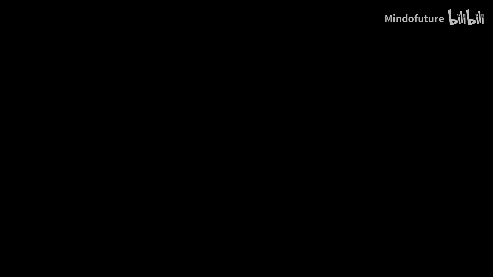
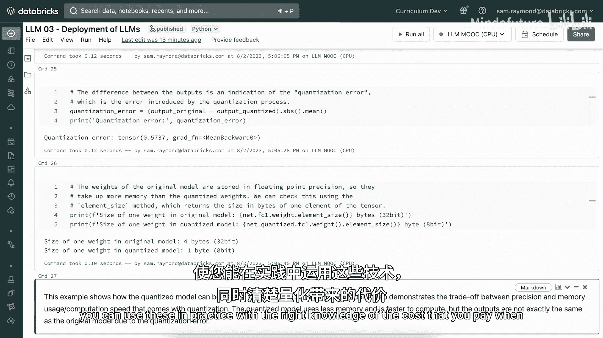

# 【Databricks】Llm模型底层基础 ｜ Llm： Foundation Models From The Ground Up p23 P23_模块_3-部署与硬件-3.7_笔记本 -BV1LZp9zXEab_p23-

Welcome to the notebookbook for moduleule 3。In this notebook。

 we're going to talk about quantization and how we can apply it to our functions and to our deep learning architectures so that we can save space both for training and at inference time。

Quantization is the approach that takes a full representation of a high precision number。

And downgrades that to a lower。Resolution representation of that same number。

We'll walk through step by step from a single value all the way up to a train neural network on how quantization works。

As always， we need to make sure that our compute resource is running in our notebook。

And we'll start as we always need to do by running the classroom setup script。Now that that's done。

 let's install of the Python libraries that we'll need to use during this notebook。

We'll be writing Pytoch code from scratch so we'll need to include all of the right libraries from Pytoch as well。

And now let's start with quantization of a single variable。

 We're going to look at both 4 bit and 8 bit quantization。

 which we saw in the lecture notess are different amounts of compute space that we allow to store our。

Numbers to a particular precision。We're going to be storing these as four bit and eight bit integers。

 and so let's have a look at how we do that for a single value。We'll define two functions。

 one to quantize a value， and another one to unquantize it。

What we're doing when we quantize a value is putting it into a set of discrete chunks。

We're also keeping track of the value that we used to reduce the value into these chunks so that we can also extrapolate back into the more refined value that it started with。

 however， as you'll see doing this process introduces some losses in accuracy and we'll see exactly how that plays out。

To start with， let's look at the quantized function。So we have our definition quants。

And we'll be quantizing a floating point number to an integer。

Since any number that's larger than one on the left hand side of the decimal can be represented as an integer itself。

 we actually only need to worry about values that are between negative one and positive one。

And so the range for this quantized function will be for all values between negative one and positive one。

It'll take in the value that we want to quantize and also the number of bits that we are going to select to use for the quantization。

 so this will typically be full bit or8 bit。It'll return the quantized value。

And we'll also make sure that we're checking that we're only going to quantize values between negative one and positive one。

All that's required to quantize the value is to take the value that。

We input to the function and then multiply it by2 to the power of the number of bits -1。

 and then subtract one from that value。We then round that to the largest value and you could also do different schemes depending on how you want to quantize it。

 we're going to use the fairly standard approach here where we multiply value by this two to the power of the number of bits minus1 to get our quantized value。

Once we've quantized our number， we'll also need to de Unantizer。

We unquantize the value by taking the quantized value and the bits that it was quantized with。

 that's going to be quite important。You can see here， well take the。

Integer back to a floating point number， given the original number of bits。

 you can't mix and match the different types of bits as you'll introduce more and more errors into your process。

 And there's already errors associated with quantization to start with。

To de quantantize or unquantize your value， you basically undo the process we did before。

 where we multiplied by two to the power of the number of bits minus1。

Here we're dividing by  two to the power of bits minus1。

Let's set up this definition and see what this looks like in practice。

We'll test this for both4 and 8 bit quantization， and we'll use the value of 0。5。

If you think about the value 2 to the power of bits -1 for2 to the power of 4。

 we'll get a particular maximum and minimum range， and for two to the power of 8。

 we'll also have that same range。 We can test this by looking at different values of the variable value。

And looking at how the quantization treats the extremes of those values。Let's start by quantizing 0。

5 with4 bit and with8 bit encoding。When we run this cell。

 we can see that with our original value of 0。5， the quantized version becomes4。

And the unquantized version becomes 0。57。For8 bit encoding， we see the quantization value be 64。

And the unquantized version be 0。503。So you can see we've already introduced some error looking at four bit quantization and ape quantization。

 and that's because we're only allocating a smaller amount of memory。

To represent the value that we're looking at。Let's take this value up to 0。

99 to see what would happen at the maximum value of our range。

 You can see the four bit quantization max is added at 7。

And the eight bit quantization max is out at 126。When we think about what ti to the power full would be。

 we would get something like 60 full。However， we're doing two to the power of bits-1。

 and so2 to the power of 3 is 8。 And so the maximum value that you could think of that we would get here would be 8。

 So if we put in 1。0。You can see we saturated that value because we also have this minus one over here。

So that means the largest value on the positive side of quantization is 7。

 and if we were to change this to minus1， you can see we would get negative7。Likewise。

 for8 bit encoding or quantization， two to the power of8 or two to the power of 7 being 128 gives us the range of values that it can output。

If we pick the value of zero。We actually get lucky in that zero is has a very special value in the quantization scheme。

 and so we actually get perfect retention for the value zero。If we return back to 0。5。

We get these results back as we did before。So now these quantized functions are working as we'd expect for a single value。

 let's look at how we might quantize a function。The quantization of a function relies on the fact that we're actually going to sample a continuous function at discrete points。

 This is true， no matter how precise our compute is。

 as every function that we can actually calculate has to be calculated at a finite precision。

 even though it might be a double precision or even more than that。

 to give the appearance of continuous。Function values in。Computers。

 we obviously have to store these values as finite numbers。

 This means that we can quantize any function that we can。Represent in our computers。

We're going to take a sine function as an example of quantization。

And then we'll generate the quantization of this using the functions that we've just defined above。

So we'll create a linear space using numppy from negative one to  one， using 100 points。

And then we'll calculate what the value is using the sine function for each of those points。

We're then going to quantize all of the values of y。For both four bit and eight bit quantization。

And store that in an array。We can then look at what the loss would be over the average。

So the mean loss for each of these different approaches。 and let's see how well it。

Can quantize these functions。 You can see that for the four bit quantization。

 we get an error down to the third decimal place。And for8 bit quantization。

 we're down to the power of negative 6。So we can see here that8 bit quantization performs much better than4 bit quantization。

 which is also intuitive。So let's look at what the consequence actually is of doing this sort of quantization and what we're losing when we quantize to eight bit and what we lose when we quantize to4 bit。

We're going to plot the original。Function。We're then going to plot the quantized versions of4 bit and8 bit。

 and then we'll also plot what it looks like when we unquantize those functions。

So we can see our original plot here is nice and smooth and is given to the precision of the machine that we're working with。

😊，We can see that because we're dealing with a unit。Sine function。

 it oscillates from0 to negative one to positive one and then back to 0。

For the four bit quantized version。We can see the distinct chunks of values。From0 down to negative7。

 up to negative7， up to positive7， and then down to 0 again。

This represents exactly what we were looking at in the。Testing of the function before。

 when we put in different values between negative one and 1。

The scaling value here that you see between 0 and 7 is how it represents values between0 and positive one using integers。

 it then takes that factor and will scale it back down to any value between 0 and 1 and likewise from0 to negative 1。

Let's look at the eight bit quantization。You can see that even though we use the same number of points。

 they're not clumped together in the same way that they offer for bit quantization。

 instead we get a much smoother representation and you can also see that we're storing much larger scale numbers on the Y axis here as well。

When we unquantize。These functions and put them through that reverse process。

 you can see here that the8 bit quantization preserves far better the structure of the sine function than the4 bit quantization does。

 and you see this as well in the approaches in large language models where we use typically eight bit encoding as standard rather than anything more than that。

 although further development into quantization of less than 8 bits is currently underway and we're seeing some impressive results with that as well。

Typically， numbers are stored at 32 bit floats， and so we're already at 25% savings with8 bit quantization。

 but we could halve that if we can improve our4 bit quantization schemes as well。

Now let's look at how we can quantize a simple neural network。

We're going to be using some special functions from Pytoch， but under the hood， they more or less。

Perform the same functionalities that we've been doing up until now。

When we define our neural network like we've seen in the course so far， we use a specific structure。

In Pyage to define the structure of our neural network with both the class definition under the knit definition and then also a forward pass definition for our neural network。

We're going to be using stub locations for where we will quantize and dequize the values as we move through the architecture when we get to training and the actual quantization procedures。

 that's where these stubs are actually replaced by the。

Operations that Pytorch will perform automatically for us。

You can learn more about this by checking out the documentation at the Pytorch organization documents。

Let's define our simple neural network architecture。You can see in the cell here。

 we are defining our net。For our neural network。We start with a quantization stub。

 which you can see here elect as a placeholder。We then have two linear layers。

We're going to be assuming that this will be a flattened Mnist。

Neural network and so the Mminist images are 28 by 28。Images。

And so we're flattening these as 28 by 28 cells。And then we have 10 classes for the。

Eminous characters from0 to 9。And so we have two neural network。

 fully connected layers At the end of our neural network， we also have a deco quantitization。

Stub as well。And then in our forward definition， you can see here we're just piecing all of this together。

 so we take in our input。We first pass it through the quantization。

We'll then have our activation and fully connected layers connected to each other。

 and then we'll de quantentize our bios。At the end。Now we can download our MIS data set。

From the Torch vision data sets， and we're going to store that to our working directory。

And then we'll define our cross entropy loss function and a stochastic gradient descent simple optimizer。

This will take just a moment to download。And now we can train our network。

We're going to train the network without doing any quantization。 This is going to be full。

Precision training， and then we' quantize later。For now there。

 we'll just loop through a fairly standard。Training of a simple neural network to complete the MNIS challenge。

This will just take a moment。Our training is now finished and now we can move on with our fully trained neural network。

 add full precision， we can look at how we can quantize this now that it's finished。😊。

It's a fairly simple process to quantize our。Model using Pytorage we use the we will first get some default configurations using quantization。

We'll then use our preparation in the quantization to prepare our network。

 and then we'll finally convert the network to our quantai state again。

 check out the Pytorch documentation if youre interested on the specifics of how you would do this。

 but we're more or less just using the defaults here。And now what we can do is we can save the。

Original， full precision model。 And we will also save the quantized neural network to disk。

 and we can look at exactly how much we save by quantizing our model。As you can see here。

 we have 408 bytes for the original model and 408，000 bytes for the original model and 108。

000 bytes for the quantized model。So you can see that the quantized model is nearly a quarter of the size of the original model。

 which makes sense， given that we're going from 32 B representation down to 8 bit for much of the model。

 There are some pieces of the model that weren't quantized， but the largest。

Component inside the model of the neural network layers and those what are quantized。

We can take a look at the different parameters inside the model to see how they compare between the original and the quants model。

We can see our fully connected weights here in the original model and the biases in full。

Float precision。And we can also have a look at the quantized。Layers as well for the。

Quantai is neural network， and you can see that these have some slightly different。

Values and some different layers。We can read a little bit more about about the quantized versus non quantized。

 You have the quantization scheme that was used。 You can have the the。Type of。

Value that you have here， and so you can see here we have the torch quantized integer8 bit。

Which is the default for Pytoch。And you can also see that there are some parameters for the quantization process that are specific to this particular quantized model。

 Again， you can read more in the documentation about the specifics here。

 but the defaults work very well。We can also look at the output of the original and the quantized model if we pass through some kind of random input。

 and so this is using the original and the quantized neural networks at inference time。

So at training time， we had to train the model。With full precision。

 but we can actually use the quantized model if we want to。At inference time。Now。

 you can see here that the output from the model is at full precision。

 And so we have our decimal representation， but you can also see that apart from one value in the output of the quantas model。

 everything else is set to0。 And that's to do with the。Precision that we gave the particular model。

 it's unable to see any of the other values apart from one。

We can run this again to see if we get a different result as we're doing different randomized inputs。

 But you can see here that due to this scheme that we had。

 these inputs are not picked up as different for the quantized model。

 And so this is a risk or this is a cost that you have to keep in mind when you work with quantized models。

 Their performance is degraded compared to the。Full precision model。

We can look at the error present in this model。And you consider that the quantization error is indeed quite large。

Just to check that we are indeed looking at different types of weights for our。

ModelWe can see that the original model is comprised of four byte representations for the fully connected weights。

 and the quantized model has just a single byte for their weights。And so in this example。

 we're showing how you can quantize different neural networks， not just large language models。

 but indeed large language models use this very heavily as there are as many billions of parameters and so the amount of savings that you could have by taking just a quarter of the precision there is dramatic。

You don't need to go to Forbit。Quantization necessarily aB quantization is still a huge amount of savings。

 and more and more refinement to these quantization schemes keep coming。

 which improves the performance and the accuracy of these models。

Hopefully this has given you a good sense of how quantization works and demystified it a little bit so that you can use these in practice with the right knowledge of the cost that you pay when you do quantize。

