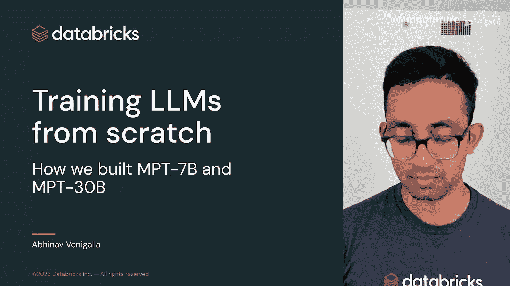
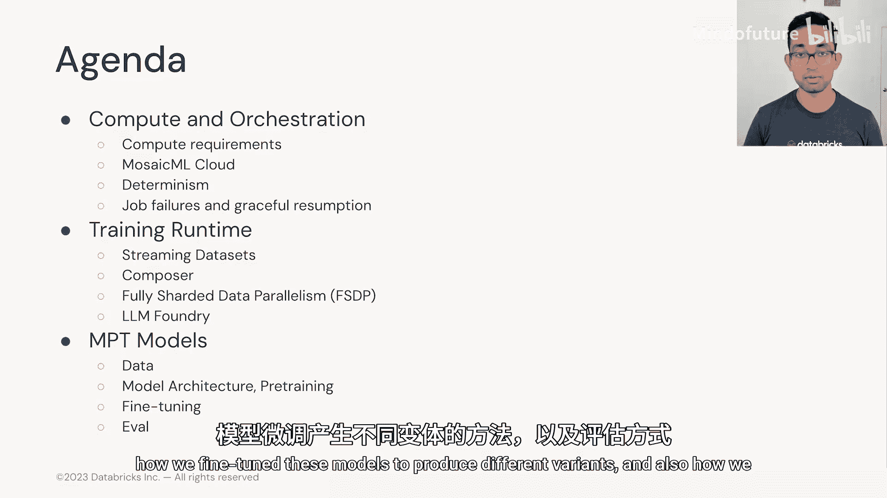
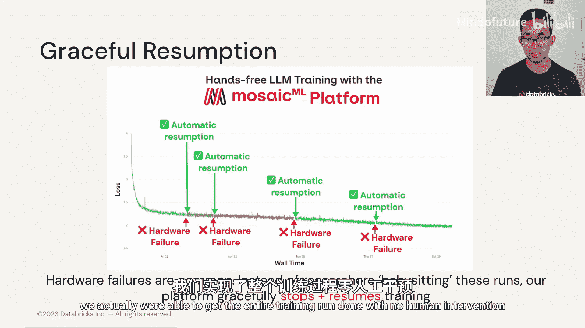
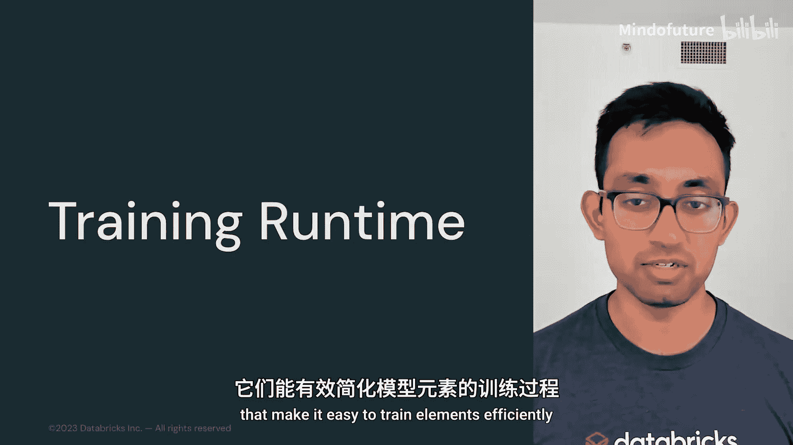
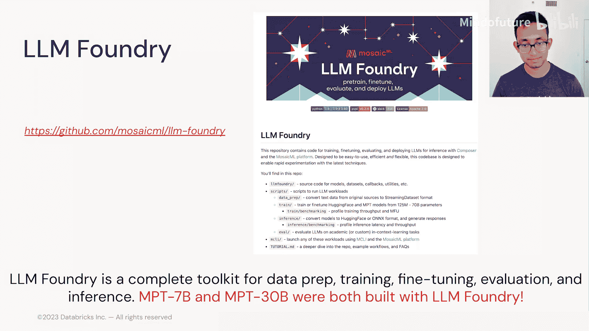
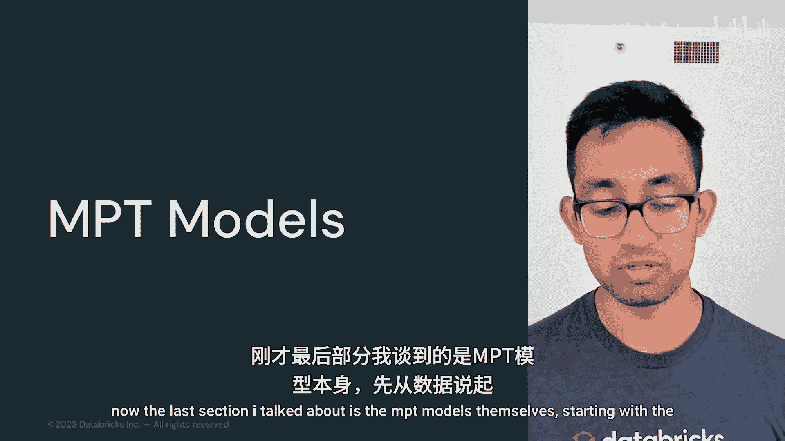
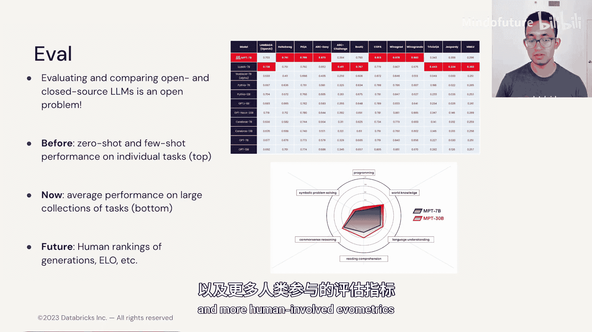
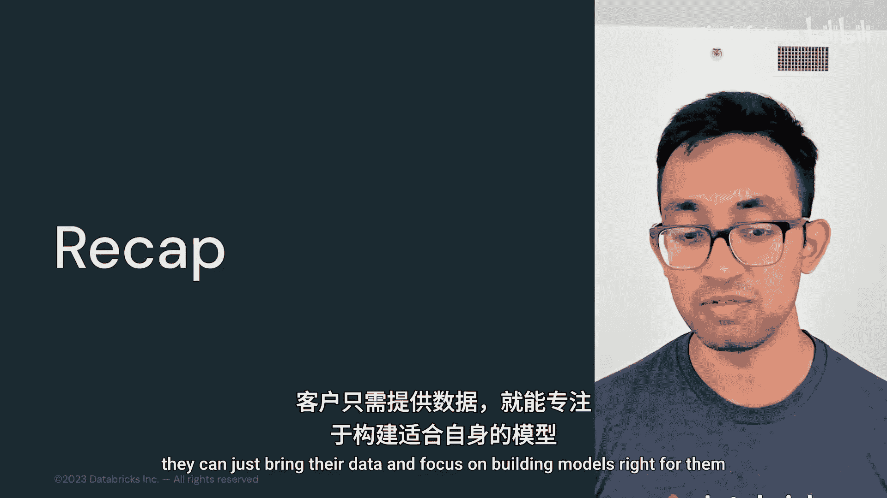

# 【Databricks】Llm模型底层基础 ｜ Llm： Foundation Models From The Ground Up p24 P24_模块_3-部署与硬件-3.8_MosaicML_关于从零开始训练LLM的客座讲座 -BV1LZp9zXEab_p24-

Hi， my name is Aby， and I lead the NLP team at formerly Mosaic Camel now part of Databricks in this module。

 I'll be talking about training alums from scratch and some of the infrastructure and science that goes into that with a focus on how we built the open source models MP 7 B and 30 B。

So in this talk therell be three main sections， the first is compute and orchestration。

 basically how we execute these large LLM training runs on big clusters of。

I'll be talking about the training runtime， some of the software and open source libraries that we've developed that make it easy and high performance for our customers。

And lastly， I'll be talking about the MPT models themselves。

 some of the choices that our research team made in terms of the data， architectures that we used。

 how we fine tune these models to produce different variants， and also how we evaluated them。

 so let's get started。

The first section is about compute and orchestration。

The most important thing to know about training alums is that they require a lot of compute and when I say a compute I mean the actual math and floating point operations required to actually train them。

To actually finish all this math in a human- friendly time scale a weeks， not years。

 we have to parallelize the work across hundreds to thousands of GPUs and that's what's unique about this。

 We need special tools for launching these very large runs on huge clusters of GPUus for managing the compute and sharing with your teammates for automatically resuming the runs in cases of failure and in all sorts of things like that So in Mosaic Ml we basically decided to build a product that specifically addresses for ML engineers and we called it the Mosaic M Cloud。

It's an orchestration and sing layer that sits on top of any GPU compute cluster， whether it's yours。

 you know whether you run compute from us， you can s up seamlessly to any one of them And what's special about it is that it basically addresses all these different problems that ML engineers face when they're actually trying to train models at scale So that means multinode training that means resuming runs when they fail it means supporting object stores both for data streaming and for checkpointing and also experiment trackers such as MLflow and weights and biases and the best part of course is that's high performance that we tune it for all the different cloud providers out there So when you come to us is you don't have to redo all of that work。

So what does this actually look like in practice here you can see a multinode training job submission via the Mosaic and allCud and on the left side you can see the actual YaML file that a user submits and there's a couple key pieces。

 one is like a Docker image， then there's an integration for checking out a GitHub repo and that's your source code。

 and then it's really just a series of commands， the training run commands。

The sort of magical part about this is that you can submit this to any one of the clusters like in your account and you can also seamlessly scale the number of GPUs。

 whether it's one or 8 or 256， and it really all just works so multi orchestration makes it easy to launch these runs on very good clusters。

 but what about the performance？So something that we found in the course of SML is that a lot of the compute clusters being built in the clouds actually have really good inter node networking What that means is that the bandwidth between GPUs across different machines is actually relatively high and what that means is that with the right software and the right orchestration tools you can actually launch jobs on large clusters with near linear scaling that means that your job gets done you know 14 or 15 x faster in this picture we got a 14。

4 x speed up out of 16x number of GPUs。And that basically means you can get your job done faster without paying much more in total cost。

After all， if you train my job that's 10 x bigger， but only use  one/10th a time。

 then the actual cost ends up being about the same。So early on in Mosaica。

 we focused on multi scaling as a way to deliver models faster shortcoms to customers without necessarily increasing the price they had to pay。

So scaling out is maybe the most exciting part of LLO training。

 but there's also a lot of details when it comes to doing the science one of those is determinism and we focus on determinism early in many components of our stack so that we could do science accurately。

Basically， anytime you want to try a new method or try a different architecture。

 you want to make sure the run you're doing doesn't have a lot of noise in it or that the e metrics you measure don't either So on the left side that you can see one of the technologies and build streaming data set where basically we enable streaming data from object store to large clusters of GPUs and whether you use one GPU or two or 64 the actual loss curve you get is pretty much deterministic the order of the samples is deterministic you can kind of see what it looks like when you don't have this feature on the top and you get a sort of a curve that looks approximate the same but not exactly and on the bottom you get pretty much totally deterministic results this also means that you can actually resume runs on different number of GPUs so if your cluster has a failure or you to share some compute with your teammate you can actually stop and resume your job on a different node GPUs and you'll still continue exactly as it did before。

Now on the right side we have a similar situation when it comes to our trainer or our actual like trainer loop that trains them model all each GPU one of the challenges there is that we use micro batchching as a technique to avoid out of memorymory errors。

 so that means when we have a total batch of data to process。

 we actually split into smaller micro batchches first and do a forwards and backwards pass on each one of them and then we accumulate the gradient across them all。

So once again， to make sure that our training ones are agnostics to sort of the memory capacity you have and the micro micro batchch size you choose。

 we basically made sure that our micro batchtching engine is deterministic。

 so you can see that whether we use a micro batchch size of one or two all the way up to seven。

 we get nearly the exact same loss curve within themers。

Now the last part of the orchestration stack that I talk about is resumption。

 and this is actually a challenge that many people don't know about until you actually start to train LMs at scale。

 which is that these GPU clusters have very common hardware failures。

 these hardware failures can range from networking errors to actual hardware failures where you have to remove the whole machine and the issue is that they occur quite frequently once every1000 a 100 days or so。

So in this front， for instance， I think we were training on 512 A100s。

And we basically had a failure almost once every two days， this was the MPT7D run。

So traditionally researchers would have to babysit training runs like this and basically wait for something to go wrong and then maybe at 2 am or something you'd have to wake up and stop the run and resume it with our platform we aim to basically eliminate this so our orchestration tool actually detect these failures on its own and will seamlessly stop the run detect any hardware failures cordon those machines that are broken and then resume the run automatically so for MPT7B we actually were able to get the entire training run done with no human intervention whatsoever thanks to our orchestration tools。

The next part I' going to talk about is the training run time。

 so this is the actual software libraries， many of which we have open source that make it easy to train LlumMS efficiently。

Now the first component I to talk about is actually not related to the models but to the data Now from the very beginning。

 we've been focused on helping customers train their own private models and their own private data。

 but to do that in a way that's secure， we need to be able to stream their data from object stores to the Comp cluster。

 and we built an open source library called Mosaic and mal streaming to do that。Now。

 what this enables you to do is you can use any objects for providers such as S3 or GCS or OCI or R2。

 and you basically stream your data to the compute cluster in a way that doesn't require you to wait for the whole data to download。

It has very high performance and good shuffling and crucially when as soon as the run is done。

 the data is deleted so it's only used ephemerly for the purpose of the training run。

 we never store it on the compute cluster at all。Now。

 another benefit of this is that it basically lets you separate where you're doing your computing from where your data is stored。

 so you can stream data from AWS to compute cluster in Oracle Cloud and we actually do this a lot until mo that come out。

 and it basically means you have a lot of negotiing power over your compute provider。

Now the next component I talk about is our open source training library called Composr。

 now composer is library built on top of Pytorch that makes it easy to train models from diffusion models to LM models to image models。

 and it takes care of all of the details such as mixed position training， distributed training。

 object store checkpointing and all those kinds of things that enable you to train these models at scale in the cloud。

Now it also comes with a really neat callback system so you can customize it to your needs。

 you can write algorithms that occur at different stages of the training loop such as after the forwards pass or before the optimizer step and you can register these and basically tailor for whatever you need for your runs so internally at MoaMl we use composer for all of our training runs and it just makes things really nice and it works with diffusion and Ls。

Now specific to large language models， a technique I like to talk about is fully chartarded data parallelism and what this is it's basically a way of splitting the parameters of the model across all the GPUs in your cluster so that you don't know not of memory some of the large models we train have 30 billion parameters or more and so they would never actually fit on a single GPU at training time instead we use FSDP built by the Pythtor team to actually split these parameters across the cluster and then only as they're needed in the forwards pass are they gathered from across the cluster。

One benefit of this is that it's very flexible to the model architecture。

 we can train any hugging face style LLM， our MPT architecture。

 we've used this to train stable diffusion architectures and in basic means we don't have to worry about tensor parallelism or pipeline parallelism。

 we just use this one FSDP strategy across all of our model types。

So here's diagram of what that actually looks like you can see during the forwards pass。

 we gather the weights from the cluster to each GPU to do just that single forwards pass for the layer。

 and then we discard the weights for the layer， then we repeat that again for layer 2 and layer 3 and so on all the way up to the end of the network。

On the backwards pass is the same thing in reverseverse as we need layer N at the end。

 we all gather at the weights and perform the backwards pass and again discard it。

 The gradients and optimizeimr state are similarly sharded so that the entire model state used during training is now split across the cluster。

What this really means is that now your total number of parameters only has to fit in the cluster memory。

 not each GPU memory， that's what makes it different from DP distributed to data forism。

The last bit Id like to mention is that all these pieces are useful on their own。

 but putting it all together into a single platform for LMs is something we focused on in the earlier half of this year。

 and we have an open source library called LLM Fory This is basically a complete toolkit for preparing your pre-training data for actually doing those training runs for fine tuning the models afterwards for evaluating them on custom Eval data sets and even preparing your models for inference。

The sort of magic part about the system we built is that everything that our research team uses is all externalized。

 so MPT 70 and 30 you were all built with the LM Foundry and that way our customers and our community members can use the same exact tools to build their LLMMS。

Now the last section I already talked about is the MPT models themselves starting with the data so when we set out to train MPT 7b and 30B。

 we picked a token budget of approximately 1 trillion tokens and then we basically fill that in with lots of different data sources across the web you can see we use different sources of English web data。

 you know common crawl scrappees， we have code data coming from the stack as well as GitHub we have scientific papers from archive and stack exchange。

 and lots of things like this。

Now， one thing that occurs when you're dealing with these very。

 very large data sets is that you have to clean them。

 basically filtering and deuplicating these space is crucial。

 especially if you have multiple overlapping web scrappes。

Pickking the proportions is also important too when we pretrain these models。

 we generally have a sort of general use case that we're targeting。

 we expect these base models to be fine tuned by different customers for different like tasks。

But we still have some choices to make such as how much English data put in versus how much code data and using some of our library's extremely data。

 it's easy to choose these proportions at runtime。And we basically perform small pre training run experiments to see how that affects downstream performance。

For MT in particular， we chose to actually up the amount of code and as a result the emptyT models are particularly bit coding compared to some similarly sized models that are open sourced。

We also find that the tokenizer can have a lot of impact， so on particular fields like math。

 arithmetic coding， where the spaces and tabs are very important in foreign languages。

 having a tokenizer that's built for those situations will greatly improve performance。

Now when it comes to the model architecture， for the MPT series。

 we chose to keep things pretty conservative， we basically started with the same architecture and model as the GBBT3 series。

 which is a decoder only transformer， the main improvements we made werere on the performance using flash attention。

 which is basically a much more optimized kernel for performing the attention operation that is math equivalent but increases the speed and reduces the amount of memory used。

The other big change we made was that we removed the positional embeddings。

 which traditionally put a hard limit on the amount of tokens you can have in a sequence。

And we use a relative position on bedding called alibi instead。

Now what alibi enables us to do is actually have a bias that's added to the attention mask and that way at runtime。

 if we wanted to， we could stretch this bias tensor out to a longer sequence length。

 and also makes it very easy to fine tune a base model to have a longer context length if you wish。

 and as'll talk about later we did this for MPT7v for one of our models called storywriter。

Now how do we actually make these decisions of the research team Well it all comes down to scaling laws at smalls test runs effectively we test out many different architecture choices with small models such as 100 million models up to 1 billion parameters and we like to plot kind of the quality we get versus the amount of compute used and we can basically draw scaling trend from this based on that trend we can see if an architecture kind of improves the performance at every scale and that's what we see as like a sort of a Pareto improvement and then that would give us the confidence to actually scale that architecture up to the final sizes like 7 billion and 30 billion parameters。

We find these healinging laws are very， very helpful for betray training。

Now what about fine tuning so with each MPT model we built 7b and 30b we also built a couple different fine tune variants these basically take the base model which is being pre for a very very long time。

 and then continue the training on a small curate dataset set where that curia dataset either has a particular input output style where you a prefix that kind of aligns it better to what you want and we have two variants that we focus on for 30b and 7b the instruction following variant。

 which helps with shortform tasks like you converting instructions to JSO or you picking the best item out of a list and then we have a multiter chat fine tune model which is basically for the chat use case like chat JT。

For MPT 7b we also targeted a unique situation which is a storywriter where we took our base model and fine tune it on a lot of books with very very long context length and as I mentioned before our architecture choice to use alibi made it very easy to do that and as a result we were able to build a model that can ingest entire books like the Great Gatsby and then continue writing like the next chapter or an epilogue most of these are demonstrations but it kind of shows the art of what's possible for our customers so if they have particular tasks that need that long context we can help them build those models。

Now it's important to know that fine tunes are a lot faster and cheaper than Btraining。

 so much so that some of those scaling actions I talked about before are less relevant here in the fine tuning space we can actually just try out all the ideas at the full token budget and basically pick the one that's best。

We also have found that larger models such as 30 B over 7 B。

 are easier to fine tune and may actually require fewer samples to do so。

So following up on that point here， some of the actual training details for MPT7v and the fineT models。

 you can see that the base model costs approximately $200，000 to train。

 but the fine tune models are much cheaper， so the Instruct model costs only $37。

 the chat model a few hundred and storywriter or a few thousand dollars。So in general。

 having strong foundation based models for customers makes it easier and more cost effective for them to build custom fine two models for themselves。

Now the last part I've talked about is evaluation so evaluation is very much an open problem and as you will hear about in other modules。

 there's no one way to do it， we're constantly evolving our techniques and getting better at it over time in the past evaluatingu MPT against other models in our first 7v blog post we basically looked at the zero shot and few shot performance of our models on individual tasks academic tasks that have been collected you know in previous papers such as the GPT3 paper and basically seeing how we stacked up to the competition that way。

Since our base models are used by people for a large large value of tasks though。

 we found that this system is a little ineffective instead we now actually aggregate performance across a very large number of tasks and you can see on the bottom our new model gauntlet technique so here across six different dimensions such as programming world knowledge we actually have 20 to 30 or 50 tasks within that across which we average the performance and then we can actually see sort of in this radar chart how each model generation improves upon the last we can see that MPT 30v for instance outperforms 7b in every single dimension。

Now in the future， we think that model evaluation will go even farther than this。

 we've been exploring techniques where we actually cement the same prompt to two or three different models and ask a human to actually rank which one they prefer over the other。

 and this can help us develop sort of heads up competitions or eO ratings across models。

The main takeaway is that LLMs， as they get more powerful as they start to saturate our simple benchmarks。

 we have to come with more complicated ones and more human involved e metrics。

So to recap， building Model like MPT takes a lot of infrastructure and science at Mosaic and Mo Datas。

 we're working to help bring that into the hands of more customers so that they don't have to worry about all the challenging infrastructure and multina training details。

 they can just bring their data and focus on building all that's right for them。

Thanks for your time。