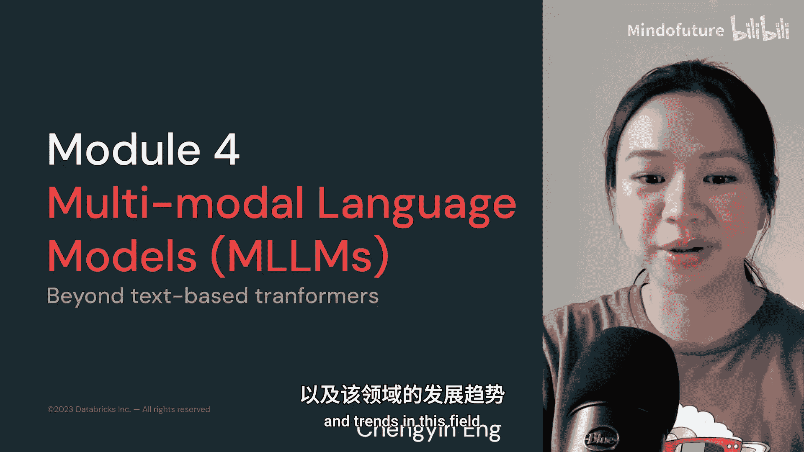
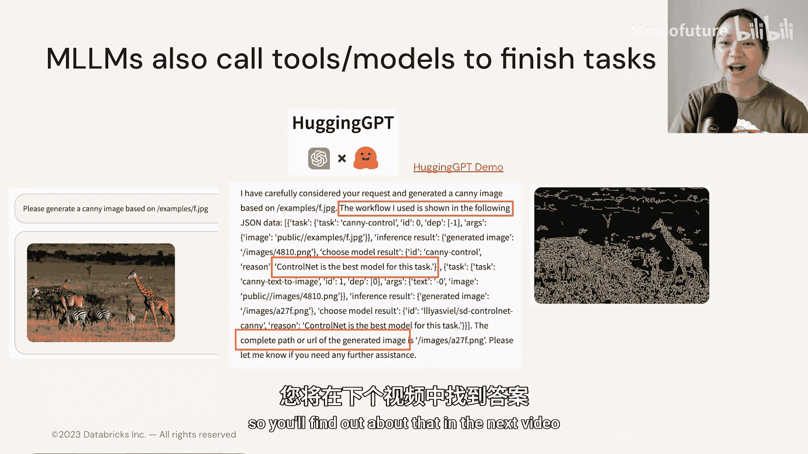

# 【Databricks】Llm模型底层基础 ｜ Llm： Foundation Models From The Ground Up p26 P26_模块_4-多模态LM-4.2_模块概览 -BV1LZp9zXEab_p26-

Welcome to this last module of this course on multimodel language models。

 This has been a really fun module to put together。

 There are so many possibilities for multimod applications that can process more than just text。

 including images and audio。 In fact， this module itself can very well be this own course。

 but I will use this opportunity to highlight what I think are some of the most interesting models and trends in this field。

 I hope you enjoy this module。😊。

By the end of this module we will have surveyed the broad landscape of multimod language models。

 you will understand how transformer architectures can be this general and flexible to accept nontext inputs as well。

We will also discuss the limitations of multimod language models and possible alternative architectures to transformers and the attention mechanism。

Lastly， we'll wrap up this module by discussing the wide possibilities of multimod applications。

Some of the most commonly cited examples of multimod language models come from OpenAI。

 The first you that you might have heard about is whisper， it can transcribe speech audio into text。

 The second is Dolly can create images from text and for clip when it's given text and image descriptions it can predict the most relevant text description for that image。

Multimodel models are very useful and in fact they are much more user friendly and much more flexible and they pretty much mirror how humans can perceive information For instance。

 you can see this video ama application where we can ask video allma to describe what it has heard in the video itself and then ask questions to follow up on the video。

😊，You can also use mini GBT4 to explain memes that you might not understand or even ask miniiGBT4 to come up with a mockup code for you to build this joke website and insert jokes within the website as well。

Just like large language models， multimodel language models can also exhibit chain of thought reasoning capability。

 we can supply multimod information as in context， for example on the left image over here。

 we can supply a video a series of video frames and ask the multimod language model to explain to us what happened between the frames。

And the second image that you see on the right， we can provide photos as our in context， for example。

 the crackers and soda， and ask the multimodel application to tell us。

 you know which property does this two have in common。Quite impressively。

 multimodal language models can also process these multimodalities simultaneously。

 so we can pass in an image， we can also pass in a recording at the same time and an ask question to the language model。

Multimodel language models can also act as an agent that calls upon other tools or models to finish tasks。

 but a lot of these multimodel models use transformer architectures。

 but how we have seen so far that transformer architectures mainly process text。

So you'll find out about that in the next video。

