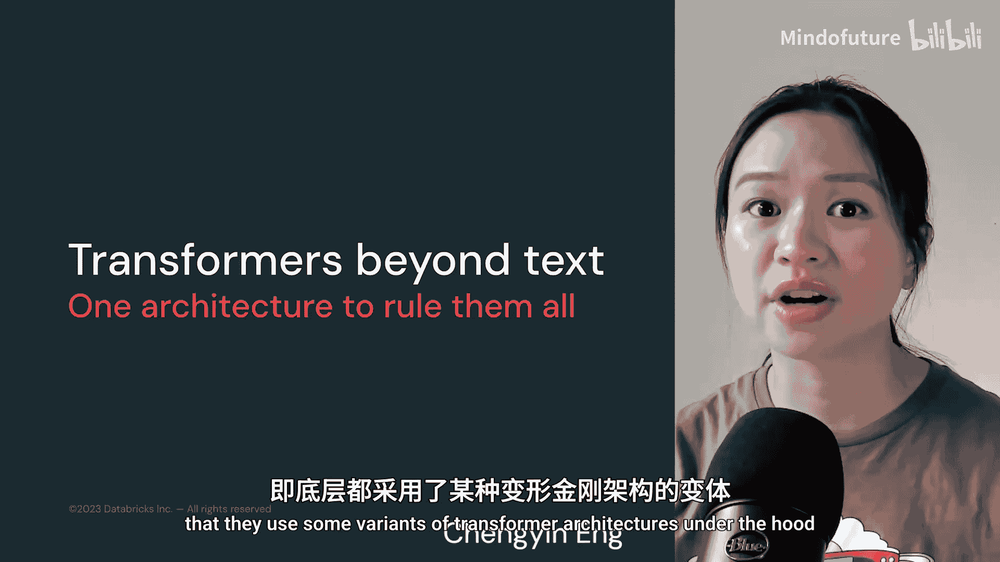
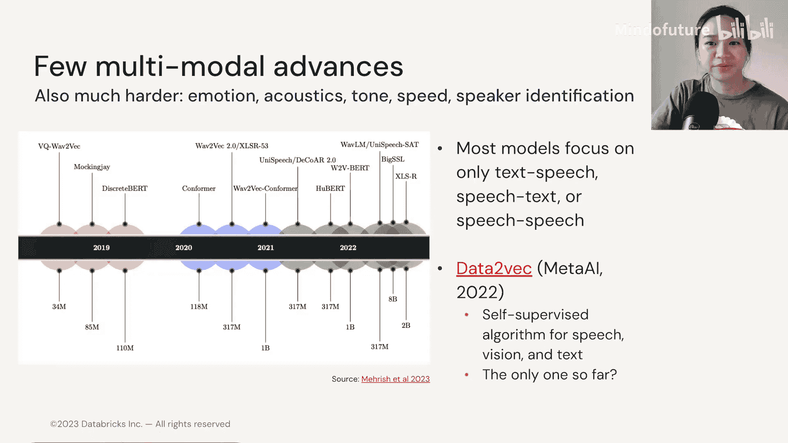

# 【Databricks】Llm模型底层基础 ｜ Llm： Foundation Models From The Ground Up p27 P27_模块_4-多模态LM-4.3_文本以外的 Transformer -BV1LZp9zXEab_p27-

We saw a suite of impressive and diverse multimod language model applications in the previous section。

 they all share one commonality， which is that they use some variant of transformer architectures under the hoop。

The transformer architecture is incredibly versatile， it is a general sequence processing tool。

 and as it turns out we can treat many things as a sequence， including an image。

 this is an image of my cat。An audio file。Some music notes。Video frames。

Even a series or a sequence of game actions and lastly protein as well。Specifically。

 the cross attention mechanism can help bridge between modalities， be it images， audio， text。

 or neuraltime series， and in fact this is what stable diffusion。

 which is a text to image model uses。So you can see on the right image over here。

 we can ask stable diffusion model to generate an image from text。

 and that is using cross attention to bridge between text and images。

Let's first look at how we can use transformers for computer vision。

How to use transformers for computer vision has been quite well researched ever since 2021 before then the de facto architecture for computer vision was convolutional neural networks。

The models I included in this slide represent milestones in the field of computer vision I won't go over every single model that I've outlined here。

 rather I will focus my attention on the vision transformformer。

 which is the first transformer used for computer vision that has outperformed convolutional neural networks by almost four times in terms of computational efficiency and accuracy。

It then spread on a series of research to apply transformers to computer vision。

We will also come back to zero shot and few shot learning in the context of computer vision and transformers as well。

But first， we need to understand how we can represent images as numbers。

When we buy a new phone or a new camera， a detail that we might care about is the camera resolution。

 which is the number of pixels in a photo usually noted in megapixels。

 we can chop an image up into many， many small pixels and each pixel will contain information on the primary color composition。

 namely how much blue， how much green， how much red you are seeing in the image。

So you can see in the image in the center over here for each pixel。

 we see that there is a hex code and also the RGB levels。

 which is what we commonly pass in to neural networks。

And the pixel values can range anywhere from 0 to 256。As it turns out。

 color images can be represented as tensors in text processing。

 we typically represent our text embeddings in the matrix form。

 which is a 2D tensor for color images they are 3D tensors。

 The third dimension is the number of channels representing red， green and blue。

Grayscale images can be 3D tensors too， but since all three channels share the same value。

 we can represent them as 2D tensors。 This is why we often use grayscale images in large scale image processing models because they require much less space。

The initial intuition for pixel processing is to simply turn them into a sequence。

We can use the sequence of pixels。In both the autoregressive context or the masked modeling context like BRT。

 but instead of predicting the next word token， we use self attention to predict the next pixel。

But there are two limitations。First is that we lose the vertical spatial relationship between the pixels。

 And this is not hard to see， because now when we flatten this。

Pixels into a single sequence from left to right， we no longer know that if this gray box over a gray pixel over here is directly above the olive green pixel。

Secondly， this method of using self attention incurs really high complexity all of n square。

 because we need to calculate the complexity of each pixel with respect to all other pixels。

Even in a lower resolution image like 256 times 256。

 we will have over 65 k calculations if you take 256 squared across from left to right。

But we also need to replicate that from top to bottom as well。

So for our 256 times 256 image we would have 10 to the power of nine calculations for a single attention layer you can imagine how much more computational resources we need when we have an even higher resolution image than 256 times 256 so this approach is not viable。

Here comes vision transformers， let's now cover the terminology first。

Vision transformer represents an input image as a series of image patches。

 I hope my CAt Pro here doesn't might have chopped her up into 16 different pieces over here in NLP we call this patches the individual patches that you are seeing words or subward tokens right。

For vision transformformer， it splits an image up into 16 times 16 patches here。

 but in this image I'm only chopping my cat up into four times four pieces。

So when you go from left to right， you can imagine that there are  patch。

 there are 16 patches and within each patch， there are multiple pixels。

This is why the Vi transformformer paper is titled an image is worth 16 times 16 words。

So vision transformers split a large image up into a sequence of patches just like you are seeing here。

 and each patch has a dimension of three， which is number of channels， times pixel。

 number of pixels and number of pixels。After building the image patches。

 VIT then uses a linear projection layer to match the image patch into a D dimensionsional vector。

These D dimension of vector outputs are called patch embeddings。

 just like similar words should occur in a similar embedding space。

 similar image patches should also be patched to similar patch embedding space as well。

 so you can imagine that there is an embedding space over here where we are mapping different patch embeddings onto that space。

But if you recall from module， the first module in this course。

 we learn that transformers do not have any default ordering mechanism。

 but we need to enable the model to somehow know or infer the order or the position of the patches。

Therefore， VIT add positional embeddings。After adding the positional embeddings。

 the patch embeddings are now complete。Now here is where we refer to something that we learn about B。

In BRT， a feature that's introduced to transformers is the use of this token。

 the CS token which stands for classificationification token this token is a special token because it actually doesn't represent an actual token。

 it begins with a blank slate， so the transformer will be forced to learn to encode a general representation of the entire sequence into that emdding。

So VIT also uses the same logic by adding this CS token， otherwise also known as learnable embedding。

So the output of this learner embedding would then be used as an input to the classifier so that the classifier can learn to make accurate predictions later。

So as you can see over here， we're now passing this entire sequence as an input to a standard transformer encoder。

Then we pretrain the model with image labels from imageNet dataset， which is what VIT is using。

At the very end， the output of the last transformer block goes through a classification head。

 which then gives us an image class prediction。That is how VIT works。

We find that VIT only outperform RESNes， which is another popular convolutional network based neural network for computer vision on larger data sets。

 so you can see that。For IageNe alone， when the image data set is smaller than VIT performs worse。

 but on larger data， VIT outperforms BNe。Something to note though is that VIT is much more computationally efficient to train than ResNe。

 in fact， it is four times faster than ResNe to train。There are many。

 many other follow ups to this VIT research using attention mechanism for computer vision。

One of them is called swing transformer， and the next one is called MLLP mixer。

Granted MLP mixer is actually not a transformer nor a CNN。

 but inspires many concurrent papers and follow ups based on the findings from this paper。

 So if you're interested about what MLP mixer is doing， definitely check out their paper。

I also wanted to mention that vision transformers are an evolution， not necessarily a revolution。

 according to this professor of computer science at New Michigan， his name is Justin Johnson。

 he said that we can fundamentally solve the same problems using convolutional neural networks。

 but the main benefit with using attention probably comes down to speed because matrix multiplication is much more hardware friendlyri than calculating convolution so VITs with the same floating point operations as convolutional networks can train and run much faster。

Now， let's take a look at audio。Audio can be represented as a function of frequency and time。

The same idea applies to audio as well， where we can create embedding vectors for each fixed length of audio frame。

So you can see that as I go from left to right， this tells me the length of the audio and each column will represent the length of each audio frame。

 so this could be every three seconds， every six seconds， every one minute and so on。Since now。

 we can simply represent audio as a sequence。Therefore， in embedding vector。

 we can also leverage the transformer architecture。

But what you will find is that audio usually is much longer than text length。

 So what do you see on this slide。Should look 90% or even higher。

 more familiar to you because it's basically the original encoder and decoder architecture。

But it has the addition of convolutional neural network layers after the input layers to reduce the audio input dimensions。

So this is a speech transformer。The authors of this paper also played with using optional modules like adding ReSNe or long short term memory networks。

 LSTMs to further process the inputs before passing them to the Transformer encoder block。

Compared to computer vision， there are much fewer multimod advances for audio。

 The models displayed on this slide are all transformers， but for a long time prior to 2019。

 audio processing models did not use transformer architectures。

 Most of these models that you see here， in fact， only focus on id text to speech。

 speech to text or speech to speech。And this is perhaps not surprising because it is hard enough to process audio only data and extract all the information available。

 you know things like emotion， acoustics， tone， speed， how to identify who is speaking， etc。

And the only model that seems to combine multimodality。

Is data to VAC model released by Meta just last year？

The other main challenge with producing such models is that it's much harder to procure high quality multimod data compared to just text data alone or image data alone。

So that's what we're going to discuss in the next section。

 what do training data for multimod models actually look like？

