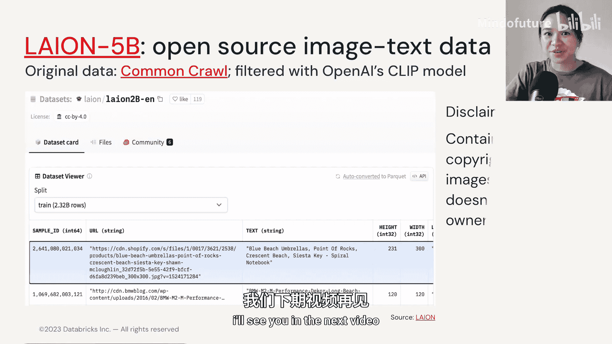

# 【Databricks】Llm模型底层基础 ｜ Llm： Foundation Models From The Ground Up p28 P28_模块_4-多模态LM-4.4_多模态大型语言模型的训练数据 -BV1LZp9zXEab_p28-

Would I write in to look at the training data for multimod language models？

Compared to text to image data and vicey versa， text to audio or text to video data are much harder to collect。

 In fact， many researchers have to manually curate them from scratch。 Here are a few examples。

If you look at the second image over here， we see that the annotators have to provide detailed video descriptions frame by frame。

 you deed by。First， next， then finally overall。Another group of researchers use the frameworkFA MOS。

Abbreviated as farmers。To describe the scenes that they see in the picture as well。

 so they divided up the scene description into either structured and also dense using the same framework。

The data can also look like this where it is organized into a JSO format or a tabular format the JSON file on the left shows a conversation exchange between a human and also a GT model。

Based on a particular image ID。On the right， we also see similar data but organize into a tableular format。

You might ask why can I ask models to generate data examples for me The answer is absolutely yes。

 but the caveat is you need to do some groundwork of providing high quality examples first you can see in the left image that the researchers did a comprehensive attempt to describe a particular image or scene first by writing pre caption。

Secondly， by labeling the objects in the image。And on the right image over here。

 the researchers also provide several caption examples to a single image that can apply correctly。

You can also see another conversation exchange that the annotators have written up。

So you can see that this is the level of detail that annotators have to put into before they can train a good model。

The best open source image text dataset set today is probably Laon 5B Many of the image text flagship models are trained of proprietary data sets。

 so this is the first large scale open source data set but is released for research purposes only it consists of 5。

85 billion clip filter image text pairs 2。3 billion of those are in English and 2。

2 billion of those are in other languages。There is a really important disclaimer though。

 the images in this data set are mostly copyrighted。

 and Leon doesn't claim any ownership over these images。Hopefully by now。

 you see that high quality data curation， especially for multimod use cases。

 can be really time consuming and is really nontri and yet that is the key to producing a high quality model。

The next question on your mind is probably， what if we don't have that much data or we don't have that much resources to collect good data。

 but still want to leverage these multimodel models？This is where few short learning comes in。

 I will see you in the next video。

