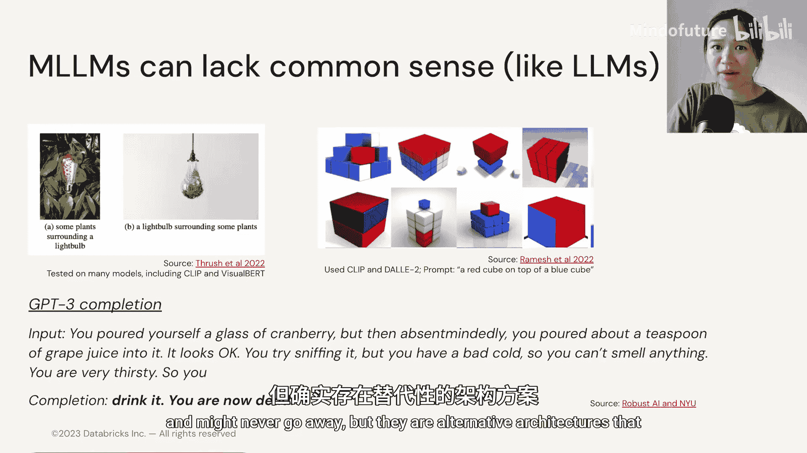
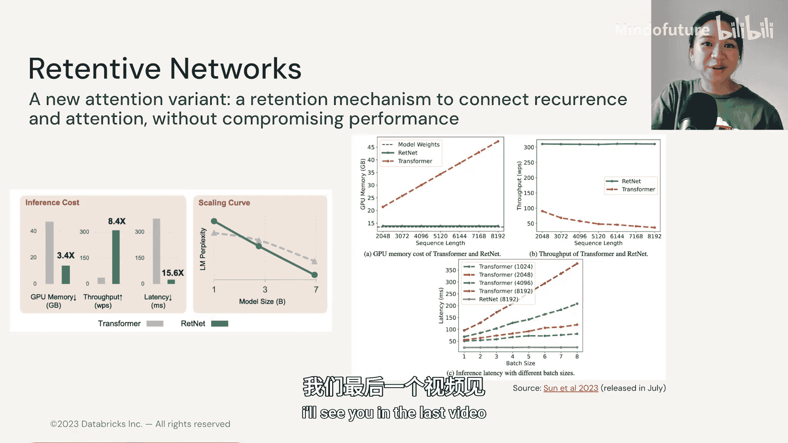

# 【Databricks】Llm模型底层基础 ｜ Llm： Foundation Models From The Ground Up p30 P30_模块_4-多模态LM-4.6_挑战与替代架构 -BV1LZp9zXEab_p30-

We saw in the previous section about the potential of multimod language models， However。

 we really haven't figured it all out yet。

Mululttimodel language models are not immune from LRM limitations， in fact。

 they inherit a lot of the same risk。First is hallucination。You can see over here on the right image。

 this is output by the flamingo model where it completely hallucininates what is in the image。

 for instance， when asked what is the message， what is on the phone screen。

 the flamingo output says a text message from a friend。

The other LOM limitations like prompt sensitivity or context limit and inference compute costs all apply to few short learning cases for multimod language models as well。

Unsurprisingly， it also inherits the same concerns for bias and also toxicity， for instance。

 this is one of the latest examples that we see on the internet where an Asian woman ask a model to make her photo more professional。

 but it made her photo more white。And what is interesting is that this model that the company has used uses fine tune on stable diffusion model and basically uses the best possible open source text image dataset set out there。

 which is La on。So it's very likely that this problem is not unique to this particular company。

And of course， we also have all sorts of copyright issues as well， just like for Leon。

 they don't claim any ownership over their copyrighted images。

A similar concern or question also arises for Reddit as well since we have been using Reddit data set to train a lot of large language models。

 and back in March or April they also pose this question that they want to get paid for helping to teach big AI systems。

Multimodel language models can also lack common sense as well。

 where we ask models to generate some image based on text， that output can be completely nonsensical。

And you can also see that we see the same problem with LOMs as well when we ask GPT3 to complete this prompt。

Something about cranberry juice， but you have a bad cold。

 but now GPT phrase says that you should drink it， but you will be dead。

So what's the next thing that well build to improve upon our existing models。

 it's possible that a lot of these challenges will be really hard to resolve and might never go away。

 but they are alternative architectures that we can consider other than the attention mechanism。

Attention and particularly self attention has been the focal point of the field of NLP and even for the field of computer vision。

But it looks like there are actually other existing or emerging promising contender architectures。

 I won't cover the mit gritty about all of the architectures。

 my goal here is to bring them into your attention because who knows what I stick。So first。

 let's talk about what might remain and become an integral part of every application。

It is none other than RLHF， which stands for reinforcement Learn with Human feedback。

No matter how good models get。Perhaps the best way to build a reliable model in production is to always involve humans in the loop。

Here， the human feedback is used to train the reward model。

And the reward model is typically another language model that outputs a label or a ranking or a score that is preferred by a human。

On the other hand， there is also KL loss to ensure that the fine tune model doesn't diverge too much from the original pretrain model。

So this reward model would encode human preference and assign a quality label to the model output。

Finally， the proximal policy optimization abbreviated as PPO。

 the algorithm will update the pretrained large language model based on the reward signal。

This is a really huge topic on its own， so I encourage you to reach about this topic in your own time。

Now let's talk about the possible next in architecture， it is called hyena Hierarchy。

 it uses convolutional neural networks rather than transformers or attention mechanism。

 and the researchers found that it makes a pretty good few short model for languages and it also matches the performance of vision transformers。

 so maybe CNNNs were making a comeback。The second architecture that has gained quite a bit of coverage in an NLP newsletters these days is retentive networks。

 the authors propose a new variant of attention， which is retention mechanism。

This retention mechanism can connect both recurrence and attention。

 but what is special about this mechanism is that it is able to achieve higher computational efficiency without compromising model performance and this is typically a really tough challenge to crack how do you have good model performance without it being too slow and vice versa。

So lastly， I want to wrap up this section by highlighting a variety of emerging applications in the field of multimod language models。

 I'll see you in the last video。

