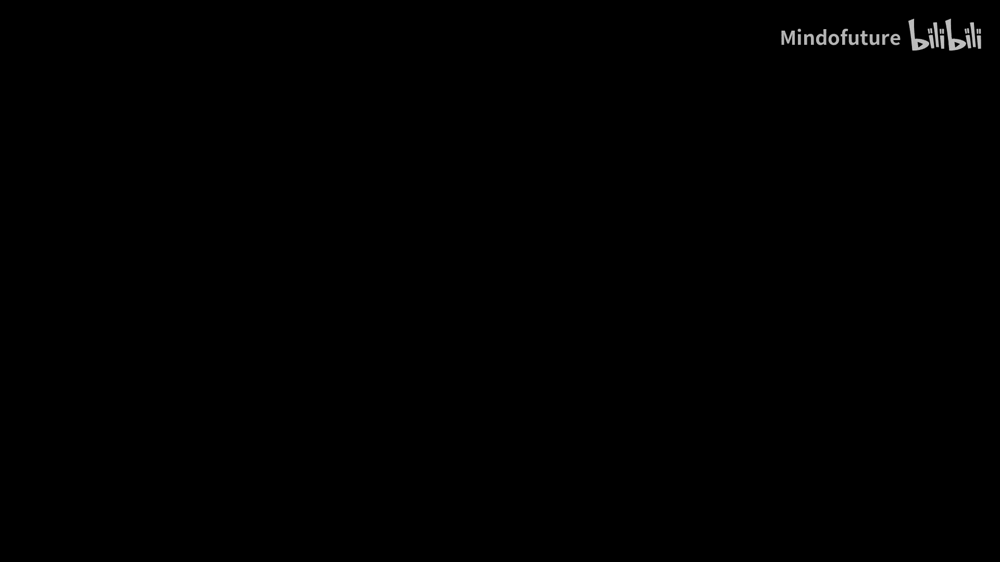
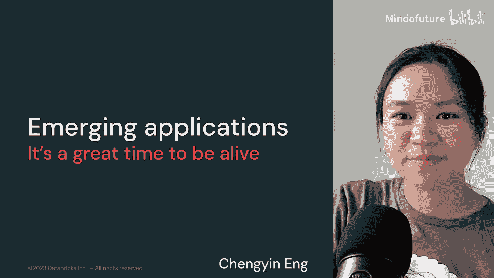
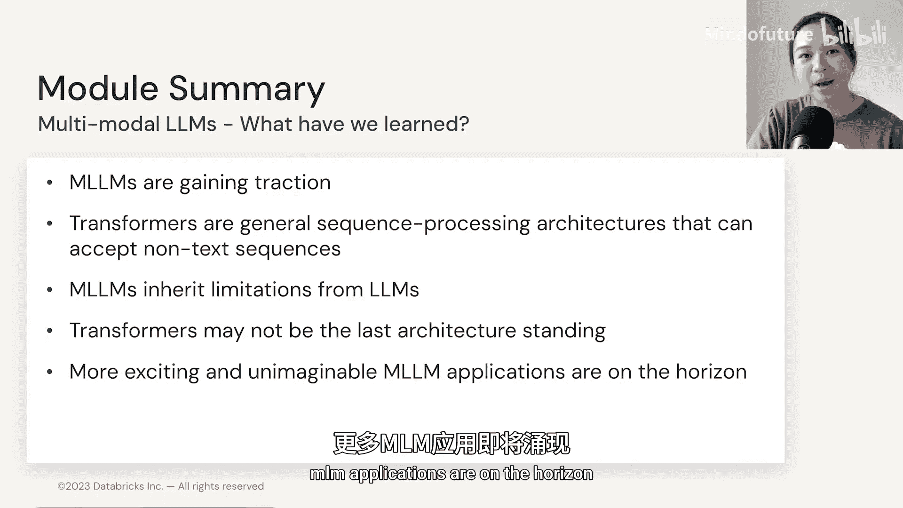
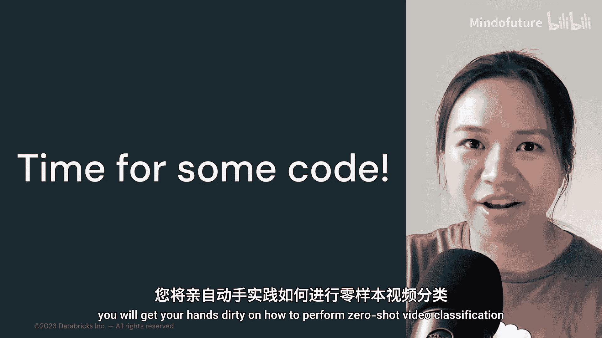
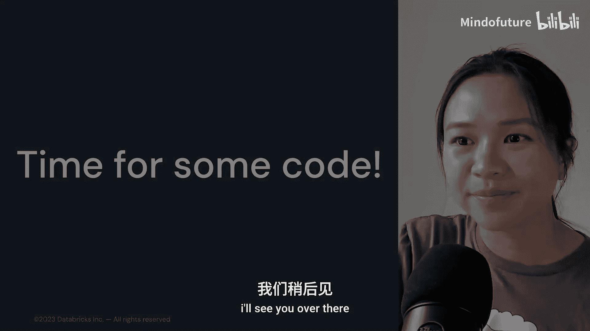

# 【Databricks】Llm模型底层基础 ｜ Llm： Foundation Models From The Ground Up p31 P31_模块_4-多模态LM-4.7_新兴应用 -BV1LZp9zXEab_p31-

It is indeed a very exciting time to be witnessing the emergence of previously unimaginable AI applications I have had the most fun putting this section together because it's truly wild to see how far the field has come I hope you will be inspired by these examples of next field applications that I'm showing and that you will keep learning perhaps you will be inventing the next newsworthy language model application。

😊。

First up is dream diffusion， you can generate 3D objects from text caption。In a similar vein。

 Meta release this megaVo application where you can generate videos from text。We also see P Ebot。

 where Google has taken PM， which is a language model to integrate with robotics applications。

Something that is probably closer to you and me in the industry right now is using large language models to generate code。

 and here we have Al code to solve the problem of the minimum number of minutes to make pizzas with end slices。

It is also really cool to see some progress finally from multilingual models。

 especially those that cover lower resource languages like Backchain X。

And it's very exciting to see more and more audio applications。

 particularly this textless NLP application where it can generate speech from raw audio without any text transcription。

 this is a pretty big deal because it can reduce the challenge of not having enough low resource language data available for training multilingual language models。

We're also starting to see the transformer architecture making waves in biological research because remember。

 you can treat protein sequences as a sequence。That can be easily passed into a transformer architecture。

Lastly， who knows maybe 10 years from now， we might all have a robot in every household that can do everything for us and with us。

 including playing games， chatting with us and stacking blocks because we all need that。

So as a quick recap for this module， we saw that multimod language models are truly gaining traction in a research field。

 transformers are general sequence processing architectures that can accept nontt sequences like audio and images。

 but they also inherit limitations from the pretrained large language models that we have been using。

As long as transformer architectures have been around and have been omnipresent for。

 it seems like they might not be the last architecture standing and more and more exciting。

MLOM applications are on the horizon。

Now in the demo notebook， we'll be looking at how we can build our own image captioning model。

 and in the left notebook， you will get your hands dirty on how to perform zero shot video classification。

I'll see you over there。

