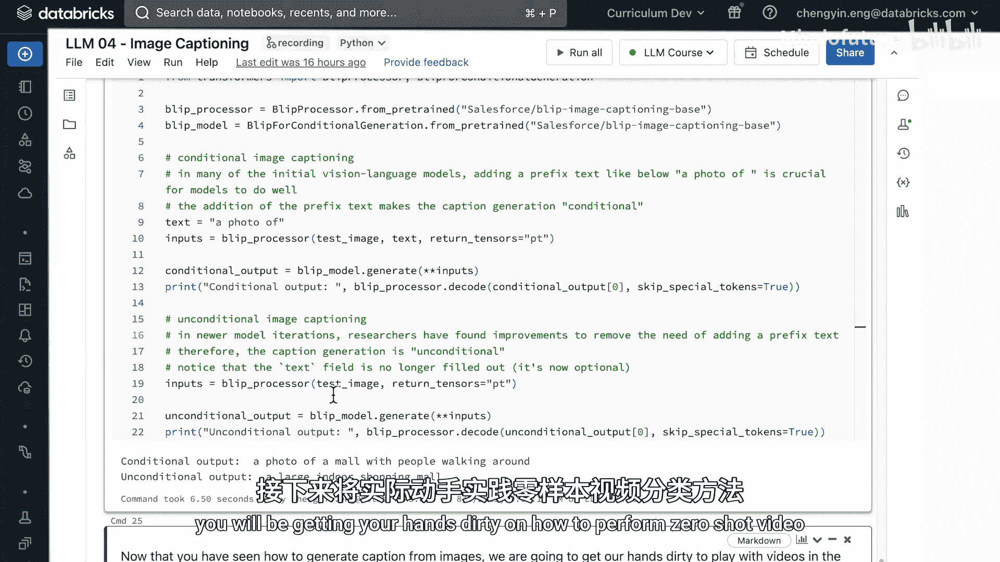

# 【Databricks】Llm模型底层基础 ｜ Llm： Foundation Models From The Ground Up p32 P32_模块_4-多模态LM-4.8_笔记本 -BV1LZp9zXEab_p32-

In the presentation， you saw that transformers are general sequence processing architectures in this notebook we're going to be implementing our own image captioning model where we can select a transformer based vision model and a transformer based text model and connect them together。

Then we are going to compare our own stitch together image captioning model against a pretrain image captioning model。

First， I'm going to run this classroom setup cell。In this notebook。

 we'll be using this data called SBU captions as our data to train our own image captions model。

SBU captions。I's a data set that contains 1 million pairs of image URLs and also caption。

 all the images are from Flickr and all the captions。Are in English。To build a image to text model。

 we have to first define how we can process our data before we do that， let's build our data first。

And then in the following cell， we'll be defining a data processing function that can take in both images and also process the caption that is available in the data set。

You will find that in this class there are a few methods that are expected by hug phase。

 namely getting the length of the data and also how to retrieve the item from the dataset。

In this function over here， you will realize that we are writing code to tell the decoder and also the encoder to be able to process the image URLs and also cap。

For each image， we are going to be sending a request to the URL to get the content of the pixel value。

And we'll be using feature extractor for the image model to do that。Secondly， to process caption。

 all the text caption have to go through a tokenizer to be processed into individual word tokens or sub word tokens。

And we'll be using a pretrain tokenizer to help us do that。

So you can see that we are relying on all of the box tokenizer and future extractors here。

 and for each of them， we are going to be initializing them。For tokenizer。

 we'll be using GT tool and for feature extractor， we'll be using VIT division vision transformer model to help us process the images。

 so we'll be using tokenizer and Vi extractor from GT2 and VIT respectively to help us process the images and then we'll connect them both together as a vision encoder decoder and fine tune that model。

So this tells us that we can pretty much choose any tokenizer or feature extractor that we want to experiment with and then build our own image captioning model from there。

To speed up the fine tuning process later， we'll be using only a subset of the data。

 2000 out of a million image taxpayers。Finally， we are ready to connect dumb boths in a vision encoder decoder architecture。

So here you will see that。We're getting。The architecture of GT2 and also VIT from。

Hugging face itself。You will also see in this hugging phase output that we say some of the weights of GT2 are not initialized。

This has been a consistent behavior since the start of hugging phase implementation。

 but since 2020 they have added this warning to make it explicit that the weights are not loaded。

 so if we were to apply this on a downstream task like we are now。

 ideally we should actually be fine tuning our own decoder first before applying this so you will see that there is also explicit recommendation from hugging F that you should probably train this model on downstream task to be able to use it for predictions at inference。

For simplicity sake， we're simply going to use both of these models as they are。

 and we're going to fine tune the image captioning model on the whole。So later on。

 watch out for what is a performance that we're getting from this non fine tune GbT2 decoder。

Before we start fine tuning our image captioning model。

 we can define some of the model configurations at the top level。For example。

 how to treat pet token and anop sequence token， how to treat vocabulary size。

 what is the number of beams and also maximum length in the output caption。Finally。

 we are ready to train our own image captioning model。

Here we're defining a couple more parameters like batch size and also train epochs。

We'll be using the good old training arguments and trainer class from hugging face to simplify our training step。

So all we need to do is simply pass in。The arguments were where do we want to save the checkpoints。

 the number of epos that we are training this model on？And what is these？

Training arguments and also the training data set we'll be using。

You have already seen this data collateder before in module2。

 and this is simply a function that can help us do。Put our data sets in batches。

Now we can finally train the model。Just like in module 2。

 you will see this N off floor run being triggered automatically。

You can click on the link over here to keep track of what。Ths M myflow has。Be keeping record off。

 you can also click on the sidebar over here to take a look at ML floor runs。

So this cell would take roughly one and a half minute to finish。Now that this training step is done。

 we can use this model to generate caption from our image。

 so now we are going to load an image from our test data set and you can see that this is an image that looks like it't an outdoor space with our vendors and also people visiting individual stores。

Now let's look at the caption that generates for us。So you can see that our decoder。

 our caption generator here is telling us that this is a view of the beach from the beach above the cliff which is completely irrelevant to this image and this comes back to the reason that we have mentioned before which is that our text decoder weights were not completely loaded from hugging F hubub and just in case it wasn't clear just now so the weights on hugging F Hub doesn't include all of the checkpoints and that is why our decoder weights are not available to be downloaded from the pre-trained checkpoints and that's why hugging phase recommends the users to further fine tune the model based on a downstream task so the best approach that we should have done is to train the decoder separately on the training data set first and then load the fine tune decoder itself。

Of course， the second reason that we could look into is to simply do more fine tuning by increasing the number of epos or increasing the number of training data samples that we are providing and adjust other model hyperparameters as well。

So you can apply this process to any combination of tors which feature extractors that you want。

 and then connect them as an encoder decoder model。To generate captions for your images。

But of course， it would definitely be much easier if you were to just use all of the box image captioning model and that's what we're going to do next。

So in the next section over here， we'll be using an existing image captioning model calledbl this Blip model stands for bootsottrapping language image pre traininging。

It stands out from other types of image captioning models because it not only has a captioner that generates captions。

 but it also has a filter to filter out the non relevant captions。So let's see how this does。

We are going to first load the Blip model from Huging Face Hub。

And then we're going to use two different methods to generate image caption。

 The first method is what we call as conditional image captioning。

This idea of conditional image captioning is quite prevalent in the early stages of vision language models。

 where the core idea is that if you were to add a prefix text，That prompts the model， for example。

 a photo of or photograph of， then the decoder model to generate caption tends to do a better job at generating a relevant caption。

So the fact that we are including this prefix text makes this image captioning step conditional。

But as time goes by， researchers have found a way to circumvent around the need of providing prefix text。

Therefore， currently there is also a way to generate text without specifying a prefix text。

 and that's what we call as unconditional image captioning。

 So you will see that in both line 10 and line 19， even though we're using exactly the same。

Method over here， blink processoror。But you will see that the text is not present in one of them。

So for conditional image captioning， we'll be passing in a prefix text。

 but we're not going to do so for unconditional image captioning and let's now compare the results for both of them。

So you will see that the conditional output tells us that the photo above is a photo of a mall with people walking around。

And a second caption that it generates from unconditional output is a large indoor shopping mall。

 so technically both of these captions are accurately representing the image that we see above。

 so this also informs us why evaluation often is hard because there can be multiple correct answers to the same image same goes to if we were to hire human annotators to label images。

 we can also receive multiple correct captions for the same image as well。

So hopefully now you clearly see that using a pretrain or just using a image captioning model as is that is specific for image captioning。

 is going to perform much better if we were going to just stitch together a feature extractor and a tokenizer together and fine tune on our data set。

And of course， to get to similar levels of this pre train model。

 we can further fine tune our previously。DIY transformer architecture of vision and vision Ender and text decoder。

 and just fine tune that a bit more and that we might be able to see at least better results than what we're seeing here above。

So now that you have seen how to generate caption from images in the lab。

 you will be getting your hands dirty on how to perform zero shot video classification。

