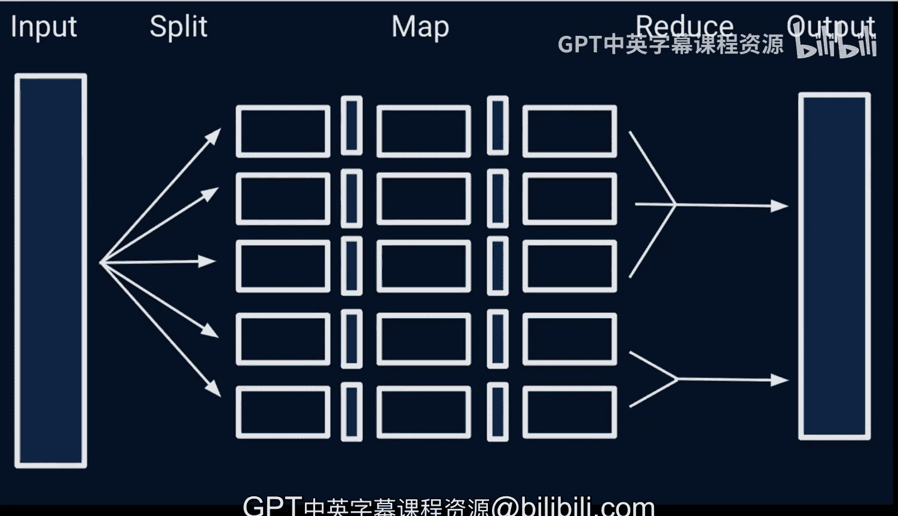
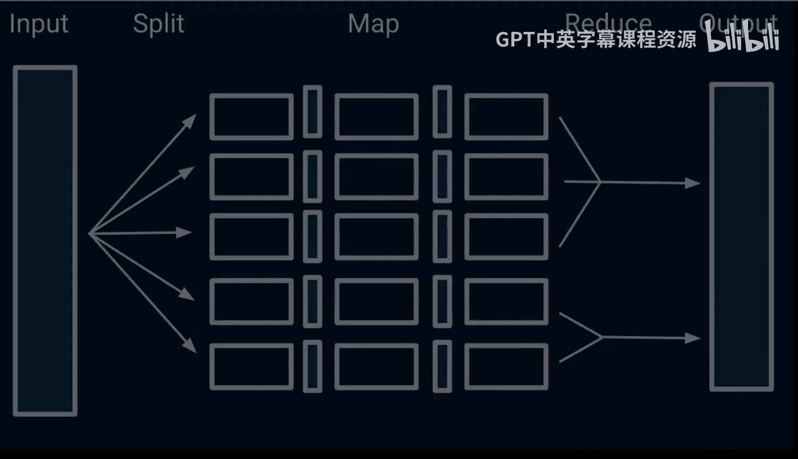

#  004：Hadoop入门 🐘

在本节课中，我们将要学习Apache Hadoop的基本概念。Hadoop是一个用于处理大数据的平台，同时也是MapReduce编程模型的一种实现。我们将了解Hadoop如何工作，以及它在处理无法完全放入内存的大型数据集时所采用的策略。

## 什么是Apache Hadoop？ 🤔

现在，我们来谈谈Apache Hadoop。Apache Hadoop是一个用于处理大数据的平台。它也是MapReduce编程模型的一种实现。

术语“Hadoop”既指MapReduce编程模型的Hadoop实现，也指Hadoop生态系统中的工具。Hadoop将工作分配到多台机器上，这些机器在集群中被称为节点。它将中间数据写入磁盘，以此作为处理无法全部放入内存的大型数据的策略。

## Hadoop的工作流程 🔄

如果我们有存储在磁盘上的输入文件，并打算使用Hadoop来处理它们，第一步是将文件分割成多个分区。

然后，我们在这些分区上运行各种转换，这个阶段被称为**Map阶段**。在每次转换之间，中间文件会被写入磁盘。接着，下一个转换步骤从磁盘上的这些文件中读取数据。

最后，数据被合并以产生最终输出。这个最终的合并阶段被称为**Reduce阶段**。

以下是Hadoop处理流程的核心步骤概述：

1.  **文件分割**：将输入文件分割成多个分区。
2.  **Map阶段**：对每个分区应用转换操作，并将中间结果写入磁盘。
3.  **Reduce阶段**：读取磁盘上的中间结果，进行合并，生成最终输出。

这个过程可以用一个简化的公式来描述：
`最终输出 = Reduce( Map( 分割(输入文件) ) )`

## 总结 📝

本节课中我们一起学习了Apache Hadoop的基础知识。我们了解到Hadoop是一个分布式大数据处理平台，它通过将数据分割、在Map阶段进行转换、将中间结果写入磁盘，最后在Reduce阶段合并结果的方式来高效处理海量数据。理解这个工作流程是掌握后续更复杂数据工程概念的重要基础。