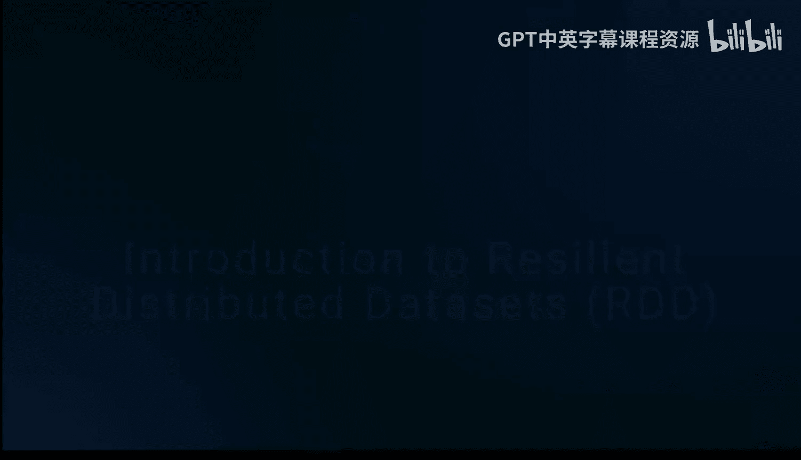
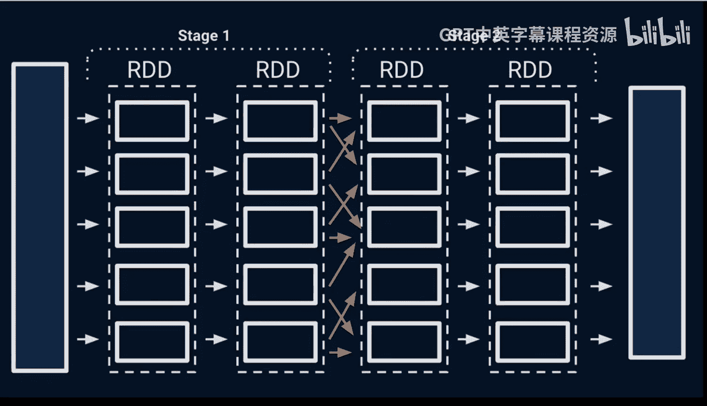

#  006：弹性分布式数据集(RDD)简介

在本节课中，我们将介绍弹性分布式数据集，即RDD。我们将讨论使用RDD时的数据流，并向您展示如何创建和操作一个RDD。

## 概述

弹性分布式数据集是数据和任务在节点间分区的抽象。它有两种核心操作：一种是惰性的**转换**操作，另一种是返回计算结果的**行动**操作。RDD之所以具有弹性，是因为当节点发生故障时，它能够恢复并重新计算本应在该节点上处理的数据。

## RDD的数据流

上一节我们介绍了RDD的基本概念，本节中我们来看看RDD在Spark作业中的具体数据流。

通常，一个作业会包含若干转换操作和一些行动操作。每个转换操作都会创建一个新的RDD，每个行动操作也会创建一个RDD。但需要注意的是，转换操作是惰性的，它们并不会立即应用到数据上，直到一个行动操作被触发执行。

以下是RDD数据流的典型过程：
1.  从磁盘等数据源读取初始数据。
2.  当我们对数据调用一个转换操作时，一个RDD被创建，数据在这个RDD内部被分区。分区由Spark自动完成，但您也可以手动调整。
3.  经过一系列转换操作后，最终运行一个行动操作。
4.  行动操作的运行会触发所有之前的转换操作真正应用到数据上，并最终完成计算，产生输出结果。

## 转换、行动与阶段

我们已经了解了转换和行动的区别。现在，让我们深入探讨一个影响性能的重要概念：**洗牌操作**。

某些转换操作需要数据在分区之间重新分配，例如对数据进行重新排序。这类操作被称为**洗牌操作**，它们比其他操作的开销更大。在洗牌过程中，数据会被写入磁盘，这同时也成为了故障恢复的一个检查点。

洗牌操作还定义了**阶段**之间的边界。非洗牌操作会在一个阶段内连续执行，直到遇到一个洗牌操作，该洗牌操作即标志着一个阶段的结束和下一个阶段的开始。

## 总结

本节课中我们一起学习了弹性分布式数据集的核心概念。我们了解到RDD是Spark中一种弹性的、分布式的数据抽象，它通过惰性的**转换**和立即执行的**行动**两种操作来处理数据。我们还探讨了数据如何在RDD中流动，以及**洗牌操作**如何划分计算**阶段**并影响性能。理解这些基础概念是掌握Spark编程的关键。