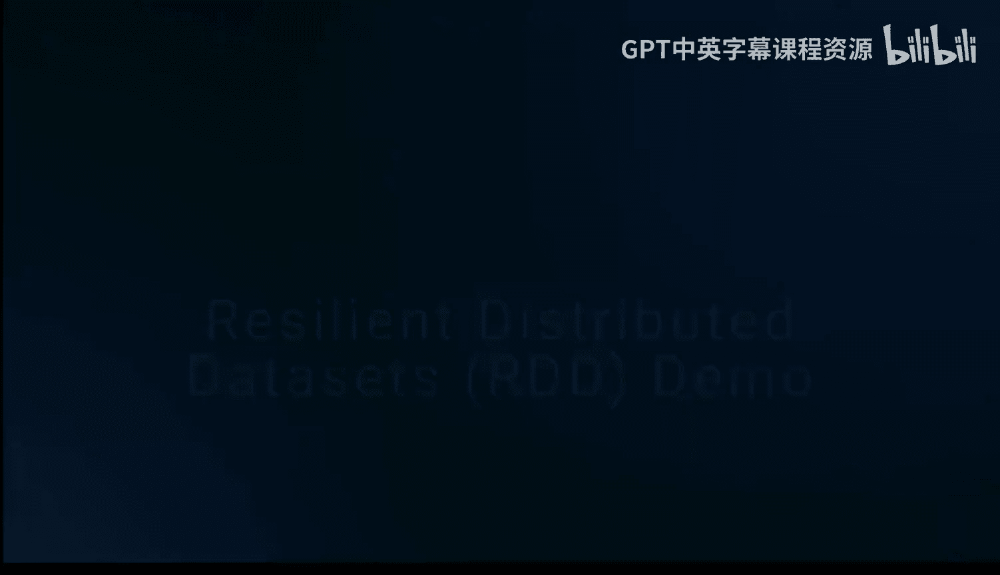
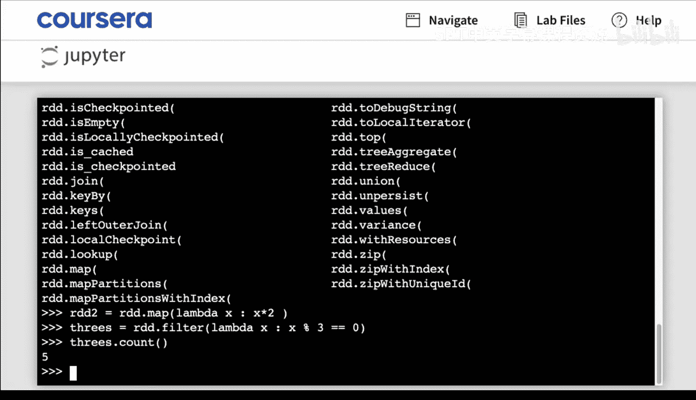
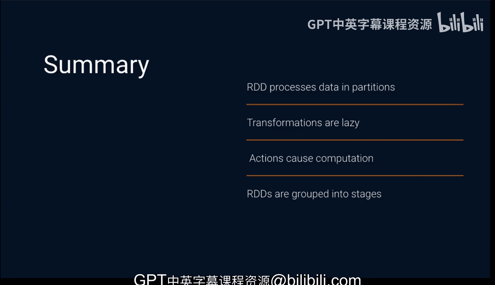

#  007：弹性分布式数据集(RDD)演示 🚀



在本节课中，我们将学习如何在交互式PySpark环境中创建和操作弹性分布式数据集（RDD）。我们将通过一个简单的例子，演示RDD的创建、转换操作和行动操作，并理解其惰性计算特性。

## 启动PySpark交互式环境

首先，我们需要启动一个PySpark交互式环境。PySpark可以通过常规的Python工具（如Pip或Anaconda）安装。安装完成后，假设已安装适当版本的Java，我们可以在命令行中输入 `pyspark` 来启动PySpark shell。

启动后，shell会为我们提供一个Spark上下文（Spark Context）和一个Spark会话（Spark Session）。通常，在交互式shell之外编写Spark作业时，我们需要通过代码来设置上下文和/或会话。会话是与Spark交互的更现代方式，也是当前推荐的方式。然而，要查看RDD，上下文仍然是使用的工具。

## 创建简单的RDD

接下来，让我们创建一个简单的RDD。首先，我们创建一个数字列表。

```python
numbers = list(range(15))
```

你可以看到我们有一个从0到14的数字列表。接下来，我们将使用这个列表作为输入来创建一个RDD。

```python
rdd = sc.parallelize(numbers)
```

调用上下文上的 `parallelize` 方法，你可以看到返回的对象是一个RDD。

## RDD的转换与行动操作

这个RDD有许多内置方法。这些方法包括代表转换（transformations）和行动（actions）的方法。转换操作是惰性的，而行动操作会触发实际计算。

以下是RDD的主要操作类型：

*   **转换（Transformations）**：对RDD进行变换，返回一个新的RDD，例如 `map`、`filter`。
*   **行动（Actions）**：触发计算并返回结果，例如 `count`、`collect`。

现在，让我们在这个RDD上调用一个 `map` 方法。作为 `map` 方法的参数，我们将给它一个Lambda函数。这个函数的作用很简单，就是将每个值乘以2。

```python
mapped_rdd = rdd.map(lambda x: x * 2)
```

接下来，我们使用 `filter` 转换操作。这里我们将使用一个Lambda函数，它会返回一个布尔值。这个Lambda函数将在 `x` 能被3整除时返回 `True`，否则返回 `False`。

```python
filtered_rdd = mapped_rdd.filter(lambda x: x % 3 == 0)
```



此时，你可以看到通过调用 `count`（这是一个行动操作），我们实际上触发了转换操作的发生，并且可以看到此时还剩下5个元素。

```python
filtered_rdd.count()
```

## 总结



本节课中我们一起学习了RDD的核心概念和基本操作。我们了解到，RDD以分区（partitions）为单位处理数据。RDD有两种类型的操作：惰性的转换操作（transformations）和触发计算的行为操作（actions）。这些操作本身又被分组到不同的阶段（stages）中执行。通过实践，我们掌握了在PySpark shell中创建RDD、应用转换和行动操作的基本流程。