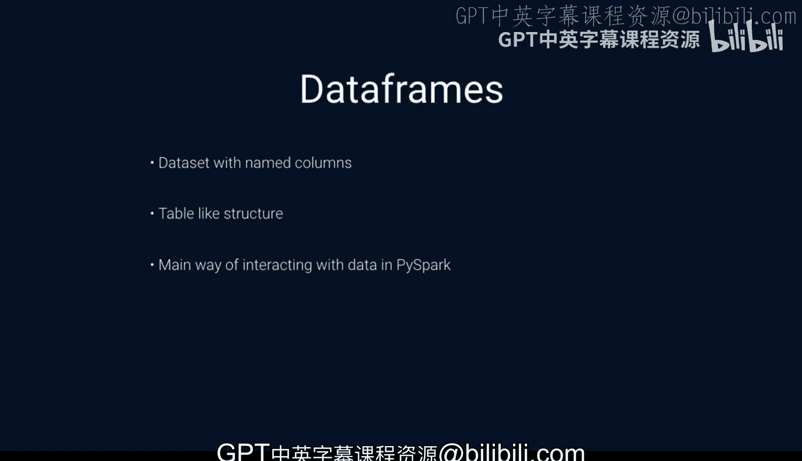

#  008：Spark SQL简介 🚀

在本节课中，我们将介绍Spark SQL模块。我们将了解数据集（Data Set）和数据框（Data Frame）的概念，并展示如何创建和操作PySpark数据框。

## 概述

虽然RDD（弹性分布式数据集）仍然是Spark运作的核心，但一个更现代的模块——Spark SQL——已被加入，并且现在通常是我们与Spark交互的主要方式。Spark SQL是一个用于结构化数据处理的模块。它利用数据结构信息和具体的计算逻辑来创建优化的操作。这些优化使其比直接使用RDD更快、更高效。

## Spark SQL模块介绍

上一节我们概述了Spark SQL的作用，本节中我们来看看它的具体构成。Spark SQL提供了两种API：一种是SQL API，另一种是数据集（Data Set）API。在PySpark中，数据集以数据框（Data Frame）的形式呈现。在Scala版本中，数据集和数据框有所区分，而在Python版本中，只有数据框。但由于Python的交互特性，我们同样能享受到数据集的所有优势。

### 核心概念：数据集（Data Set）

一个Spark SQL数据集是一个**分布式数据集合**。它既拥有RDD的优势，又结合了经过优化的Spark SQL引擎。数据集API在Java和Scala中可用。

### 核心概念：数据框（Data Frame）

一个数据框是一个**带有命名列的数据集**。它创建了一种类似表格的结构，如果你熟悉Pandas等包中的数据框，可能会觉得这种结构很亲切，但两者有所不同。数据框是在PySpark中与数据交互的主要方式。

## 总结

本节课中我们一起学习了Spark SQL模块的基础知识。我们了解到Spark SQL通过优化操作提升了处理结构化数据的效率和速度。我们介绍了数据集作为分布式集合的概念，以及数据框作为带有列名的、表格化结构的数据集，并明确了数据框是PySpark中进行数据操作的主要接口。