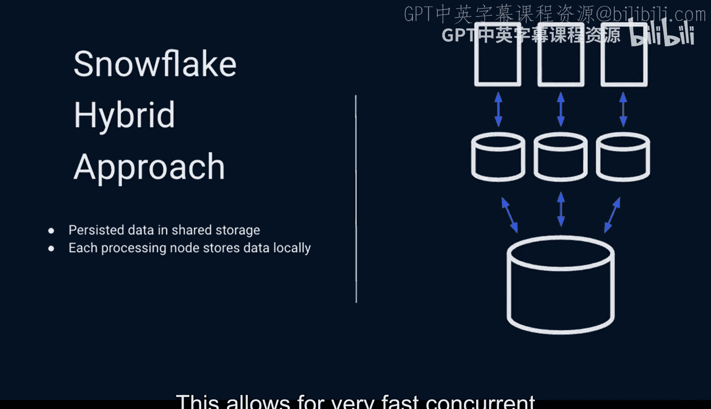

#  011：什么是Snowflake ❄️

在本节课中，我们将介绍Snowflake。我们将概述Snowflake的整体架构，包括其数据库存储层、计算层和云服务层。

Snowflake是一个为大数据设计的存储与计算平台。它以服务形式运行在公共云上，包括AWS、Microsoft Azure或Google Cloud。你可以根据偏好选择提供商。Snowflake使用其专有的**Snowflake SQL**，这意味着它并非采用其他数据产品设计的SQL版本。

## 大数据存储方法

在探讨大数据存储方法时，存在多种不同的实现方式。

以下是几种主要的大数据存储架构：

*   **共享一切架构**：这是传统且最简单的方法。你将数据库安装在一台服务器上，所有希望在数据上运行的计算或进程都在这台与数据库相同的服务器上执行。大多数非大数据解决方案都采用这种方式。你会有一个关系数据库，它位于服务器上，你与之交互。这种方式很好，并且在数据量未达到影响效率的程度时，这无疑是最优选的解决方案。
*   **共享磁盘架构**：在这种情况下，计算在多个独立的节点上进行，但这些节点都使用相同的存储。这种架构的缺点是，单个计算节点的计算效率可能会受到干扰，因为如果它们需要访问与另一个节点相同的数据，则可能需要等待。
*   **共享无架构**：在这种情况下，每个计算节点都拥有自己专用的存储。

Snowflake采用了共享磁盘和共享无架构的组合，即一种混合方法。因此，其持久化数据存储在共享存储中，而每个处理节点在处理期间都拥有并使用其所处理数据子集的一个副本。这种设计允许非常快速且并发的处理，同时兼具共享持久化存储的简洁性。

## 总结

本节课我们一起学习了Snowflake的基本概念。我们了解到Snowflake是一个运行在主流云平台上的大数据存储与计算服务，它使用专有的SQL语言。我们还探讨了不同的大数据存储架构，并重点介绍了Snowflake所采用的、结合了共享磁盘和共享无架构优势的混合设计，这种设计旨在实现高效并发处理与存储管理简洁性的平衡。