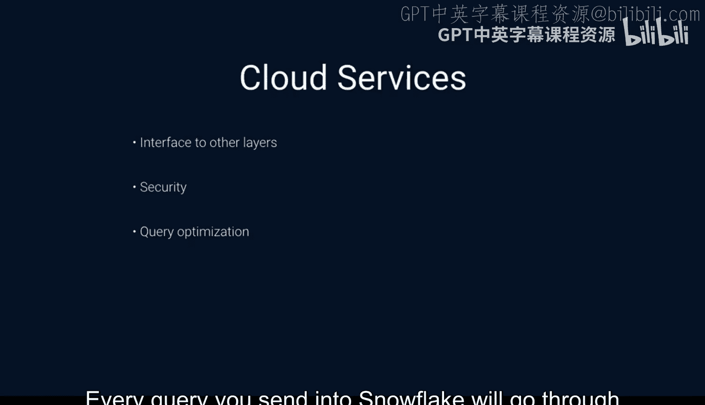

#  012：Snowflake三层架构解析

在本节课中，我们将要学习Snowflake数据仓库的核心架构设计。Snowflake采用独特的三层分离架构，这种设计使其在性能、扩展性和成本管理方面具有显著优势。

## 架构总览

Snowflake被设计为三个独立的层次。最上层是云服务层，中间是计算层，最底层是数据库存储层。每一层都可以独立于其他层进行扩展。这意味着你只需为你实际使用的扩展部分付费。

## 数据库存储层

上一节我们介绍了架构总览，本节中我们来看看最底层的数据库存储层。

数据库存储层完全由Snowflake管理。文件的大小、加密类型、数据布局等所有细节都由Snowflake端管理，用户无法直接查看。数据以优化的列式格式存储，所有数据都经过压缩和加密。访问这些数据的唯一方式是通过计算层使用Snowflake SQL。

## 计算层

了解了数据如何存储后，本节我们来看看负责数据处理的计算层。

计算层中，你将主要与虚拟仓库进行交互。虚拟仓库是由Snowflake从云服务商处分配的一组节点集群。这些节点在不同的仓库之间是隔离的，因此一个仓库的性能不会影响另一个仓库。

这些仓库可以进行水平或垂直扩展。水平扩展是指向仓库添加额外的节点集群，而垂直扩展是指添加更大或更强大的节点。这两种扩展都可以在仓库运行时进行。

此外，这些仓库被设计为可以自动停止和自动恢复。这意味着你只需在仓库启动和运行时付费。

以下是两种主要的仓库类型：
*   **标准仓库**：用于常规的数据处理任务。
*   **Snowpark仓库**：这是较新的类型，专为需要大量内存的任务设计，例如机器学习任务。

## 云服务层

最后，我们来看看协调一切的顶层——云服务层。

云服务层是你与所有其他层交互的接口层。它负责处理安全、身份验证和授权。同时，查询优化也发生在此层。你发送到Snowflake的每一个查询，在到达计算层之前，都会先经过云服务层的处理。

## 总结

本节课中我们一起学习了Snowflake的三层架构。我们了解到，其**数据库存储层**负责安全、高效地存储数据；**计算层**通过可独立扩展的虚拟仓库提供处理能力；而**云服务层**则作为大脑，协调安全、优化和所有交互。这种分层且独立扩展的设计，是Snowflake实现弹性、高性能和成本效益的关键。