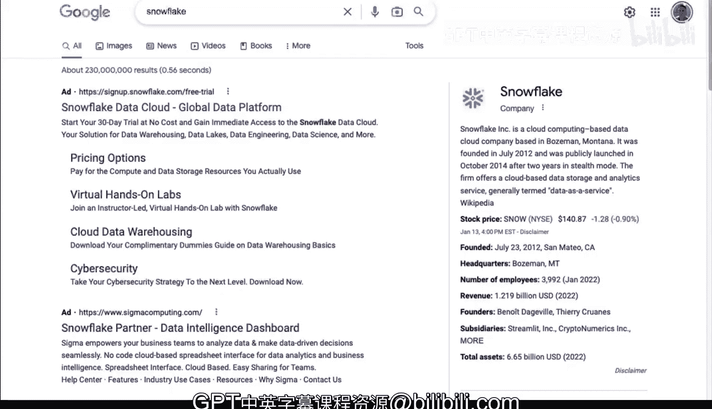
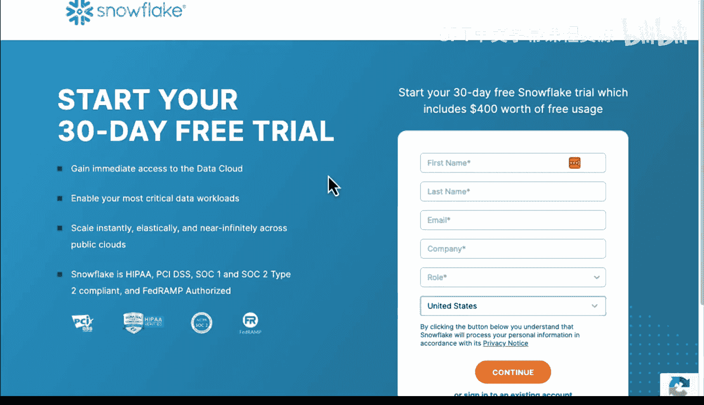
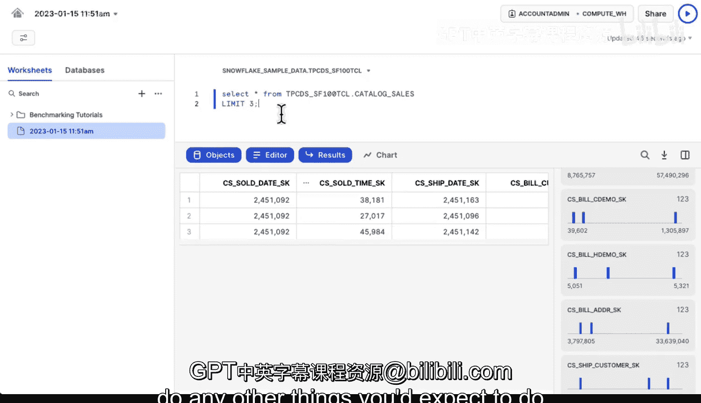

#  013：Snowflake Web用户界面入门指南 🚀

在本节课中，我们将学习如何访问和使用Snowflake的Web用户界面。我们将从注册免费试用开始，逐步探索其核心功能，包括数据浏览、工作表编写以及查询执行。

## 概述

Snowflake是一个云数据平台，其Web界面是管理和操作数据的主要工具。本节将引导你熟悉该界面的布局和基本操作。

## 访问与注册

首先，访问Snowflake官方网站。你可以注册一个免费试用账户。建议你注册一个账户，并跟随本周课程中的示例进行操作。

当你首次登录Snowflake时，界面顶部会显示你的账户信息。

## 界面功能概览

Snowflake Web界面包含多个主要功能区域。以下是这些区域的简要介绍。

*   **工作表**：这是你编写SQL代码并在Snowflake上运行的地方。
*   **仪表板**：你可以在此处设置数据可视化仪表板。
*   **数据**：这是访问数据服务层的地方，你可以在此管理数据库、模式和表。
*   **市场**：提供第三方插件，Snowflake周围有一个庞大的生态系统提供这些服务。
*   **活动**：你可以在此查看账户的历史活动记录。对于新账户，这里可能没有活动记录。
*   **管理**：此部分包含账户和用户的管理设置。

## 浏览示例数据

现在，让我们查看Snowflake免费套餐附带的示例数据。在“数据”部分，有一个“数据库”区域。Snowflake会自动提供两个数据库，其中一个名为“示例数据”。

在我们的示例数据库中，可以看到多个**模式**。每个模式可以包含视图或表。例如，这个模式包含多个表。点击进入某个表，可以查看其详细信息，包括有权访问它的用户，以及该表包含的列。

要预览表中的数据，需要先选择一个**仓库**来运行预览查询。选择后，即可看到数据。

## 使用工作表编写查询

上一节我们浏览了现有数据，本节中我们来看看如何编写和执行查询。这主要通过“工作表”功能完成。

Snowflake提供了许多示例教程工作表，非常适合学习。你也可以创建自己的新工作表。

在工作表中，首先需要选择要操作的数据库和模式。虽然这不是强制要求（你可以在查询中显式指定），但在此处选择会更为方便。例如，选择 `MOVIE` 模式后，我们的查询就会默认针对该数据库和模式运行，无需在查询语句中重复指定。

工作界面还提供了自动补全功能。输入模式名后，可以看到该模式下的所有表。

假设我们想查看 `CATALOG_SALES` 表。同样，在Snowflake中运行任何操作都需要一个活跃的仓库。让我们选择系统自动提供的仓库。

然后，我们可以运行查询。结果区域会显示查询到的数据，以及查询本身的详细信息，例如执行耗时和表的元数据。

你可以通过这些工作表运行大量标准SQL语句，并为不同目的创建不同的工作表。此外，你还可以在此创建和删除表、修改权限，以及执行任何在标准SQL实现中预期的操作。

## 总结

本节课中，我们一起学习了Snowflake Web用户界面的基本使用方法。我们从注册和登录开始，了解了主要功能区域，并实践了如何浏览示例数据、在工作表中编写SQL查询以及执行查询查看结果。掌握这些基本操作是后续在Snowflake平台上进行数据工程工作的基础。