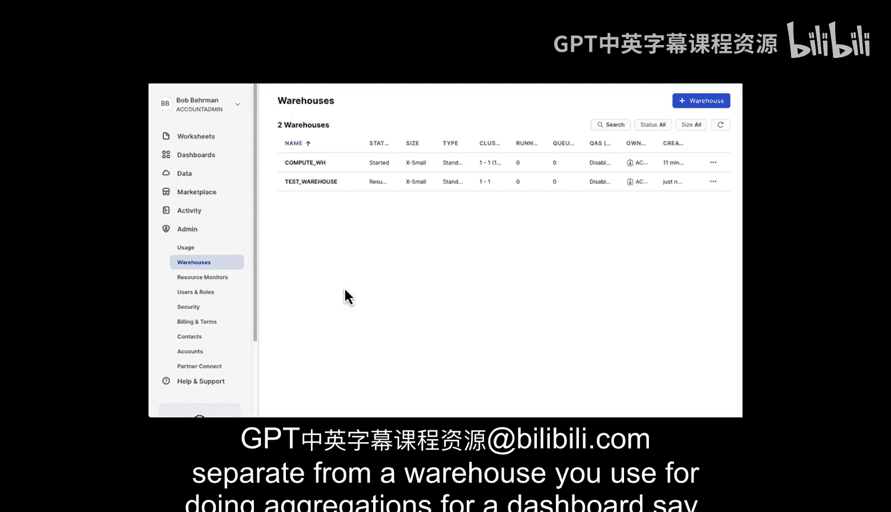

#  014：Snowflake平台管理指南 🏔️


在本节课中，我们将学习如何在Snowflake平台中进行基础的管理操作，包括用户与角色管理，以及计算仓库的创建与配置。这些是有效使用Snowflake进行数据工程工作的核心步骤。

## 用户与角色管理 👥

上一节我们介绍了课程概述，本节中我们来看看如何进行用户与角色的管理。这是控制数据访问权限的基础。

在Snowflake中，您可以进入“用户和角色”界面。这里可以查看当前账户中的所有用户和角色。

您登录时使用的账户即为账户所有者。如果需要，您可以在此处添加其他用户。

或者，您可以查看角色。角色是Snowflake权限管理的核心概念。以下是Snowflake默认提供的六个角色及其权限结构：

*   **ACCOUNTADMIN**：拥有所有权限。
*   **SECURITYADMIN**：拥有管理用户和角色的权限。
*   **USERADMIN**：拥有创建和管理用户与角色的权限。
*   **SYSADMIN**：拥有创建和管理仓库、数据库、模式等对象的权限。
*   **PUBLIC**：一个低权限角色，所有用户默认拥有。

这些角色之间存在继承关系。例如，`ACCOUNTADMIN` 角色继承自 `SECURITYADMIN` 和 `SYSADMIN` 的权限，从而拥有最高权限。

您也可以创建具有特定权限的新角色。例如，我们可以创建一个名为 `API_ROLE` 的角色，并将其继承自 `USERADMIN`。创建命令如下：

```sql
CREATE ROLE API_ROLE;
GRANT ROLE API_ROLE TO ROLE USERADMIN;
```

## 创建计算仓库 ⚙️

了解了权限管理后，接下来我们看看如何创建用于运行计算任务的计算仓库。

您可以为您的新仓库命名，并决定其规模。仓库规模决定了计算能力，也直接关联到信用点的消耗速度。因此，一个基本原则是：**尽可能选择最小的可用规模**。

在创建时，您可以添加注释。通常，建议将仓库设置为“自动恢复”和“自动暂停”。这意味着：

1.  当您向此仓库提交查询时，如果仓库未运行，它将自动启动。
2.  查询完成后，经过一段设定的空闲时间，仓库会自动暂停。

请记住，**您只需为仓库运行的时间支付信用点**。因此，应避免仓库在空闲状态下持续运行。

您可以将自动暂停前的空闲时间设置为1分钟。甚至可以通过执行Snowflake SQL命令，将其设置为更短的时间。

在仓库类型上，您可以选择“标准”或“Snowpark优化型”。对于免费试用账户，通常只能选择“标准”类型。

创建完成后，您可以在界面中看到新的仓库。除了注册账户时自动设置的默认计算仓库外，您现在拥有了一个新的专用仓库。

您可能需要为不同的用户或不同的用途创建不同的仓库。例如：

*   一个专门用于数据摄入的仓库。
*   另一个专门用于为仪表板进行数据聚合计算的仓库。

这样可以更好地隔离工作负载和管理成本。

## 总结 📝



本节课中，我们一起学习了Snowflake平台的两项核心管理功能。首先，我们探讨了如何通过用户和角色来管理系统访问权限，并了解了默认的角色体系。其次，我们详细介绍了如何创建和配置计算仓库，重点强调了根据需求选择合适规模以及设置自动暂停以优化成本的重要性。合理运用这些管理功能，是构建高效、安全且经济的数据工程工作流的基础。