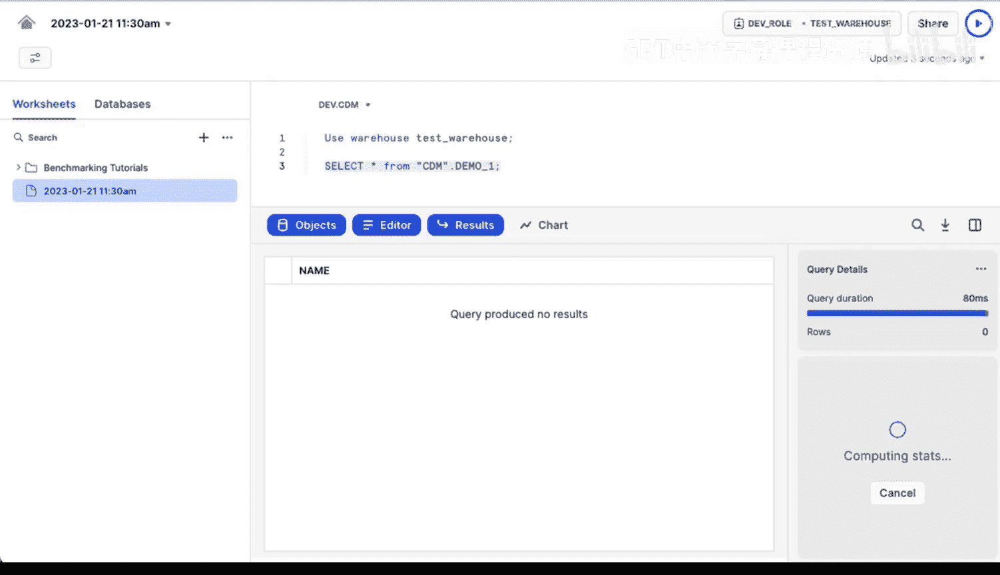

#  016：Snowflake仓库权限配置 🏭


在本节课中，我们将学习如何为Snowflake中的角色配置仓库（Warehouse）的使用权限，以便该角色能够在工作表中执行SQL查询。

上一节我们介绍了如何为角色分配数据库和模式的权限。本节中，我们来看看如何授予角色使用计算仓库的权限，这是执行查询的必要条件。

## 配置仓库使用权限

当我们在工作表中创建新的Notebook并尝试运行SQL时，需要关联一个负责执行查询的计算仓库。如果当前角色没有仓库的使用权限，则无法进行选择或执行操作。

以下是配置仓库权限的步骤：

1.  在管理（Admin）区域，找到并进入“仓库”（Warehouses）部分。
2.  这里会列出所有现有的仓库。点击你需要授权给角色的目标仓库。
3.  在仓库详情页面，切换到“权限”（Privileges）标签页。
4.  在此处，将使用该仓库的权限授予你的目标角色（例如 `R_DEV` 角色）。

**核心概念**：修改仓库的权限（如创建大型仓库）通常受到限制，因为如果资源使用不当，可能会产生高昂的费用。

## 在工作表中应用仓库

完成权限授予后，返回工作表界面。

以下是验证和应用仓库的步骤：

1.  在工作表的仓库选择下拉菜单中，你现在应该能看到被授权的测试仓库（例如 `TEST` 仓库）已变为可用状态。
2.  在此界面中选择该仓库，之后在此工作簿中运行的所有Snowflake SQL都将使用此仓库进行计算。
3.  作为一种替代方法，你也可以在Notebook的开头使用SQL命令来设置仓库，这样就无需在图形界面中手动选择。例如：
    ```sql
    USE WAREHOUSE TEST;
    ```

## 设置查询上下文

为了方便查询，我们可以在工作表顶部预设默认的数据库和模式。

以下是设置方法：

1.  在界面中选择你希望运行查询的数据库，例如 `DEV` 数据库。
2.  接着选择相应的模式，例如 `CDM` 模式。
3.  这意味着，在后续的查询中，我们无需在每条SQL语句中显式指定数据库和模式。当然，如果你需要跨数据库查询，仍然可以显式指定。

## 权限验证测试

现在，`R_DEV` 角色已拥有在 `DEV` 数据库的 `CDM` 模式中使用 `TEST` 仓库运行SQL语句的权限。

我们可以运行一个简单的查询进行验证：
```sql
SELECT * FROM SOME_TABLE;
```
由于该表可能没有数据，查询预期会返回零条结果。但重要的是，查询能够成功执行，这证明了访问权限已被正确授予。



---


本节课中我们一起学习了如何为Snowflake角色配置计算仓库的使用权限，并在工作表中进行应用和验证。掌握仓库的权限管理是控制计算资源成本和确保任务顺利执行的关键。