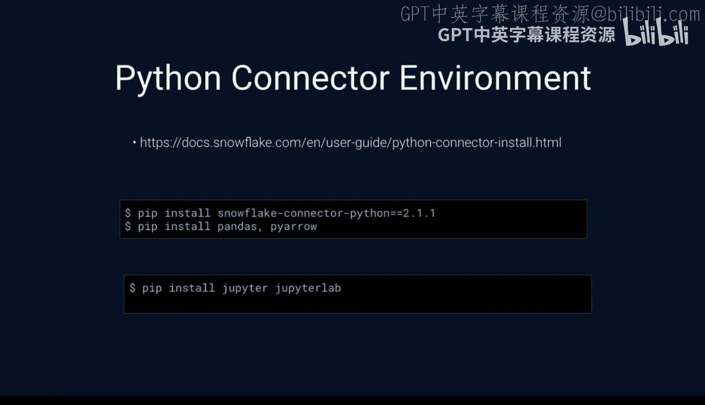
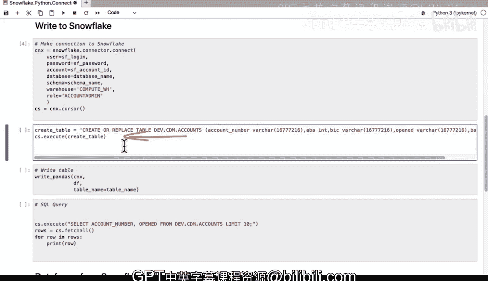

#  017：写入Snowflake 🗄️


在本节课中，我们将学习如何使用Python连接器（Snowflake Connector for Python）与Snowflake数据仓库进行交互。主要内容包括：设置连接环境、建立与Snowflake的连接、创建表以及将Pandas DataFrame中的数据写入Snowflake。

## 环境设置与包导入

首先，我们需要设置Python环境并安装必要的包。Snowflake连接器是一个Python包，可用于运行Snowflake SQL，并处理与Snowflake兼容的DataFrame。你可以用它来拉取、推送或操作数据。

以下是设置连接器环境的步骤。你应该查阅Snowflake官方文档，根据你特定的Python版本和环境进行设置。在本例中，我们只需使用pip安装特定版本的snowflake-connector-python。此外，为了在Jupyter Notebook中工作，我们还需要安装pandas、pyarrow、jupyter和jupyterlab。

```python
# 安装命令示例
# pip install snowflake-connector-python==2.11 pandas pyarrow jupyter jupyterlab
```

现在，让我们在代码中导入必要的包。

```python
import os
import snowflake.connector
from snowflake.connector.pandas_tools import write_pandas
import pandas as pd
```

我们导入了Python内置的操作系统模块`os`、`snowflake.connector`、用于写入pandas的`write_pandas`方法，并按照惯例将pandas导入为`pd`。

## 配置连接参数与读取数据



在建立连接之前，我们需要设置一些变量，用于存储Snowflake的登录信息、密码以及我们将要使用的数据库、模式和表。

```python
# 设置连接参数（在实际应用中，建议使用环境变量或配置文件管理敏感信息）
snowflake_user = ‘your_username‘
snowflake_password = ‘your_password‘
snowflake_account = ‘your_account‘
snowflake_database = ‘your_database‘
snowflake_schema = ‘your_schema‘
snowflake_table = ‘your_table‘
snowflake_role = ‘your_role‘
snowflake_warehouse = ‘your_warehouse‘
```

接下来，我们使用pandas的`read_csv`方法从一个CSV文件中读取一些示例数据，并查看其内容。

```python
# 从CSV文件读取数据
df = pd.read_csv(‘path/to/your/accounts.csv‘)
# 查看数据前几行
print(df.head())
```

假设我们有一个账户表，包含账户号码、余额以及开户时间等字段。

## 建立Snowflake连接与创建表

要与Snowflake交互，首先需要建立连接。我们使用`snowflake.connector.connect`方法，并传入之前设置的参数，同时指定要使用的角色和仓库。

```python
# 建立与Snowflake的连接
conn = snowflake.connector.connect(
    user=snowflake_user,
    password=snowflake_password,
    account=snowflake_account,
    role=snowflake_role,
    warehouse=snowflake_warehouse
)

# 创建游标以执行SQL语句
cursor = conn.cursor()
```

连接建立后，我们创建一个游标（cursor）来运行Snowflake SQL语句。现在，我们将在Snowflake中创建一个新表。

以下是创建表的SQL命令。我们创建一个名为`dev_accounts`的表，并指定列名和列的数据类型。

```sql
CREATE OR REPLACE TABLE dev_accounts (
    account_number INTEGER,
    customer_name STRING,
    balance FLOAT,
    opened_date DATE
)
```

在Python中，我们使用游标的`execute`方法来运行这段SQL代码。

```python
# 执行SQL以创建表
create_table_sql = “““
CREATE OR REPLACE TABLE dev_accounts (
    account_number INTEGER,
    customer_name STRING,
    balance FLOAT,
    opened_date DATE
)
“““
cursor.execute(create_table_sql)
print(“Table created successfully.“)
```

## 将数据写入Snowflake

表创建好后，我们就可以将之前从CSV读取的Pandas DataFrame数据写入到Snowflake的表中。`snowflake.connector.pandas_tools`模块中的`write_pandas`函数可以高效地完成这个任务。

```python
# 将DataFrame写入Snowflake表
success, nchunks, nrows, _ = write_pandas(
    conn=conn,
    df=df,
    table_name=‘DEV_ACCOUNTS‘, # Snowflake中表名通常大写
    schema=‘PUBLIC‘, # 替换为你的模式名
    database=‘YOUR_DATABASE‘ # 替换为你的数据库名
)

# 输出写入结果
if success:
    print(f“Data written successfully. Number of rows inserted: {nrows}“)
else:
    print(“Failed to write data.“)
```

`write_pandas`函数会返回一个元组，其中包含操作是否成功的标志、数据块数量、插入的行数等信息。

## 清理与关闭连接

所有操作完成后，务必关闭游标和连接，以释放资源。

```python
# 关闭游标和连接
cursor.close()
conn.close()
print(“Connection closed.“)
```

## 总结



本节课中，我们一起学习了如何使用Python连接器与Snowflake进行数据交互。我们首先设置了环境并导入了必要的包，然后配置了连接参数并从本地文件读取了数据。接着，我们建立了与Snowflake的连接，创建了一个游标，并执行SQL语句在Snowflake中创建了新表。最后，我们利用`write_pandas`函数成功地将Pandas DataFrame中的数据写入到了Snowflake表中，并在操作完成后妥善地关闭了连接。掌握这些步骤，你就能使用Python高效地将数据导入Snowflake数据仓库了。