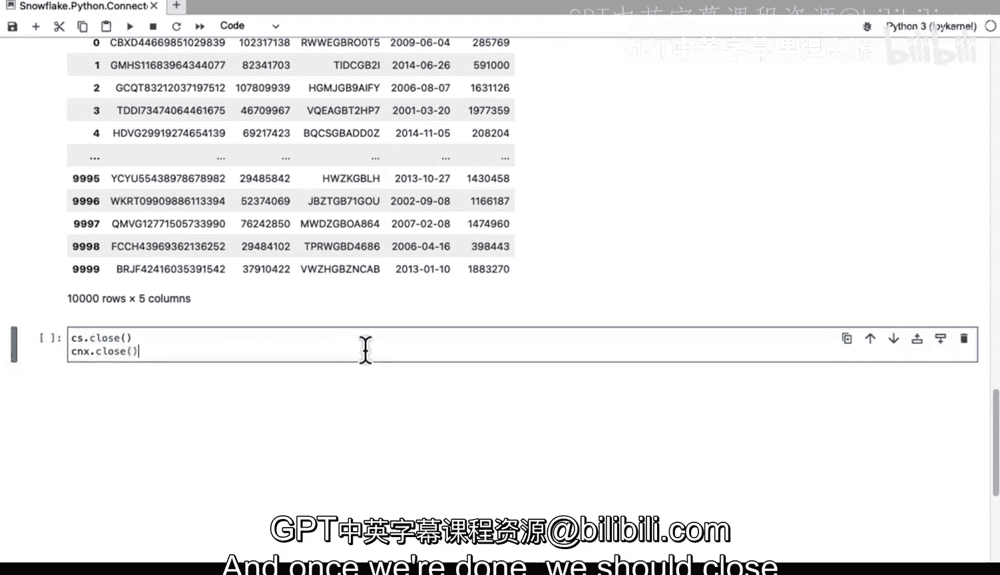

#  018：从Snowflake读取数据


在本节课中，我们将学习如何从Snowflake数据仓库中读取数据。我们将探讨使用SQL语句直接查询数据，以及如何将查询结果转换为Pandas DataFrame以便于进一步分析。

上一节我们介绍了如何将数据写入Snowflake。本节中我们来看看如何从Snowflake中读取数据。

## 使用SQL语句查询数据

我们可以使用游标对象执行SQL查询语句，从已创建的表中获取数据。

以下是执行查询并获取结果的步骤：

1.  使用游标执行一个SQL `SELECT`语句，从`accounts`表中选择`account_number`和`opened`列，并限制返回10条记录。
2.  调用`fetchall()`方法获取所有查询结果。
3.  遍历并打印每条结果。

```python
# 示例：使用游标执行SQL查询
sql_statement = "SELECT account_number, opened FROM accounts LIMIT 10"
cursor.execute(sql_statement)
results = cursor.fetchall()
for row in results:
    print(row)
```

通过这种方式，你可以与Snowflake中的表进行交互，执行SQL语句并通过游标获取结果。

## 将查询结果转换为Pandas DataFrame

除了直接获取结果，我们还可以将Snowflake表中的数据直接读入Pandas DataFrame，以便利用Pandas强大的数据分析功能。

以下是具体操作方法：

1.  执行一个从目标表选择数据的SQL语句。
2.  使用游标的`fetch_pandas_all()`方法，该方法会返回一个包含查询结果的DataFrame。

```python
# 示例：将Snowflake查询结果读入DataFrame
df_from_snowflake = cursor.fetch_pandas_all()
```

## 关闭连接

完成所有数据操作后，为了释放资源，必须关闭游标和数据库连接。

```python
# 关闭游标和连接
cursor.close()
connection.close()
```



本节课中我们一起学习了从Snowflake读取数据的两种主要方法：通过执行SQL语句并使用游标获取结果，以及利用`fetch_pandas_all()`方法直接将数据读入Pandas DataFrame。最后，我们强调了在操作完成后关闭连接的重要性。