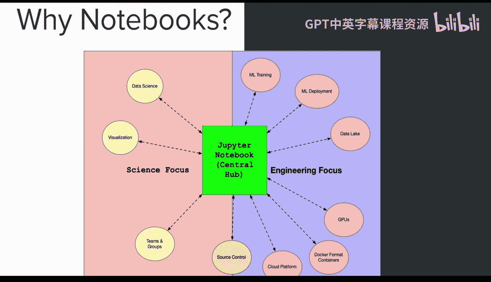
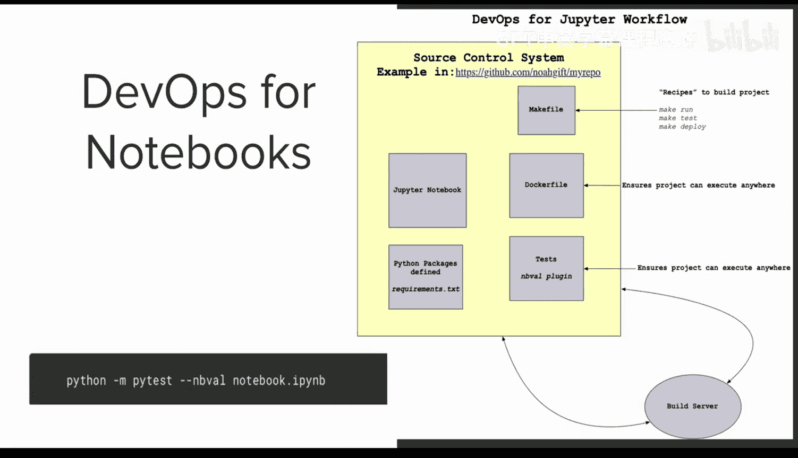
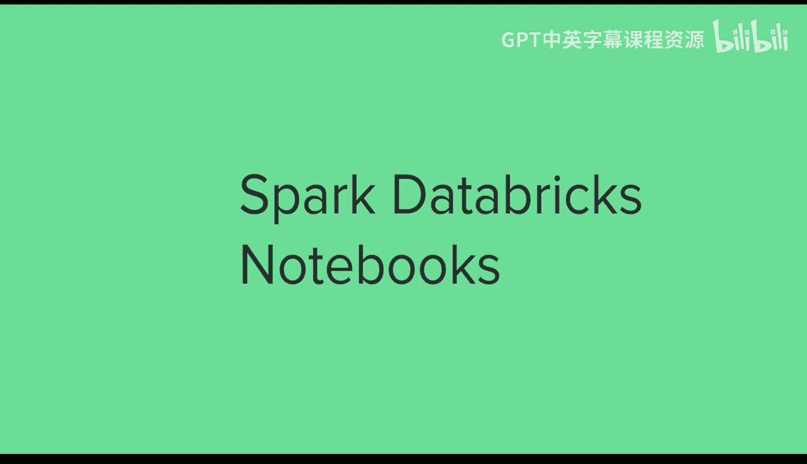
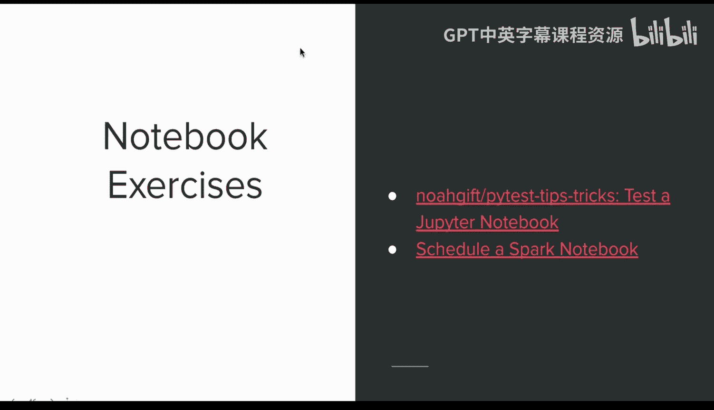
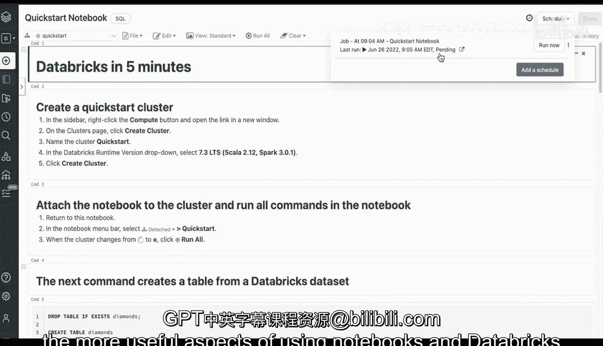

#  020：在Databricks中使用Spark笔记本 📓

在本节课中，我们将要学习Spark笔记本在Databricks平台上的核心用途、功能以及具体操作方法。我们将从笔记本的通用概念讲起，逐步深入到Databricks环境中创建、修改、调度和开发Spark笔记本的实践步骤。

---

## 笔记本的用途与角色

要理解笔记本本身，我们首先需要深入探讨它们的用途以及它们所扮演的角色。

笔记本在数据科学项目中用于处理数据科学任务。它们也能帮助你进行可视化工作，例如绘制散点图。同时，笔记本也是团队协作的绝佳工具，例如，组织内的博士生与他们指导的学生可以共同进行一个研究项目。

但笔记本也具备工程侧重的功能。这可能意味着机器学习训练、机器学习部署、处理数据湖（例如大数据系统）、处理GPU使用、处理Docker格式的容器，以及云平台。因此，笔记本实际上是一种跨领域的方法。

---

## 笔记本的DevOps概念

另一个需要考虑的概念是“笔记本的DevOps”。在这种特定场景下，你可以使用一个Makefile来测试和部署代码，例如，将机器学习模型作为微服务的一部分部署到生产环境。可以有一个与你的Jupyter笔记本工作流相关联的Dockerfile，这将确保你能够精确复现项目中的内容。最后，可能还需要在`requirements.txt`中列出包依赖以及一些测试。你实际上也可以使用`pytest`和`nbval`插件来测试笔记本。

---

## Spark Databricks笔记本详解

现在，让我们深入探讨Spark Databricks笔记本的具体细节。

在Spark Databricks笔记本中，你可以执行多项操作，包括创建和修改笔记本、调度作业，以及基于这些笔记本开发代码。

以下是创建和修改笔记本的要点：
*   你可以使用用户界面管理笔记本。
*   你也可以使用命令行界面进行管理。
*   你还可以调用工作区API。

通常，我会选择从头创建一个笔记本，或者导入、导出它，再或者将其附加到一个计算集群上。这些是笔记本的常见操作。

如果你想调度一个笔记本，过程相当直接。你可以在角落右键点击，看到“快速启动笔记本”选项，然后针对一个集群调度一个作业，例如，为你的组织生成每周报告。

一旦你调度了作业，它就会重复运行，甚至会在作业开始、成功或失败时向你发送电子邮件提醒。

---

## 使用笔记本进行开发

在使用笔记本进行开发时，需要记住以下几点：
*   这些笔记本专为开发和运行代码单元而设计。
*   你可以混合搭配使用不同的语言，例如Python、R、Scala和SQL。
*   你可以操作这些代码单元，并在Markdown中包含文档说明。

---

## 实践练习：调度Spark笔记本

包含笔记本练习总是结束本教程的好方法。因此，我将演示如何调度一个Spark笔记本。

为此，我将进入我的Databricks界面，并确保我们有一个正在运行的计算集群。

你可以看到我有几个不同的集群：一个单节点集群和一个拥有12个核心的集群。如果我转到我的工作区，我可以查看我之前使用的这个快速启动笔记本，并确保它已附加到一个集群。

如果我想将这个快速启动笔记本与一个调度作业关联起来，我只需在这里选择“调度”，然后将其命名为一个调度作业。例如，这可以设置为每天上午9点运行。我会在这里设置，并选择仅在运行此作业出现问题时向我发送消息。让我们创建它。

好了。现在，这个快速启动作业将在每天上午9点运行。我也可以立即运行它。如果你要创建一个调度作业，首先手动运行一次通常是个好主意。我们现在可以运行它。它将检查我们作业的逻辑。

因此，调度作业已设置完成。这是使用Databricks笔记本时更有用的一个方面。

---

## 总结

本节课中，我们一起学习了Spark笔记本在Databricks平台上的核心功能。我们了解了笔记本在数据科学和工程领域的双重角色，探讨了与之相关的DevOps概念。接着，我们详细介绍了在Databricks中创建、修改、调度笔记本以及使用多语言进行开发的具体方法。最后，通过一个实践练习，我们演示了如何为笔记本创建定时调度作业。掌握这些技能，将帮助你更高效地在Databricks环境中进行数据工程和数据分析工作。